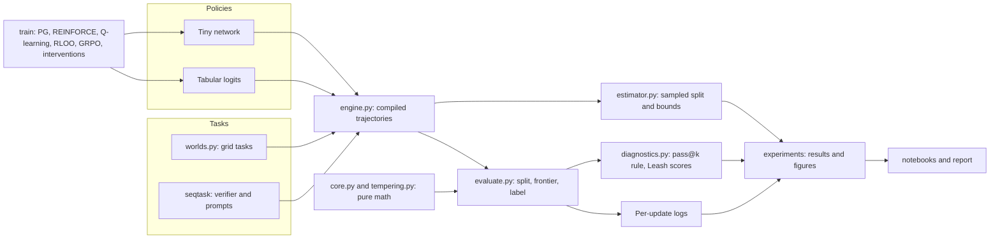
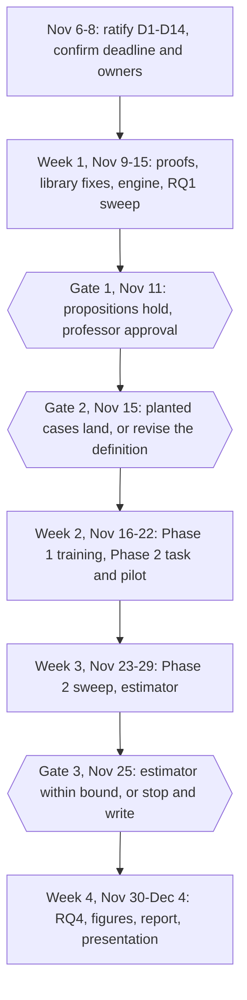

# capsplit technical blueprint

**Status:** draft for team review, 6 November 2026.
**Sources:** `docs/project-plan.pdf` (Oct 12, revised Nov 4), the code at commit `7313bc6`, and throwaway probes run against that code on Nov 6.
**Planning date:** the final deadline is "early December". This document assumes **Friday, Dec 4, 2026** until the exact date is confirmed.

How this document relates to the plan:

- The plan remains the source for the project's goals and research claims.
- This blueprint adds the implementation design, the schedule and a list of proposed changes.
- Every departure from the plan is a numbered decision (D1 to D14 in section 4). **All are proposals until the team ratifies them.**
- Sections 5 to 9 are written as if the decisions are accepted, so rejecting one means editing the sections it lists.

## Contents

1. [Goal and scope](#1-goal-and-scope)
2. [Formal specification](#2-formal-specification)
3. [Current state](#3-current-state)
4. [Decisions to ratify](#4-decisions-to-ratify)
5. [Architecture](#5-architecture)
6. [Phase 1: exact grid worlds](#6-phase-1-exact-grid-worlds)
7. [Phase 2: verifiable sequence task](#7-phase-2-verifiable-sequence-task)
8. [Phase 3: design sketch](#8-phase-3-design-sketch)
9. [RQ4: pass@k misdiagnosis](#9-rq4-passk-misdiagnosis)
10. [Reproducibility and testing](#10-reproducibility-and-testing)
11. [Schedule and gates](#11-schedule-and-gates)
12. [Risks and valid negative results](#12-risks-and-valid-negative-results)
13. [Open questions](#13-open-questions)
14. [Traceability](#14-traceability)

---

## 1. Goal and scope

**The question.** When a trained policy beats its starting policy, how much of the gain is *reliability* (producing more often what it already produced sometimes) and how much is *capability* (reaching what it effectively could not)?

**Why current metrics fall short.** Mean return, success rate and pass@k rise under both kinds of gain. The difference matters in practice: reliability gain may be reproducible by sampling the base policy more carefully, while capability gain means training added something.

**The contribution:**

1. An exact additive split of $J(\pi_1) - J(\pi_0)$ into mass on reachable and unreachable solutions at a stated budget $N$.
2. A budget-matched excess score $E_N$ against the best re-tempered base policy, over both per-step and sequence-level tempering, plus a proof of what sharpening cannot do.
3. Validation against planted ground truth, which the surveyed LLM papers lack.
4. Exact tracking of each component along real training runs in small worlds.

**What the project does not claim.** It does not claim to show whether RL expands capability in large language models. It claims a measurement with proven properties, validated where the answer is known, and a demonstration of what it reveals there.

**Commitment.** Phases 1 and 2 run on a laptop and are the commitment. Phase 3 is a stretch goal and is cut first.

| Level | What must be true |
|---|---|
| **Minimum** | Propositions 1, 2 (both families) and 3 (benchmark version) are proven, and Proposition 2 is checked numerically. RQ1 holds in at least 3 Phase 1 world sizes. The library runs and has unit tests. |
| **Target** | RQ2 and RQ3 are answered in Phases 1 and 2 with at least 20 seeds, including the time-to-cross curve and shared-structure sweep. The estimator meets its Chernoff bound. RQ4 reports the misdiagnosis rate beside the Invisible Leash scores (SRR, NDR). |
| **Stretch** | Phase 3 runs on one real base and RL pair, with format validity reported separately and a sensitivity analysis over "same solution". |

**Related work.** Threshold-based support metrics already exist for language models, so the pitch must not say that no metric exists. What the surveyed papers lack is an exact decomposition of improvement and validation against a known answer.

| Paper | What it does | Gap this project fills |
|---|---|---|
| *The Invisible Leash* (Wu et al.) | Defines empirical support from a sampling-budget threshold; count-based scores (SRR, NDR, SDS, NSCR); proves on-policy RLVR can't reach zero-probability completions | Counts completions rather than mass; no exact split, sharpening-matched baseline or ground-truth check |
| *When RLVR Shrinks the Reasoning Boundary* (Zhou) | Buckets prompts by base success; two-mode model of RLVR committing away from a rare mode | Per prompt rather than per solution; diagnoses coverage loss rather than decomposing improvement |
| *Rewarding the Unlikely* (He, Fried, Welleck) | Argues large-$N$ gains need lifting solutions near $1/N$ | Gives the intuition and a training fix, not a metric |
| *Does RL Really Incentivize Reasoning Capacity…* (Yue et al.) | RLVR-trained models can fall below base at large $k$ | Measures with pass@k only |
| *Reasoning with Sampling* (Karan and Du) | Samples $P_0(\tau)^\alpha$, $\alpha = 4$, by Metropolis-Hastings | Empirical comparison of curves; this project turns it into a computable baseline |
| *RLVR Implicitly Incentivizes Correct Reasoning* (Wen et al.) | CoT-Pass@K, because answer-only pass@K can credit lucky guesses | Shows why "same solution" is contested |
| *Hidden Costs and Measurement Gaps of RLVR* (Tu et al.) | Argues for budget-matched, protocol-controlled evaluation | Motivates the budget $N$ |
| *Locked at the Entrance* (Zhou and Li) | Reports an untuned base with under 3% format-valid outputs | Motivates Phase 3's format-valid solution map |

Per the plan, only the first two were read in full. *Reasoning with Sampling* and *Locked at the Entrance* were skimmed for specific claims, and the others were seen only as abstracts or search summaries, so they need reading before citation.

**Deliverables:** the Python library, one notebook per phase, and the written report. Every figure must regenerate from the repository. The commit history is graded (`README.md`).

---

## 2. Formal specification

### 2.1 MDP formulation

| Element | Phase 1: grid world | Phase 2: sequence task |
|---|---|---|
| State | Agent position | Prompt plus tokens emitted so far |
| Action | Up, down, left, right | Next token from a vocabulary of size $V$ |
| Transition | Deterministic; bumps leave the agent in place | Append token |
| Reward | 1 on reaching the goal within $H$, else 0 | 1 if the verifier accepts the finished sequence, else 0 |
| Horizon | $H$ steps; the goal is absorbing | Fixed length $L$ |
| Policy | Tabular softmax over action logits | Softmax over tokens, tabular or a tiny network |
| $\pi_0$ | Hand-set logits, so base probabilities are dials | Pre-trained on supervised examples |
| $\pi_1$ | After policy gradient or Q-learning | After policy-gradient RL against the verifier |

**Course concepts.** The project must be stated in states, actions, rewards and policy in every phase, and it uses these class concepts:

| Concept | Role |
|---|---|
| MDP, trajectories, return | The formal setting; expected return is what gets decomposed |
| Value functions $V$ and $Q$ | Compute each part exactly in small worlds |
| Performance difference lemma | Starting point for splitting $J(\pi_1) - J(\pi_0)$ |
| Policy gradient theorem, REINFORCE, baselines | Phase 2 training; source of gradient variance |
| Q-learning and TD learning | Alternative Phase 1 training |
| Exploration (ε-greedy, entropy bonus) | Sets how reachable a success is |
| Sparse reward, credit assignment | Why capability gain is hard to obtain and easy to miss |
| Importance sampling, off-policy evaluation | Estimating $\pi_0$ probabilities from $\pi_1$ samples |

### 2.2 Definitions

A verifier gives each trajectory $\tau$ a reward $R(\tau) \in \{0, 1\}$. A solution map $\phi$ groups trajectories that count as the same solution. $q_\pi(s)$ is the probability that $\pi$ produces solution $s$, $S^*$ is the set of correct solutions, and

$$J(\pi) = \sum_{s \in S^*} q_\pi(s).$$

**Reachable set (Definition 1).** With threshold multiplier $c$ (the plan's definition is $c = 1$):

$$\mathcal{R}_N = \{s \in S^* : q_{\pi_0}(s) \ge c/N\}, \qquad \mathcal{U}_N = S^* \setminus \mathcal{R}_N.$$

At $c = 1$, $N$ samples from $\pi_0$ contain $s$ with probability at least $1 - 1/e \approx 63\%$. The Invisible Leash's threshold $\ln(1/\zeta)/k$ reduces to this at $\zeta = 1/e$, and experiments vary $c$ to show the sensitivity.

**The split (Definition 2).** Reported as a pair, never a ratio, because $\Delta_{\text{rel}}$ can be negative:

$$\Delta_{\text{rel}}(N) = \sum_{s \in \mathcal{R}_N} \big(q_{\pi_1}(s) - q_{\pi_0}(s)\big), \qquad \Delta_{\text{cap}}(N) = \sum_{s \in \mathcal{U}_N} \big(q_{\pi_1}(s) - q_{\pi_0}(s)\big).$$

**Tempering families (Definition 3).**

- *Per-step:* $\pi_0^\beta(a \mid s) \propto \pi_0(a \mid s)^\beta$ at every state.
- *Sequence-level:* $P_\beta(\tau) \propto P_{\pi_0}(\tau)^\beta$ over whole trajectories, then pushed through $\phi$.

**Excess score.** With $\text{pass@}N(\pi) = 1 - (1 - J(\pi))^N$ for one task, and averaged over prompts for a benchmark before subtracting:

$$E_N(\pi_1) = \text{pass@}N(\pi_1) - \sup_{\beta > 0,\ \text{both families}} \text{pass@}N(\pi_0^\beta).$$

$E = E_1$ is the single-sample case. $E_N$ is reported only where $|A|^H \ge 100N$, because at the $\beta \to 0$ end the family otherwise reaches every route.

### 2.3 The 2×2 diagnostic

| | Within reach | Beyond reach |
|---|---|---|
| **Within temperature** | **Pure sharpening:** a re-tempered $\pi_0$ does as well and nothing new is reached | **Compounded sharpening:** a rare solution crossed the line, but sharpening alone can do that above the Proposition 2 bar |
| **Beyond temperature** | **Reweighting:** beats every re-tempered $\pi_0$ yet reaches nothing new | **Capability:** new mass beyond the line that no re-tempering reproduces |

The plan writes these axes as $E_N > 0$ and $\Delta_{\text{cap}} > 0$. D2 proposes the exact rule that makes them robust.

### 2.4 Propositions

| Proposition | Statement | Proof status | Numeric status |
|---|---|---|---|
| **1. Exact split** | $J(\pi_1) - J(\pi_0) = \Delta_{\text{rel}}(N) + \Delta_{\text{cap}}(N)$ for any $\pi_0, \pi_1, N, \phi$, because $\mathcal{R}_N$ and $\mathcal{U}_N$ partition $S^*$. | Immediate; needs writing up | Tested |
| **2. Sharpening cannot lift what the base disfavors** | For $\beta \ge 1$, any $\tau$, either family: $P_{\pi_0^\beta}(\tau) / P_{\pi_0}(\tau) \le (P_{\pi_0}(\tau) / U)^{\beta - 1}$, where $U = \lvert A\rvert^{-H}$ (per-step) or $U = 1/T$ (sequence-level) and $T$ is the support size. | Sketch in plan; argument re-traced on Nov 6, formal write-up and teammate check needed | Tested, but the sequence-level test uses a generic dict, not grid trajectories |
| **3. pass@k cannot determine the split** | Two policies share an averaged pass@k curve at every $k$ exactly when they share the multiset $\{J_i\}$. The split depends on where mass sits inside each prompt, which $\{J_i\}$ does not fix. | Sketch and example in plan; needs writing up | Example tested |

**Proposition 2 proof sketch.** Per-step: the normalizer at each state is $\sum_a \pi_0(a \mid s)^\beta \ge \lvert A\rvert^{1-\beta}$ by Jensen, and the bound multiplies over $H$ steps. Sequence-level: the normalizer is $\sum_\tau P_{\pi_0}(\tau)^\beta \ge T^{1-\beta}$ by the same inequality applied once. Since $T \le \lvert A\rvert^H$ under deterministic dynamics, the sequence-level bound is at least as tight.

**Scope limit of Proposition 2.**

- It says nothing for $\beta < 1$, where the inequality reverses. $E_N$ covers that side.
- It is a *trajectory* statement, while $\Delta_{\text{cap}}$ is a *solution* statement. The report should add this corollary: if every $\tau \in \phi^{-1}(s)$ has $P_{\pi_0}(\tau) < U$, then every $\beta > 1$ strictly lowers $q(s)$, by summing the bound term by term. A solution with $q_{\pi_0}(s) > U$ can still meet this condition, so the bar must be checked on trajectories.
- Compounded sharpening is possible only when the base probability lies in $[U, c/N)$. That interval is non-empty under the $|A|^H \ge 100N$ rule.

### 2.5 Sample estimator

Draw $M$ trajectories from each policy and classify each correct sample with an exact lookup of $q_{\pi_0}$ (Phases 1 and 2). Four means are involved: mass on $\mathcal{R}_N$ and on $\mathcal{U}_N$, under each policy. With a union bound at $\delta/4$ per mean:

$$M_{\text{Hoeffding}} \ge \frac{\ln(8/\delta)}{2\varepsilon^2}, \qquad M_{\text{Chernoff}} \ge \frac{3\ln(8/\delta)}{\eta^2\mu}.$$

| Bound | Parameters | $M$ per policy |
|---|---|---|
| Hoeffding | $\varepsilon = 10^{-4}$, $\delta = 0.05$ | about $2.5 \times 10^8$ |
| Chernoff | $\mu = 10^{-3}$, $\eta = 0.1$, $\delta = 0.05$ | about $1.5 \times 10^6$ |

Both figures were recomputed and match the plan. D11 tightens how the Chernoff guarantee is stated. Importance sampling from $\pi_1$, reweighted by $P_{\pi_0}/P_{\pi_1}$, is the fallback for rarer mass.

### 2.6 Research questions

| RQ | Question | Prediction | Contradicted if |
|---|---|---|---|
| **RQ1** | Do the split and $E_N$ recover planted ground truth? | Each planted case lands in its cell. | A planted case lands elsewhere, or a planted new route goes undetected. |
| **RQ2** | What does standard on-policy training change? | Early gain is mostly $\Delta_{\text{rel}}$; $\Delta_{\text{cap}}$ appears late or not at all. Time to cross grows roughly as $1/q_{\pi_0}(s)$. | $\Delta_{\text{cap}}$ dominates from the first updates, or time-to-cross is flat in base probability. |
| **RQ3** | Which interventions create capability gain? | Depends on what the policy class shares. Tabular: only imported information. Shared parameters: on-policy training can lift rare solutions sharing prefixes with common ones. | Phase 1 on-policy training gives lasting $\Delta_{\text{cap}}$, or Phase 2 $\Delta_{\text{cap}}$ is unrelated to shared structure. |
| **RQ4** | How often does a pass@k rule misdiagnose a run? | It disagrees with the 2×2 label in a sizable share of runs, most often in the compounded-sharpening and reweighting cells. | The rule matches the label in over 95% of runs. |

### 2.7 Knobs

| Knob | Range | Tests | Constraint |
|---|---|---|---|
| Horizon $H$ | 4 to 10 | Compounding and shrinking reachability (Proposition 2) | D7 for $E_N$ |
| Base probability of planted solution | $10^{-6}$ to $10^{-1}$, log scale | Where it crosses the line; time to cross | Must sit below the line in RQ2 (D6) |
| Budget $N$ | 10, 100, 1,000, 10,000 | Budget dependence | D7 |
| Threshold multiplier $c$ | 0.5, 1, 3, 5 | Sensitivity to confidence level | None |
| Tempering exponent $\beta$, both families | 0.25 to 8, log scale | Re-tempering frontier | D3 |
| Shared structure (Phase 2) | None to prefix of $L - 1$ tokens | Generalization alone (RQ3) | D13 |
| Entropy bonus | Zero to strong | Exploration alone (RQ3) | None |
| Outside information | None, teacher data, hint states | Imported information (RQ3) | None |

---

## 3. Current state

About 25% of Phase 1 is built. All 20 tests pass in a clean Python 3.12 environment, and `experiments/phase1_rq1.py` runs.

| Area | State | Location |
|---|---|---|
| Split, reachable set, pass@N | Done for one task | `src/capsplit/core.py` |
| $E_N$ and 2×2 label | Done with defects (D1 to D3) | `src/capsplit/core.py` |
| Deterministic grid, exact enumeration, per-step tempering | Done, pure Python | `src/capsplit/worlds.py` |
| RQ1 planted cases | One 4×4 world; hand-tuned; no compounded case | `experiments/phase1_rq1.py` |
| Benchmark (multi-prompt) aggregation | Missing | |
| Exact PG, REINFORCE, Q-learning, interventions | Missing | |
| Phase 2 task, policy, pre-training, RL | Missing | |
| Sample estimator and bounds | Missing | |
| pass@k rule, Invisible Leash scores | Missing | |
| Proposition write-ups, notebooks, report, CI | Missing | |

One API gap to fold into the relevant task: the plan's "verifier" input is currently a precomputed `correct` set.

---

## 4. Decisions to ratify

Each entry gives the problem, the evidence and the proposed fix. Evidence comes from the Nov 6 probes unless stated otherwise. Those probes were throwaway scripts on specific configurations, so each fix should land with its own regression test.

| # | Decision | Type | Urgency |
|---|---|---|---|
| D1 | Temper sequences over trajectories | Bug fix toward plan | Before Gate 2 |
| D2 | Replace the sign rule with explicit label thresholds | **Changes the definition** | Before Gate 2 |
| D3 | Refine the $\beta$ sup and flag boundary hits | Fixes a plan claim | Before Gate 2 |
| D4 | Use loop-erased routes as the solution map | Clarifies plan | Before Gate 2 |
| D5 | Make RQ4 and budget-matched $E_N$ multi-prompt | **Changes experiment design** | Before Phase 2 |
| D6 | Split RQ2 into isolated and competing arms | **Changes experiment design** | Before Phase 1 training |
| D7 | Restrict knobs to valid $(H, N)$ pairs | Fixes a plan conflict | Before Gate 2 |
| D8 | Run RQ1 as a pre-registered sweep | Strengthens plan | Before Gate 2 |
| D9 | Make state sharing an explicit Phase 1 covariate | Corrects a plan claim | Before Phase 1 training |
| D10 | Define the pass@k rule and its scoring | Fills a plan gap | Before RQ4 |
| D11 | Tighten the Chernoff guarantee | Corrects a plan claim | Before Gate 3 |
| D12 | Build a vectorized exact engine | Implementation | Before Phase 1 training |
| D13 | Match base probability across shared-structure levels | Prevents a confound | Before Phase 2 sweep |
| D14 | Cut slip dynamics, keys and doors | Scope | Now |

### D1. Temper sequences over trajectories

**Problem.** Definition 3 tempers $P(\tau)$ over whole trajectories. `phase1_rq1.py` calls `sequence_temper` on the *state-path* distribution, where different action sequences have already been merged (bumping up and bumping left give the same path). The 4×4 world has 4,096 action sequences but only 1,107 paths.

**Evidence** (trap base, $N = 20$):

| $\beta$ | $J$, code | $J$, plan |
|---|---|---|
| 0.25 | 0.0208 | 0.0093 |
| 0.5 | 0.0510 | 0.0325 |
| 2 | 0.0640 | 0.1009 |
| 4 | 0.0036 | 0.0113 |

This shifts $E_{20}$ for planted cases (b) and (c) from +0.0875 to +0.0587.

**Fix.** Temper action-sequence probabilities, then push them through $\phi$. Tasks expose trajectories, and the library owns that order of operations, so callers can't repeat this mistake.

### D2. Replace the sign rule with explicit label thresholds

**Problem 1: the label depends on an undocumented tolerance.** The script sets `TOL = 0.01`; the library default is `1e-12`. Planted case (b) has $\Delta_{\text{cap}} = +0.0009$, so the library default labels it `capability` while the script labels it `reweighting`. The plan's "$\Delta_{\text{cap}} = 0$" can't hold exactly with softmax logits, because any logit change moves some mass on other routes through the same states.

**Problem 2: a positive sum doesn't mean anything became reachable.** $\Delta_{\text{cap}}$ is a net sum, so a tiny rise counts as "beyond reach" under the sign rule.

**Problem 3: $E_N$ saturates.** If $\mathcal{R}_N$ is non-empty then $J(\pi_0) \ge 1/N$ at $c=1$, so $E_N \le (1 - 1/N)^N \le 1/e$. Cases (b) and (c) have the same $E_{20}$ even though their $J$ gaps differ (0.730 and 0.698). In floating point, a real gap can round to exactly 0: the easy-base sharpening case has $E_{20} = 0$ but a $J$ gap of −0.014.

**Key property.** For one task, pass@N is strictly monotone in $J$, so **the sign of $E_N$ is the same at every $N$**, and equals the sign of $J(\pi_1) - \sup_\beta J(\pi_0^\beta)$. So on a single task, $N$ affects the magnitude of $E_N$ but never the beyond-temperature axis.

**Fix.**

- **Beyond reach** when $\Delta_{\text{cap}} \ge c/N$. This matches Definition 1's standard: the mass $\pi_1$ gained on $\mathcal{U}_N$ would be hit in $N$ samples with probability about 63%.
- **Beyond temperature** on one task when $J(\pi_1) - \sup_\beta J(\pi_0^\beta) > \epsilon_E$. Use $\epsilon_E = 10^{-9}$ for exact computation and a positive 95% CI lower bound for sampled estimates. On a benchmark, use the averaged $E_N > \epsilon_E$.
- **Improvement flag.** The plan's cells describe improvements, so report `improved = ΔJ > 0` beside the label. The current pure-sharpening regression test uses a policy that gets *worse* ($\Delta J = -0.108$).
- **Always report raw values:** $\Delta_{\text{rel}}$, $\Delta_{\text{cap}}$, $E_N$, the $J$ gap, and the solutions that crossed $c/N$ with their mass. Sensitivity runs repeat the labels with the reach threshold at $0$, $0.1c/N$ and $c/N$.
- **Saturation flag.** Mark $E_N$ `saturated` when $1 - \sup \text{pass@}N < 0.05$. Its magnitude shouldn't be interpreted there.

**Probe result.** With D1 and D2 applied to the existing 4×4 world at $N = 20$, all four cells are reachable. The weak-bonus base has per-step route bonuses of 1, 0 and 0, so even its most likely route starts below the line:

| Planted case | $\Delta J$ | $\Delta_{\text{cap}}$ | $J$ gap | Label |
|---|---|---|---|---|
| Sharpening, easy base, per-step $\beta=3$ | +0.723 | −0.0125 | −0.0139 | Pure sharpening |
| Sharpening, easy base, sequence $\beta=3$ | +0.729 | −0.0128 | −0.0083 | Pure sharpening |
| Reweighting, trap base | +0.750 | +0.0009 | +0.7301 | Reweighting |
| Sharpening, weak-bonus base, per-step $\beta=3$ | +0.426 | +0.4261 | −0.5524 | Compounded sharpening |
| Sharpening, weak-bonus base, sequence $\beta=3$ | +0.460 | +0.4597 | −0.5189 | Compounded sharpening |
| Rare route boosted, trap base | +0.717 | +0.6073 | +0.6977 | Capability |

**Trade-off.** A long tail of solutions that each gain a little can stay below $c/N$ in total and read as "within reach". That is the reason to report raw values and threshold sensitivity. It's also the most consequential definition change here, so it needs explicit team sign-off.

### D3. Refine the $\beta$ sup and flag boundary hits

**Problem.** The plan calls the sup "exact", but a finite grid gives a lower bound, which biases $E_N$ upward. A planted $\beta$ that isn't on the grid can produce a false positive: $\beta = 3$ is 0.089 away from the nearest point on the current grid.

**Fix.**

- Use the log grid over $[0.25, 8]$ with $\beta = 1$ always included, then run golden-section refinement around the best two grid points in each family.
- For one task, maximize $J$ directly. The maximizer doesn't depend on $N$, so one frontier serves every budget.
- For a benchmark, maximize the average pass@N using a single shared $\beta$ per $N$.
- Record the best $\beta$ and family, and set `boundary_hit` if it lies at either end of the range.

### D4. Use loop-erased routes as the solution map

**Problem.** The plan says each route is one solution. The code uses the raw visited-state path, so a bump or a detour creates a new "solution". With $H$ above the shortest path length, correct mass fragments into many individually rare solutions and $\mathcal{U}_N$ inflates:

| $H$ (4×4 world, easy-base logits, $N=20$) | Raw correct paths | Loop-erased routes | $\mathcal{U}_{20}$ mass, raw | $\mathcal{U}_{20}$ mass, loop-erased |
|---|---|---|---|---|
| 6 | 8 | 8 | 0.013 | 0.013 |
| 7 | 52 | 8 | 0.174 | 0.022 |
| 8 | 288 | 18 | 0.335 | 0.039 |
| 9 | 1,312 | 18 | 0.438 | 0.052 |
| 10 | 5,624 | 26 | 0.521 | 0.067 |

**Fix.** Make $\phi$ explicit and pluggable. The Phase 1 default is the loop-erased route. Default experiments use $H$ equal to the shortest path length, where all these maps agree. Experiments with longer $H$ report raw and loop-erased results side by side as an early version of the "same solution" sensitivity analysis.

### D5. Make RQ4 and budget-matched $E_N$ multi-prompt

**Problem.** On one task, the pass@k curves of two policies can't cross, because pass@k is monotone in $J$. The rule "RL below base at large $k$ means sharpening; RL above base at every $k$ means capability" reduces to the sign of $\Delta J$, and pass@k inversion can't occur at all. The same monotonicity makes the beyond-temperature label independent of $N$ (D2). Crossing appears only with several prompts:

| $k$ | 1 | 2 | 5 | 10 | 20 | 100 |
|---|---|---|---|---|---|---|
| Averaged pass@k, $\{0.99, 0.01\}$ minus $\{0.4, 0.4\}$ | +0.100 | −0.130 | −0.398 | −0.446 | −0.409 | −0.183 |

**Fix.** Add a `Benchmark` of $P$ tasks to the library. Each task has its own $\mathcal{R}_N$. The split is the mean over tasks, while the Proposition 3 example keeps its per-prompt sum, as the plan states it. Phase 1 RQ4 uses sets of tasks with different base dials. Phase 2 uses $P$ prompts. Single-task runs stay valid for RQ1 to RQ3.

### D6. Split RQ2 into isolated and competing arms

**Problem.** The plan measures time to cross for a route with base probability from $10^{-6}$ to $10^{-1}$. Two things get in the way:

1. A $q_{\pi_0}$ of $10^{-1}$ can't sit below a line at a large $N$, so the range and budget must be set together.
2. Under exact-gradient softmax PG, a rare route facing a more likely correct route can *fall* rather than cross.

**Evidence, isolated route** ($H = 8$, line at 0.1, reduced to a scalar logit gap; continuous-time integral with a discrete check within 3%):

| $q_{\pi_0}$ | $10^{-6}$ | $10^{-5}$ | $10^{-4}$ | $10^{-3}$ | $10^{-2}$ |
|---|---|---|---|---|---|
| Updates at unit learning rate | 148,403 | 17,837 | 2,354 | 359 | 61 |

The log-log slope is −0.85 across the range and steepens toward −1 for small $q$ (about −0.92 between $10^{-6}$ and $10^{-5}$), which supports the near-inverse prediction.

**Evidence, competing route** (3×3 ring with exactly 2 correct routes, $H = 4$, exact PG, learning rate 2, 6,000 updates). From a symmetric start, both routes finish at 0.5. In all six asymmetric starts tried, the rarer route's mass peaked at its starting value and ended at or below $4 \times 10^{-5}$, even at $q_{\pi_0} = 0.09$.

**Fix.**

- **Arm A, isolated route:** one correct route, $q_{\pi_0}$ from $10^{-6}$ to $10^{-2}$, line at 0.1 ($N = 10$). This produces the time-to-cross curve and carries the plan's contradiction test.
- **Arm B, competing routes:** report the fraction of runs that cross within a cap, peak mass, and final mass, with never-crossed runs treated as censored rather than dropped. This is a direct small-world analogue of "RLVR commits away from a rare mode".

The arm B result needs a proper sweep across worlds and learning rates, since the probe used one small world.

### D7. Restrict knobs to valid $(H, N)$ pairs

**Problem.** The plan's knobs cross $H$ from 4 to 10 and $N$ up to 10,000, but its own $|A|^H \ge 100N$ rule excludes many pairs.

| Setting | Largest valid $N$ |
|---|---|
| Grid, $H=4$ | 2 |
| Grid, $H=6$ | 40 |
| Grid, $H=8$ | 655 |
| Grid, $H=10$ | 10,485 |
| Sequence task, $V=8$, $L=6$ | 2,621 |

**Fix.** Experiments only generate valid pairs, and the library refuses to report $E_N$ outside them unless forced. $\Delta_{\text{rel}}$ and $\Delta_{\text{cap}}$ remain reported everywhere. Phase 2 uses $N \in \{10, 100, 1000\}$. $N = 10{,}000$ appears only at $H = 10$ in Phase 1.

### D8. Run RQ1 as a pre-registered sweep

**Problem.** Commit `7313bc6` retuned the base until the planted cases landed in their predicted cells, then added those cases as regression tests. That's fine for debugging. As evidence for RQ1, though, a hand-tuned configuration can't contradict the prediction. Also, case (a) with on-grid $\beta$ is true almost by construction, so it mostly tests the implementation.

**Fix.** Write generators for each planted family, and state their preconditions up front. Freeze those and the D2 rule in the repo **before** running the sweep. Run randomized configurations in 3 world sizes, and report the landing rate per family with every miss listed. Keep the hand-tuned cases as unit tests only. Gate 2 fails on any unexplained miss, as the plan requires.

### D9. Make state sharing an explicit Phase 1 covariate

**Problem.** The plan says tabular parameters share nothing across routes. But logits are per *state*, and routes share states: `R_COMMON` and `R_RARE` in the current script share their first three cells. Training a common route therefore also changes a rare route's probability.

**Fix.** Run RQ3 Phase 1 in worlds with state-disjoint routes as the clean baseline. Report overlapping routes as a covariate, measured as the number of shared states. The RQ3 prediction then reads "no shared parameters" for the disjoint case, which is what the plan intends.

### D10. Define the pass@k rule and its scoring

See [section 9](#9-rq4-passk-misdiagnosis). The plan leaves two things unspecified: what "large $k$" means, and how a two-output rule can be scored against a four-cell label. Without a definition, reweighting runs can never agree, which would inflate the disagreement rate by construction.

### D11. Tighten the Chernoff guarantee

**Problem.** The plan says $M_{\text{Chernoff}}$ gives relative error at most $\eta$ on all four means, with $\mu$ the smallest mass to resolve. That doesn't hold for a mean below $\mu$. A relative bound on each mean also isn't a relative bound on their difference, which can be near zero.

**Fix.** State the guarantee as: with probability at least $1 - \delta$, each mean $m$ has error at most $\eta \max(m, \mu)$, for $\eta \le 1$. Each $\Delta$ then has error at most $\eta(\max(m_1, \mu) + \max(m_0, \mu))$. Gate 3 tests this form. The derivation should be written out with the Proposition proofs.

### D12. Build a vectorized exact engine

**Problem.** Current Python enumeration takes 0.79 s per $\beta$ at $H = 10$ on a 4×4 grid, measured with uniform logits. A frontier of 25 $\beta$ values costs about 20 s for the per-step family alone, which rules out computing $E_N$ at every update across many runs.

**Fix.** Compile a task's trajectory structure once as arrays, then compute probabilities from per-state log-probabilities ([section 5.3](#53-exact-engine)). Compute the split at every update, and compute the $\beta$ frontier at log-spaced checkpoints plus the final policy. This narrows the plan's "log $E_N$ at every update". Measure throughput once the engine exists, and set checkpoint density from that.

### D13. Match base probability across shared-structure levels

**Problem.** The Phase 2 sweep varies how much a rare solution shares with common ones. Pre-training a shared-parameter network also changes the rare solution's base probability, so sharing and starting probability would be confounded, and RQ2 already says starting probability strongly affects crossing.

**Fix.** Calibrate pre-training per level so the rare solutions' $q_{\pi_0}$ fall in a common target band ([section 7.3](#73-pre-training-and-calibration)). Report any seed outside the band, and include $q_{\pi_0}$ as a covariate in the analysis. Never drop such seeds silently.

### D14. Cut slip dynamics, keys and doors

**Problem.** The plan lists slip probability and keys or doors as optional. Its derivations assume deterministic dynamics, and sequence-level tempering of a stochastic environment would temper the dynamics too. With about four weeks left, these add risk and no required result.

**Fix.** Keep Phase 1 deterministic and position-only. Mention stochastic dynamics as future work in the report.

---

## 5. Architecture

### 5.1 Components and data flow



The important boundary: **metrics never know how a policy was trained.** Anything that can produce a trajectory distribution can be evaluated, including planted policies and, later, sampled checkpoints.

### 5.2 Package layout

```text
src/capsplit/
  core.py            # pass@N, reachable set, split, label (existing; pure math)
  tempering.py       # per-step and sequence families; beta search (D1, D3)
  engine.py          # ExactTask, TrajectoryTable, compilation (D12)
  evaluate.py        # evaluate(), evaluate_benchmark(), Report
  worlds.py          # GridWorld (existing), route solution maps (D4)
  planted.py         # planted-case generators for RQ1 (D8)
  estimator.py       # sampled split, Hoeffding and Chernoff sizes, IS fallback
  diagnostics.py     # pass@k rule, Invisible Leash scores
  train/
    tabular.py       # exact PG, REINFORCE with baseline, Q-learning
    interventions.py # entropy bonus, teacher data, hint states, fine-tuning
    sequence.py      # RLOO and GRPO-style updates (requires torch)
  seqtask/
    verifier.py      # prompts and accepted sets, shared-structure levels
    policy.py        # tabular prefix tree and tiny autoregressive network
    pretrain.py      # supervised pre-training and calibration (D13)
experiments/         # one script per figure, each with a fixed config and seeds
notebooks/           # per-phase analysis; reads results only, never trains
tests/
```

`torch` stays in the optional `deep` extra, so Phase 1 and the core library need only `numpy`. Plotting and any statistics libraries should be added as another optional extra, not as core dependencies.

### 5.3 Exact engine

```python
@dataclass(frozen=True)
class TrajectoryTable:
    """Compiled once per task; independent of any policy."""
    states: np.ndarray        # (T, H) index of the state at each step; -1 is padding
    actions: np.ndarray       # (T, H) action at each step; -1 is padding
    solution_ids: np.ndarray  # (T,) index of phi(tau) for each trajectory
    correct: np.ndarray       # (S,) verifier result per solution
```

```text
log pi[state, action]        ← from logits at the requested beta
log P(tau)                   = sum over steps of log pi[states, actions]
q(s)                         = np.bincount(solution_ids, weights=P)
```

- **Per-step family:** recompute `log pi` at $\beta$.
- **Sequence family:** take $\exp(\beta \log P(\tau))$ with normalization in log space. This needs no re-enumeration, and it happens before $\phi$, so D1 holds by construction.
- **Exact PG:** $\nabla J$ comes from a forward and backward pass over time-indexed states, which is much cheaper than enumerating trajectories. It works for Phase 1's position-only logits, and a test should compare it against finite differences.
- **Phase 2:** the prefix tree has $\sum_{\ell < L} V^\ell \approx 37{,}000$ nodes per prompt at $V = 8, L = 6$. Run the network once per node, then fill the same table.

At $H = 10$ the table has up to about $10^6$ rows, which should be checked for memory on the team's laptops when it's built.

### 5.4 Public API

```python
class ExactTask(Protocol):
    def compile(self) -> TrajectoryTable: ...
    def log_policy(self, policy, beta: float = 1.0) -> np.ndarray: ...

@dataclass(frozen=True)
class Report:
    delta_rel: float
    delta_cap: float
    delta_j: float
    excess: float             # E_N
    j_gap: float              # J(pi1) - sup J(pi0^beta)
    label: str                # one of the four cells
    improved: bool            # delta_j > 0
    best_beta: float
    best_family: str
    boundary_hit: bool
    saturated: bool
    e_n_valid: bool           # |A|^H >= 100 N
    crossed: dict             # solution -> (q0, q1), for s that crossed c/N
    n: int
    c: float

def evaluate(task, pi0, pi1, n, *, c=1.0, betas=DEFAULT_BETAS) -> Report: ...
def evaluate_benchmark(tasks, pi0s, pi1s, n, *, c=1.0, betas=DEFAULT_BETAS) -> Report: ...
```

`pi1` may also be a planted distribution over trajectories, which lets RQ1 move mass directly when it needs $\Delta_{\text{cap}} = 0$ exactly. Current functions in `core.py` stay as pure helpers, and the script-level `TOL` goes away.

---

## 6. Phase 1: exact grid worlds

Phase 1 validates the metric where the answer is known. It is not where capability gain is expected.

### 6.1 Worlds

| World | Grid | $H$ (shortest path) | $N$ values for $E_N$ | Purpose |
|---|---|---|---|---|
| Small | 4×4 | 6 | 10, 20, 40 | Fast tests, all planted families |
| Medium | 5×5 | 8 | 10, 100, 500 | Minimum-level size 2 |
| Large | 6×6 | 10 | 10, 100, 1,000, 10,000 | Minimum-level size 3 and budget range |

Each world has a family of wall layouts, including state-disjoint ones (D9). Longer $H$ runs are reserved for the D4 sensitivity analysis.

### 6.2 RQ1: planted ground truth

| Family | Construction | Expected cell | Precondition, frozen before the sweep |
|---|---|---|---|
| (a) Pure sharpening | $\pi_0^\beta$, $\beta > 1$, either family | Pure sharpening | Modal behavior correct, so $\Delta J > 0$; rare mass doesn't compound past $c/N$ |
| (a′) Compounded | $\pi_0^\beta$ with rare route mass concentrated above the Proposition 2 bar | Compounded sharpening | Target's probability in $[U, c/N)$ |
| (b) Reweighting | Move mass among $\mathcal{R}_N$ toward a route sharpening disfavors | Reweighting | Base's modal behavior makes sharpening hurt |
| (b′) Exact reweighting | Move mass directly on the trajectory table | Reweighting, with $\Delta_{\text{cap}} = 0$ exactly | As (b) |
| (c) New route | Add mass to a route below $c/N$ | Capability when no re-tempering reaches it | Base's modal behavior is wrong, or the route is below the bar |

**Also check:** Proposition 2 for both families on grid trajectories, and $\Delta_{\text{rel}} + \Delta_{\text{cap}} = \Delta J$ on every run. **Report:** landing rate per family and size, every miss, and the sensitivity to $c \in \{0.5, 1, 3, 5\}$ and to the D2 thresholds.

### 6.3 RQ2: what on-policy training changes

| Experiment | Setup | Output |
|---|---|---|
| Time to cross, arm A | Isolated route, 5×5 world, $q_{\pi_0}$ log-spaced over $10^{-6}$ to $10^{-2}$, line 0.1, exact PG | Log-log curve and fitted slope. Deterministic, so one run per point. |
| Time to cross, arm B | 2 or more correct routes with varying probability ratios, exact PG, several learning rates | Fraction crossing, peak and final mass, with censoring |
| Training dynamics | 3 algorithms on the Section 6.1 worlds | $\Delta_{\text{rel}}$, $\Delta_{\text{cap}}$ every update; $E_N$ at checkpoints |

**Algorithms:**

- **Exact-gradient softmax PG.** Deterministic given the world, so "seeds" means world and dial draws here.
- **REINFORCE with a baseline.** Sampled, with 20 or more seeds.
- **Q-learning.** Sampled, with 20 or more seeds. A policy is needed to evaluate the split, so define it as Boltzmann over $Q$ with a fixed temperature, initialized so that it equals $\pi_0$ at step 0. Behavior uses ε-greedy. The report must note that its exploration makes it not purely on-policy, and treat it separately in RQ3's on-policy conclusion.

### 6.4 RQ3: interventions in the tabular setting

Run each with state-disjoint routes and with overlap, at 20 or more seeds:

| Intervention | Mechanism | Imported information? |
|---|---|---|
| Entropy bonus | Add $\lambda H(\pi)$; $\lambda$ from zero to strong | No |
| Teacher data | Add a supervised term on a fraction of a teacher's trajectories | Yes |
| Hint states | Reset some episodes partway along a hard route; **always evaluate from the true start** | Yes |

**Prediction:** only teacher data and hint states give lasting $\Delta_{\text{cap}}$ at practical budgets. An entropy bonus may raise $\Delta_{\text{cap}}$ while it's active by flattening the policy, so label results by whether they last when entropy is annealed.

---

## 7. Phase 2: verifiable sequence task

### 7.1 Task

Defaults: $V = 8$, $L = 6$ (262,144 sequences per prompt), $P = 4$ prompts. The verifier is a Python function with a seeded accepted set for each prompt, split into a common set and a rare set. Sequences stay exact to enumerate, so $\phi$ is the full sequence.

**Shared structure level $k$:** a rare solution shares its first $k$ tokens with a common one, for $k \in \{0, 2, 4, 5\}$. $k = L - 1 = 5$ is the plan's upper end. Rare and common solutions otherwise come from disjoint token patterns, so the level is the only thing that varies.

### 7.2 Policies

| Policy | Definition | Role |
|---|---|---|
| Tiny network (primary) | Token and prompt embeddings, small GRU or MLP over the prefix, softmax over $V$. Starting size: embedding 16, hidden 64. | Shared parameters |
| Prefix-tree tabular (control) | One logit vector per prefix | Shares nothing beyond the prefix itself; contrasts directly with the network |

### 7.3 Pre-training and calibration

Pre-train with supervised examples: common solutions often, rare ones seldom, and incorrect distractors so that $J(\pi_0)$ leaves room to improve (starting target 0.1 to 0.3). The distractors matter: without them, a base that's already nearly correct leaves little gain to split.

**Calibration (D13):** adjust rare-example weight per level until each rare solution's $q_{\pi_0}$ falls in a target band below the line. A starting band is $[1/(100N), 1/(3N)]$ at the primary budget. Save the calibrated $\pi_0$ per seed, so every intervention starts from the same base.

### 7.4 Training

RLOO (leave-one-out baseline within a group) and GRPO-style group-normalized advantages, both against the verifier, for each prompt in a batch. Group size, optimizer and number of updates are settled with a short pilot, and then frozen in config before the sweep.

### 7.5 Run matrix

| Dimension | Levels |
|---|---|
| Shared structure $k$ | 0, 2, 4, 5 |
| Intervention | On-policy only, entropy bonus, teacher data, hint prefixes, supervised fine-tuning on rare solutions |
| Policy | Network; tabular control for the on-policy arm |
| Seeds | At least 20 |

That is $4 \times 5 \times 20 = 400$ network runs, plus 80 tabular control runs. Each is evaluated at log-spaced checkpoints with the exact engine. The pilot must confirm this fits on the team's laptops. If it doesn't, use the cut order in [section 11](#111-cut-order).

**Primary test of RQ3:** does final $\Delta_{\text{cap}}$ for on-policy-only network runs rise with $k$, with $q_{\pi_0}$ as a covariate? A rise here is the plan's most interesting outcome: generalization alone creating capability.

### 7.6 Estimator check (Gate 3)

1. Compute $\Delta_{\text{rel}}$, $\Delta_{\text{cap}}$ and $E_N$ exactly by enumeration.
2. Recompute from $M$ samples, at $M_{\text{Chernoff}}$ and at a Hoeffding-sized comparison where feasible.
3. Repeat across independent draws and report how often the D11 bound holds. The rate must be at least $1 - \delta$.
4. Test on a real policy pair from the sweep, with $\mu$ set to the smallest mass of interest.

Importance sampling is implemented only if rare terms actually need it.

---

## 8. Phase 3: design sketch

**Entry criteria (all required):** Gate 3 passed, Target-level RQ2 and RQ3 figures complete, a GPU available, and at least a week left before report freeze. With an early-December deadline, this is unlikely, and the report doesn't depend on it.

| Item | Design |
|---|---|
| **Setup** | One public base and RL-trained model pair, on a verifiable benchmark, with answer-level solution classes. |
| **Solution map** | A solution counts only if format-valid and correct. Format validity is reported separately for both policies, and any split where it moves more than a few points is flagged. |
| **Reachability** | Whole-trace probabilities are too small to define reachability. Instead, sample $N_0 \ge N$ base completions and treat an answer as reachable if it appears often enough. The Chernoff bound sets $N_0$. |
| **Noise control** | Sample splitting: one base sample set to classify, an independent one to measure. |
| **Sensitivity** | Repeat with two other definitions of "same solution". |
| **Verifier errors** | Check rare accepted outputs with a second verifier, because a false positive on a rare output inflates $\Delta_{\text{cap}}$. |

The library boundary in section 5.1 allows this: Phase 3 would add a sampled backend to the estimator, with no changes to the metric definitions.

---

## 9. RQ4: pass@k misdiagnosis

Proposition 3 settles that pass@k can't determine the split. RQ4 asks how often a practical rule built on pass@k gets a run wrong.

**The rule, made precise (D10).** For a run with benchmark curves on $K = \{1, 2, 5, 10, \ldots, k_{\max}\}$, with $k_{\max}$ the largest valid $N$ for that task:

| Observed | Rule's output |
|---|---|
| $\pi_1$ below $\pi_0$ at any $k \ge k_{\text{large}}$ | **Sharpening** |
| $\pi_1$ above $\pi_0$ at every $k \in K$ | **Capability** |
| Anything else, including ties | **Undetermined** |

$k_{\text{large}}$ is fixed at a stated budget before looking at results. Differences within $\epsilon_E$ count as ties.

**Scoring against the 2×2 label:**

| Metric | Definition | Why |
|---|---|---|
| **Primary** | Agreement on "capability or not". Undetermined counts as disagreement, and its rate is reported separately. | A fair test in all four cells: reweighting is correct when the rule says it isn't capability. |
| **Secondary** | Agreement where "sharpening" must match a sharpening cell. | Closer to the plan's wording, but reweighting can never match. Report it per cell and don't quote it as a headline figure. |

**Data.** All final policies from multi-prompt Phase 1 and Phase 2 runs, reported per cell with bootstrap CIs. RQ4's contradiction test is over 95% primary agreement.

**Invisible Leash comparison.** Report SRR and NDR beside the misdiagnosis rate on the same runs. The plan names these scores but doesn't define them, so implementing them requires taking the exact definitions from Wu et al.

---

## 10. Reproducibility and testing

### 10.1 Experiment conventions

- **One script per figure** in `experiments/`, with a documented config and seeds. It writes to `results/<experiment>/<config-hash>/seed-<n>.npz`, plus a `manifest.json` containing the commit, config and library versions.
- **`results/` and `data/` stay git-ignored**, so the regeneration commands are part of the deliverable. Notebooks read results and never train.
- **Statistics:** training curves use at least 20 seeds, with mean and 95% CI. Bootstrap CIs are the default, since $\Delta_{\text{cap}}$ is likely to be heavily skewed. Never report a single run.
- **Freezing:** planted-case preconditions, thresholds, $k_{\text{large}}$, and pilot-chosen hyperparameters are committed before the corresponding sweep runs.
- **Workflow:** branch per issue (`feat/...`, `exp/...`), PR, teammate review, merge to `main`, per the README.

### 10.2 Tests

| Layer | Tests |
|---|---|
| **Properties** | Split sums to $\Delta J$ for random policies. Probabilities sum to 1. pass@N is monotone in $J$. The sign of $E_N$ is $N$-independent on a single task. |
| **Propositions** | Proposition 2 on grid trajectories for both families, with bound tightness sampled. Proposition 3 example and a randomized multiset search. |
| **Regression, one per decision** | D1: sequence family matches a brute-force trajectory computation. D2: the label table in section 4. D3: planted off-grid $\beta$ gives $J$ gap $\le 0$. D4: bumps and loops map to one route. D7: invalid pairs flagged. |
| **Engine agreement** | The vectorized engine matches the existing pure-Python enumeration exactly on small worlds. Keep the old enumerator as a test oracle. |
| **Gradients** | Exact PG matches finite differences and sampled REINFORCE in expectation. |
| **Estimator** | Sampled values match exact ones within bounds, using a fixed seed. |
| **Sweep integrity** | A short run of each experiment completes and writes a valid manifest. |

Add a GitHub Actions workflow running `pytest` on every PR.

---

## 11. Schedule and gates

The plan's ten weeks were written from Oct 12, and implementation started on Nov 4. Four weeks remain under the Dec 4 assumption, so parallel work is mandatory. Thanksgiving falls on Nov 26, so that week has less capacity.



| Dates | Proofs and theory | Phase 1 and library | Phase 2 | Writing |
|---|---|---|---|---|
| **Nov 6 to 8** | Review D2, D11 | Review D1, D3, D4, D7, D8 | Review D5, D13 | Confirm deadline and professor questions |
| **Nov 9 to 15** | Finish Propositions 1 to 3, Chernoff derivation | D1 to D4, D7, engine, planted generators, RQ1 sweep | Verifier and shared levels | Outline; re-check arXiv |
| **Nov 16 to 22** | Time-to-cross derivation for the report | Exact PG, REINFORCE, Q-learning, interventions; RQ2 and RQ3 | Policy, pre-training, calibration, RL, pilot | Method sections |
| **Nov 23 to 29** | Check results against the propositions | Figures, benchmark runs | Sweep, estimator, Gate 3 | Results drafts |
| **Nov 30 to Dec 4** | Final proof review | Regeneration check from a clean clone | RQ4 analysis | Report freeze Dec 2; presentation |

### Gates

| Gate | Passes when | If it fails |
|---|---|---|
| **1** | Propositions 1 to 3 are written and re-derived by a second teammate; the professor has approved the direction | Fix the proof or narrow the claim before building on it |
| **2** | Every RQ1 family lands in its cell in 3 world sizes, or each miss is explained | Revise the definition and say so in the report; this is the plan's failure path |
| **3** | The estimator meets the D11 bound on real policy pairs | Stop extending scope, write up what is exact, and report the estimator as a limitation |

### 11.1 Cut order

Cut from the top if the schedule slips:

1. Phase 3.
2. Importance sampling fallback.
3. Hoeffding comparison at full sample size; keep it as a computed figure.
4. Supervised fine-tuning arm in Phase 2.
5. Q-learning (exact PG and REINFORCE still answer RQ2).
6. Reduce Phase 2's shared levels to $k \in \{0, 3, 5\}$, or reduce $P$.
7. Phase 1 long-horizon sensitivity runs.

**Never cut:** Minimum-level proofs and RQ1, the at-least-20-seeds rule for reported training curves, or figure regeneration.

### 11.2 Workstreams

The plan names four parallel workstreams. Owners are for the team to assign.

| Workstream | Owns | Depends on |
|---|---|---|
| **Proofs** | Propositions, Chernoff derivation, D2 and D11 review | Nothing |
| **Phase 1 and exact computation** | `engine`, `tempering`, `evaluate`, `worlds`, `planted`, `train/tabular`, RQ1 to RQ3 Phase 1 | D1 to D4 |
| **Phase 2 training** | `seqtask/`, `train/sequence`, sweep, estimator | Engine interface by Nov 15 |
| **Writing and library** | Report, `diagnostics`, RQ4, notebooks, CI, packaging, literature | Result files from both phases |

---

## 12. Risks and valid negative results

| Risk | Why it matters | Mitigation |
|---|---|---|
| **"Same solution" is contestable** | Reviewers will attack any choice; the raw-path map already shows the effect (D4) | State $\phi$ explicitly; exact in Phases 1 and 2; report sensitivity |
| **Label definition changes after seeing data** | Would undermine RQ1 | Ratify D2 and freeze before the sweep (D8) |
| **The result depends on $N$** | One number hides this | Report curves over $N$ and $c$ |
| **"It's pass@k in disguise"** | The likeliest first objection | Proposition 3 and RQ4 |
| **Proposition 2 rarely fires** | The bar is very low at long horizons | Present it as a sufficient test for $\beta \ge 1$; rely on $E_N$; treat a per-state refinement as a research goal |
| **Schedule** | Four weeks, with Thanksgiving | Parallel workstreams and the cut order |
| **Phase 2 sweep cost** | Not measured yet | Pilot in week 2; the cut order reduces the matrix |
| **Calibration confound** | Could produce a false RQ3 result | D13, with $q_{\pi_0}$ as a covariate |
| **Scooped by a new paper** | The area moves monthly | Search arXiv weekly; exactness and planted validation are the defensible parts |
| **Toy results are dismissed** | Common response to grid-world work | Claim the mechanism, not a benchmark result |
| **Citing unread papers** | The plan flags that several were seen only as abstracts | Read them before citing; see section 13 |

**These are findings, not failures:**

- On-policy RL gives $E_N \le 0$ and $\Delta_{\text{cap}} \le 0$ in every run: the sharpening hypothesis is supported.
- Pure sharpening produces large $\Delta_{\text{cap}}$ at moderate horizons: compounded sharpening is where real runs live, and the report characterizes when, using Proposition 2.
- Phase 2 on-policy training lifts rare solutions through shared structure alone: "only imported information creates capability" is falsified for that policy class.
- The split can't recover a planted capability gain: the definition is wrong, and the report says so and revises it. Gate 2 exists to catch this early.

---

## 13. Open questions

### For the team

1. **Ratify D1 to D14.** D2, D5 and D6 change the plan the most.
2. **What is the exact deadline?** All dates here assume Dec 4.
3. **Who owns each workstream?** The repository shows commits from MohammadYassin03, and the plan names Sazan Khalid and Munashe, but it doesn't list roles.
4. **Has the pitch to Professor Hickman happened?** Gate 1 depends on approval, and its planned window has passed.
5. **What exactly could the team not separate in the multi-agent orchestration benchmarking?** The plan wants this from Sazan as the motivating case.
6. **Should the library also serve the GenAI class project,** as Munashe suggested?

### For Professor Hickman (from the plan)

1. Is the main deliverable a theorem, experiments, or both, and how are they weighted?
2. Does a released code library count as part of the work?
3. What are the checkpoint dates before the final deadline?
4. Is Phase 3 preferred, or more depth on theory? Given the time left, this blueprint assumes theory.

### Reading and checks before the report

- Exact definitions of SRR and NDR from *The Invisible Leash*.
- *Reasoning with Sampling* in full, confirming that its sampler targets the sequence-level power distribution.
- The papers the plan lists as seen only in abstract, before they are cited.
- A hand re-derivation of Proposition 2 (sequence-level), the Proposition 3 example and the Chernoff sample size by a teammate. The plan says the propositions haven't been checked by anyone else. The Nov 6 arithmetic and argument checks here don't replace that review.
- A fresh arXiv search for any paper decomposing improvement into reliability and capability.

---

## 14. Traceability

| Requirement | Experiment | Code | Primary output | Level |
|---|---|---|---|---|
| Propositions 1 to 3 | Proofs and tests | `core`, `tempering`, `tests/` | Report section | Minimum |
| RQ1 | Planted sweep | `planted`, `evaluate` | Landing-rate table, 3 world sizes | Minimum |
| Library | All | `src/capsplit/` | Package with unit tests | Minimum |
| RQ2 time to cross | Arms A and B | `train/tabular` | Log-log curve; crossing and censoring table | Target |
| RQ2 dynamics | 3 algorithms | `train/tabular`, `evaluate` | Curves over updates, 20+ seeds | Target |
| RQ3 tabular | Interventions, disjoint and overlapping | `train/interventions` | $\Delta_{\text{cap}}$ by intervention | Target |
| RQ3 shared structure | Phase 2 sweep | `seqtask/`, `train/sequence` | $\Delta_{\text{cap}}$ against $k$, 20+ seeds | Target |
| Estimator | Gate 3 check | `estimator` | Bound-coverage table | Target |
| RQ4 | All multi-prompt runs | `diagnostics` | Misdiagnosis per cell, beside SRR and NDR | Target |
| Reproducibility | All | `experiments/` | Regeneration from a clean clone | Target |
| Phase 3 | Only if entry criteria pass | Sampled estimator backend | One real pair | Stretch |

### First implementation slice

Once the decisions are ratified, the first plan should cover the work needed for Gate 2, in this order:

1. Regression tests that expose D1 to D4.
2. `tempering.py` and the corrected label in `core.py`.
3. `engine.py` and `evaluate.py`, checked against the existing enumerator.
4. `planted.py` and the frozen RQ1 sweep across 3 world sizes.
