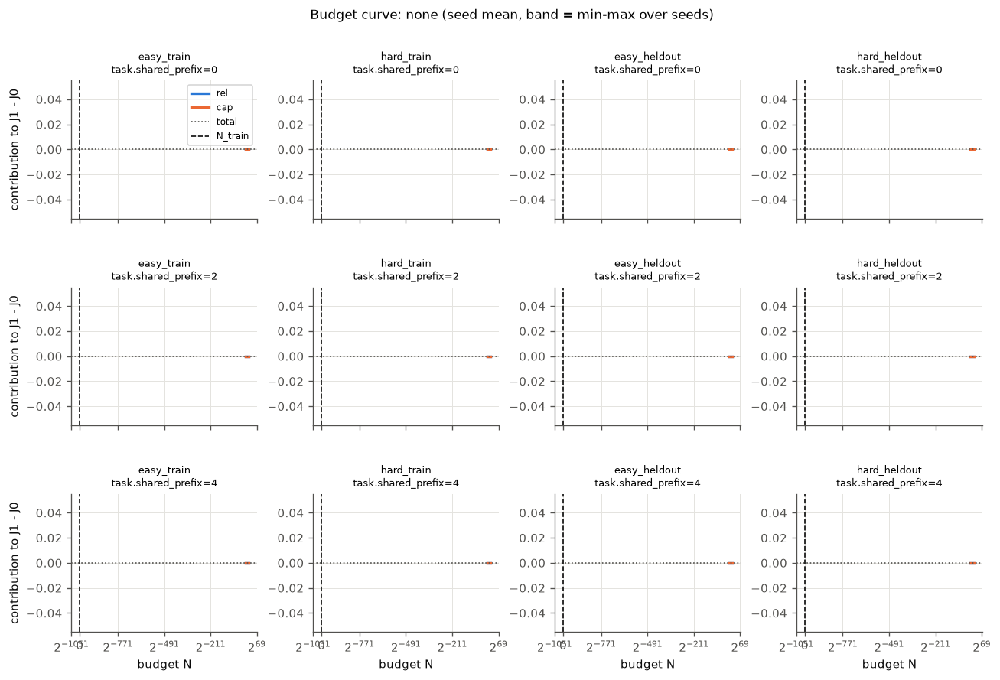
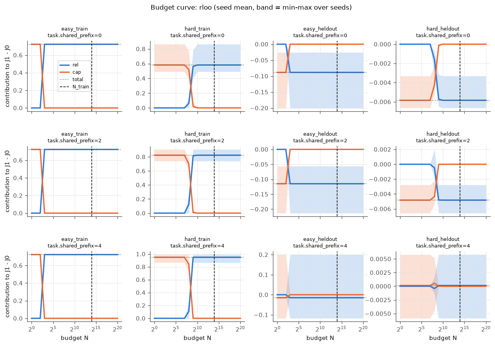
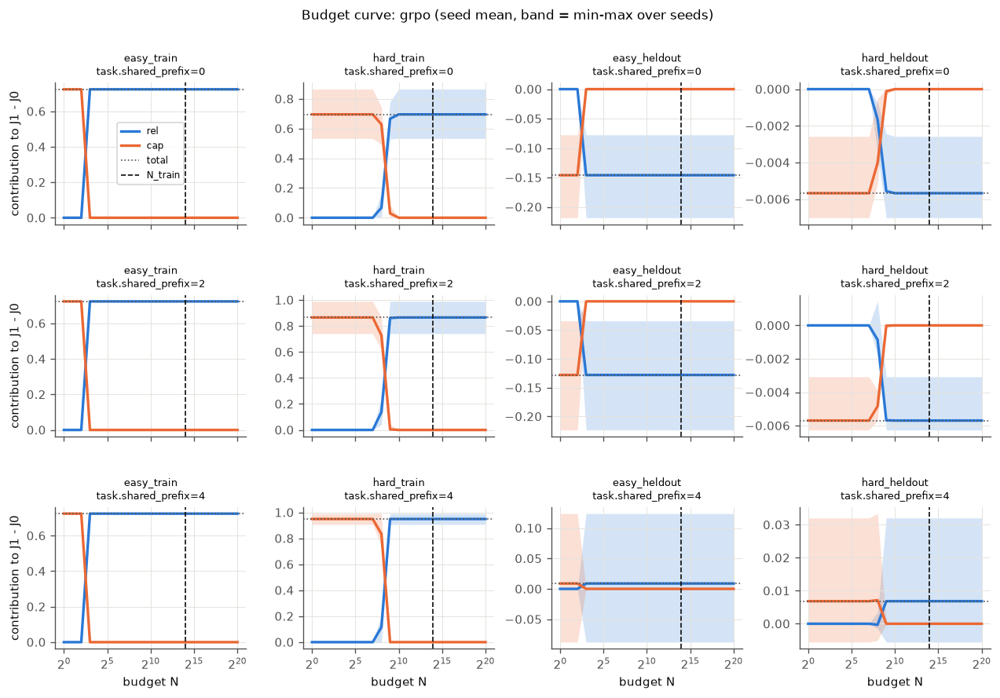
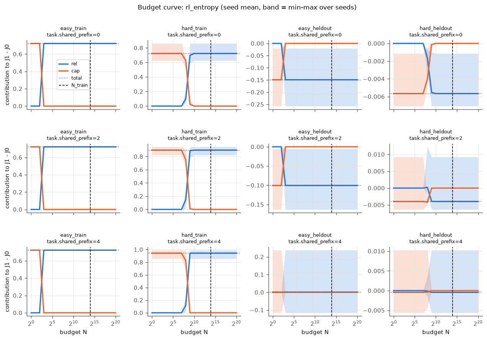
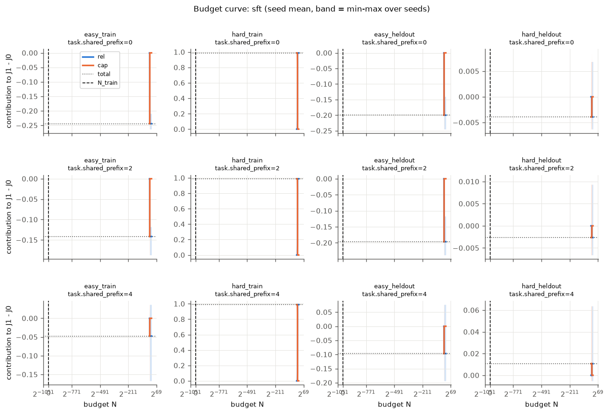
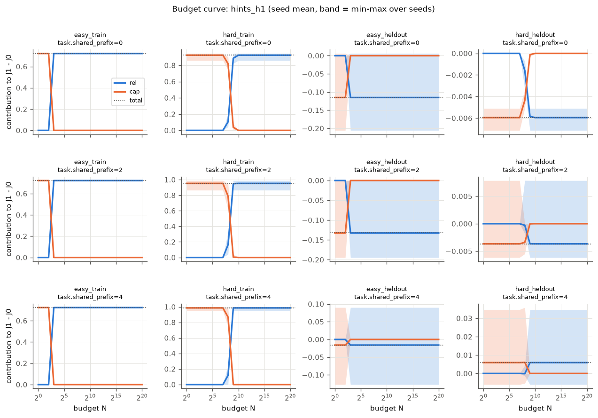
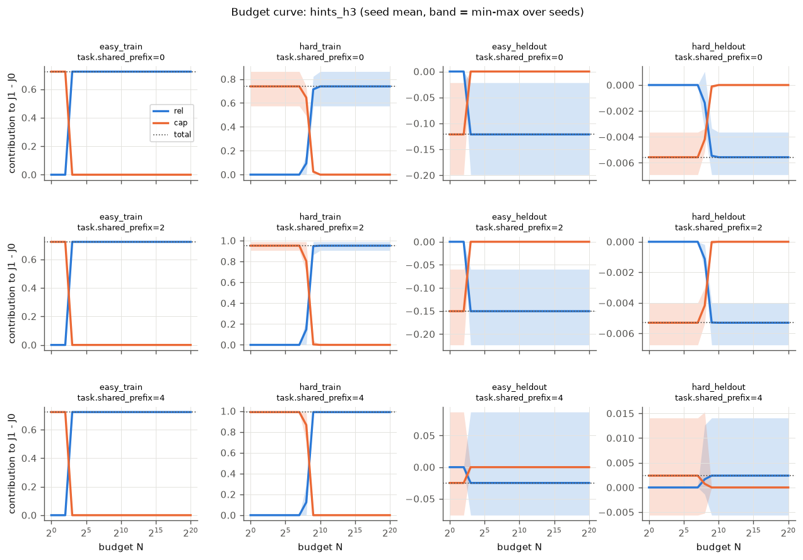
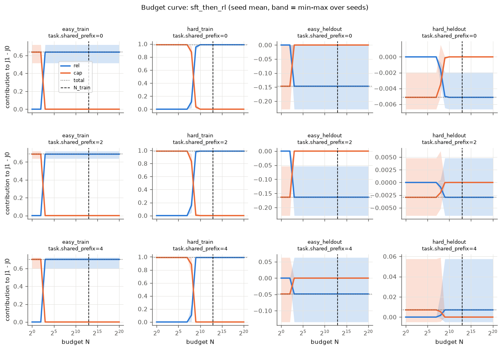

# Budget curve

Generated by `capsplit.harness.budget.build_budget_curve`; do not edit by hand.

Source: `results/main`, checkpoint: final, c = 1.

## What this measures

A correct solution counts as *reachable* at budget N when the base model already finds it with probability at least 1/N, so N tries would usually find it. Training changes each solution's probability; **rel(N)** adds up the change on reachable solutions (better reliability on what the base could already do) and **cap(N)** the change on unreachable ones (new capability at that budget). The two always add up to the total gain J1 - J0 (checked to 1e-12 at every N).

As N grows more solutions become reachable, so gain moves from cap to rel. **N\*** is the smallest budget on the grid at which rel holds at least half of the gain: above N\*, most of what training added was already within reach of the base given that many tries. rel(N) only rises with N when no solution lost probability; otherwise it can move either way, so N\* is read off the grid literally.

**cap at N_train** is cap evaluated at the number of episodes the arm sampled per training prompt: the part of the gain that the base could not have found with the same sampling the arm used.

Grid: 21 budgets from 1 to 1048576 (powers of two by default).

## Results

N\* is the seed mean over seeds where it is defined (k/n = defined/seeds). cap at N_train: seed mean [min, max].

### none

| factors | group | total gain | N* (k/n) | cap at N_train [min, max] | N_train | N_train source |
|---|---|---|---|---|---|---|
| task.shared_prefix=0 | all | +0.0000 | n/a (0/10) | n/a (N_train < 1 (no episodes sampled)) | 0 | from_config (not logged) |
| task.shared_prefix=0 | easy | +0.0000 | n/a (0/10) | n/a (N_train < 1 (no episodes sampled)) | 0 | from_config (not logged) |
| task.shared_prefix=0 | hard | +0.0000 | n/a (0/10) | n/a (N_train < 1 (no episodes sampled)) | 0 | from_config (not logged) |
| task.shared_prefix=0 | heldout | +0.0000 | n/a (0/10) | n/a (N_train < 1 (no episodes sampled)) | 0 | from_config (not logged) |
| task.shared_prefix=0 | train | +0.0000 | n/a (0/10) | n/a (N_train < 1 (no episodes sampled)) | 0 | from_config (not logged) |
| task.shared_prefix=0 | easy_heldout | +0.0000 | n/a (0/10) | n/a (N_train < 1 (no episodes sampled)) | 0 | from_config (not logged) |
| task.shared_prefix=0 | easy_train | +0.0000 | n/a (0/10) | n/a (N_train < 1 (no episodes sampled)) | 0 | from_config (not logged) |
| task.shared_prefix=0 | hard_heldout | +0.0000 | n/a (0/10) | n/a (N_train < 1 (no episodes sampled)) | 0 | from_config (not logged) |
| task.shared_prefix=0 | hard_train | +0.0000 | n/a (0/10) | n/a (N_train < 1 (no episodes sampled)) | 0 | from_config (not logged) |
| task.shared_prefix=2 | all | +0.0000 | n/a (0/10) | n/a (N_train < 1 (no episodes sampled)) | 0 | from_config (not logged) |
| task.shared_prefix=2 | easy | +0.0000 | n/a (0/10) | n/a (N_train < 1 (no episodes sampled)) | 0 | from_config (not logged) |
| task.shared_prefix=2 | hard | +0.0000 | n/a (0/10) | n/a (N_train < 1 (no episodes sampled)) | 0 | from_config (not logged) |
| task.shared_prefix=2 | heldout | +0.0000 | n/a (0/10) | n/a (N_train < 1 (no episodes sampled)) | 0 | from_config (not logged) |
| task.shared_prefix=2 | train | +0.0000 | n/a (0/10) | n/a (N_train < 1 (no episodes sampled)) | 0 | from_config (not logged) |
| task.shared_prefix=2 | easy_heldout | +0.0000 | n/a (0/10) | n/a (N_train < 1 (no episodes sampled)) | 0 | from_config (not logged) |
| task.shared_prefix=2 | easy_train | +0.0000 | n/a (0/10) | n/a (N_train < 1 (no episodes sampled)) | 0 | from_config (not logged) |
| task.shared_prefix=2 | hard_heldout | +0.0000 | n/a (0/10) | n/a (N_train < 1 (no episodes sampled)) | 0 | from_config (not logged) |
| task.shared_prefix=2 | hard_train | +0.0000 | n/a (0/10) | n/a (N_train < 1 (no episodes sampled)) | 0 | from_config (not logged) |
| task.shared_prefix=4 | all | +0.0000 | n/a (0/10) | n/a (N_train < 1 (no episodes sampled)) | 0 | from_config (not logged) |
| task.shared_prefix=4 | easy | +0.0000 | n/a (0/10) | n/a (N_train < 1 (no episodes sampled)) | 0 | from_config (not logged) |
| task.shared_prefix=4 | hard | +0.0000 | n/a (0/10) | n/a (N_train < 1 (no episodes sampled)) | 0 | from_config (not logged) |
| task.shared_prefix=4 | heldout | +0.0000 | n/a (0/10) | n/a (N_train < 1 (no episodes sampled)) | 0 | from_config (not logged) |
| task.shared_prefix=4 | train | +0.0000 | n/a (0/10) | n/a (N_train < 1 (no episodes sampled)) | 0 | from_config (not logged) |
| task.shared_prefix=4 | easy_heldout | +0.0000 | n/a (0/10) | n/a (N_train < 1 (no episodes sampled)) | 0 | from_config (not logged) |
| task.shared_prefix=4 | easy_train | +0.0000 | n/a (0/10) | n/a (N_train < 1 (no episodes sampled)) | 0 | from_config (not logged) |
| task.shared_prefix=4 | hard_heldout | +0.0000 | n/a (0/10) | n/a (N_train < 1 (no episodes sampled)) | 0 | from_config (not logged) |
| task.shared_prefix=4 | hard_train | +0.0000 | n/a (0/10) | n/a (N_train < 1 (no episodes sampled)) | 0 | from_config (not logged) |

### rloo

| factors | group | total gain | N* (k/n) | cap at N_train [min, max] | N_train | N_train source |
|---|---|---|---|---|---|---|
| task.shared_prefix=0 | all | +0.4194 | 32.8 (10/10) | +0.0000 [+0.0000, +0.0000] | 16000 | from_config (not logged) |
| task.shared_prefix=0 | easy | +0.4528 | 8 (10/10) | +0.0000 [+0.0000, +0.0000] | 16000 | from_config (not logged) |
| task.shared_prefix=0 | hard | +0.3860 | 512 (10/10) | +0.0000 [+0.0000, +0.0000] | 16000 | from_config (not logged) |
| task.shared_prefix=0 | heldout | -0.0471 | n/a (0/10) | +0.0000 [+0.0000, +0.0000] | 16000 | from_config (not logged) |
| task.shared_prefix=0 | train | +0.6527 | 32.8 (10/10) | +0.0000 [+0.0000, +0.0000] | 16000 | from_config (not logged) |
| task.shared_prefix=0 | easy_heldout | -0.0884 | n/a (0/10) | +0.0000 [+0.0000, +0.0000] | 16000 | from_config (not logged) |
| task.shared_prefix=0 | easy_train | +0.7234 | 8 (10/10) | +0.0000 [+0.0000, +0.0000] | 16000 | from_config (not logged) |
| task.shared_prefix=0 | hard_heldout | -0.0058 | n/a (0/10) | +0.0000 [+0.0000, +0.0000] | 16000 | from_config (not logged) |
| task.shared_prefix=0 | hard_train | +0.5819 | 512 (10/10) | +0.0000 [+0.0000, +0.0000] | 16000 | from_config (not logged) |
| task.shared_prefix=2 | all | +0.4954 | 307.2 (10/10) | +0.0000 [+0.0000, +0.0000] | 16000 | from_config (not logged) |
| task.shared_prefix=2 | easy | +0.4437 | 8 (10/10) | +0.0000 [+0.0000, +0.0000] | 16000 | from_config (not logged) |
| task.shared_prefix=2 | hard | +0.5471 | 512 (10/10) | +0.0000 [+0.0000, +0.0000] | 16000 | from_config (not logged) |
| task.shared_prefix=2 | heldout | -0.0599 | n/a (0/10) | +0.0000 [+0.0000, +0.0000] | 16000 | from_config (not logged) |
| task.shared_prefix=2 | train | +0.7731 | 307.2 (10/10) | +0.0000 [+0.0000, +0.0000] | 16000 | from_config (not logged) |
| task.shared_prefix=2 | easy_heldout | -0.1150 | n/a (0/10) | +0.0000 [+0.0000, +0.0000] | 16000 | from_config (not logged) |
| task.shared_prefix=2 | easy_train | +0.7231 | 8 (10/10) | +0.0000 [+0.0000, +0.0000] | 16000 | from_config (not logged) |
| task.shared_prefix=2 | hard_heldout | -0.0048 | n/a (0/10) | +0.0000 [+0.0000, +0.0000] | 16000 | from_config (not logged) |
| task.shared_prefix=2 | hard_train | +0.8231 | 512 (10/10) | +0.0000 [+0.0000, +0.0000] | 16000 | from_config (not logged) |
| task.shared_prefix=4 | all | +0.5550 | 435.2 (10/10) | +0.0000 [+0.0000, +0.0000] | 16000 | from_config (not logged) |
| task.shared_prefix=4 | easy | +0.4774 | 8 (10/10) | +0.0000 [+0.0000, +0.0000] | 16000 | from_config (not logged) |
| task.shared_prefix=4 | hard | +0.6326 | 512 (10/10) | +0.0000 [+0.0000, +0.0000] | 16000 | from_config (not logged) |
| task.shared_prefix=4 | heldout | -0.0074 | 8 (2/10) | +0.0000 [+0.0000, +0.0000] | 16000 | from_config (not logged) |
| task.shared_prefix=4 | train | +0.8362 | 435.2 (10/10) | +0.0000 [+0.0000, +0.0000] | 16000 | from_config (not logged) |
| task.shared_prefix=4 | easy_heldout | -0.0150 | 8 (2/10) | +0.0000 [+0.0000, +0.0000] | 16000 | from_config (not logged) |
| task.shared_prefix=4 | easy_train | +0.7236 | 8 (10/10) | +0.0000 [+0.0000, +0.0000] | 16000 | from_config (not logged) |
| task.shared_prefix=4 | hard_heldout | +0.0001 | 512 (4/10) | +0.0000 [+0.0000, +0.0000] | 16000 | from_config (not logged) |
| task.shared_prefix=4 | hard_train | +0.9488 | 512 (10/10) | +0.0000 [+0.0000, +0.0000] | 16000 | from_config (not logged) |

### grpo

| factors | group | total gain | N* (k/n) | cap at N_train [min, max] | N_train | N_train source |
|---|---|---|---|---|---|---|
| task.shared_prefix=0 | all | +0.4477 | 233.6 (10/10) | +0.0000 [+0.0000, +0.0000] | 16000 | from_config (not logged) |
| task.shared_prefix=0 | easy | +0.4340 | 8 (10/10) | +0.0000 [+0.0000, +0.0000] | 16000 | from_config (not logged) |
| task.shared_prefix=0 | hard | +0.4615 | 512 (10/10) | +0.0000 [+0.0000, +0.0000] | 16000 | from_config (not logged) |
| task.shared_prefix=0 | heldout | -0.0759 | n/a (0/10) | +0.0000 [+0.0000, +0.0000] | 16000 | from_config (not logged) |
| task.shared_prefix=0 | train | +0.7095 | 107.2 (10/10) | +0.0000 [+0.0000, +0.0000] | 16000 | from_config (not logged) |
| task.shared_prefix=0 | easy_heldout | -0.1460 | n/a (0/10) | +0.0000 [+0.0000, +0.0000] | 16000 | from_config (not logged) |
| task.shared_prefix=0 | easy_train | +0.7240 | 8 (10/10) | +0.0000 [+0.0000, +0.0000] | 16000 | from_config (not logged) |
| task.shared_prefix=0 | hard_heldout | -0.0057 | n/a (0/10) | +0.0000 [+0.0000, +0.0000] | 16000 | from_config (not logged) |
| task.shared_prefix=0 | hard_train | +0.6950 | 512 (10/10) | +0.0000 [+0.0000, +0.0000] | 16000 | from_config (not logged) |
| task.shared_prefix=2 | all | +0.5074 | 307.2 (10/10) | +0.0000 [+0.0000, +0.0000] | 16000 | from_config (not logged) |
| task.shared_prefix=2 | easy | +0.4398 | 8 (10/10) | +0.0000 [+0.0000, +0.0000] | 16000 | from_config (not logged) |
| task.shared_prefix=2 | hard | +0.5750 | 512 (10/10) | +0.0000 [+0.0000, +0.0000] | 16000 | from_config (not logged) |
| task.shared_prefix=2 | heldout | -0.0668 | n/a (0/10) | +0.0000 [+0.0000, +0.0000] | 16000 | from_config (not logged) |
| task.shared_prefix=2 | train | +0.7945 | 281.6 (10/10) | +0.0000 [+0.0000, +0.0000] | 16000 | from_config (not logged) |
| task.shared_prefix=2 | easy_heldout | -0.1279 | n/a (0/10) | +0.0000 [+0.0000, +0.0000] | 16000 | from_config (not logged) |
| task.shared_prefix=2 | easy_train | +0.7236 | 8 (10/10) | +0.0000 [+0.0000, +0.0000] | 16000 | from_config (not logged) |
| task.shared_prefix=2 | hard_heldout | -0.0057 | n/a (0/10) | +0.0000 [+0.0000, +0.0000] | 16000 | from_config (not logged) |
| task.shared_prefix=2 | hard_train | +0.8654 | 512 (10/10) | +0.0000 [+0.0000, +0.0000] | 16000 | from_config (not logged) |
| task.shared_prefix=4 | all | +0.5604 | 358.4 (10/10) | +0.0000 [+0.0000, +0.0000] | 16000 | from_config (not logged) |
| task.shared_prefix=4 | easy | +0.4856 | 8 (10/10) | +0.0000 [+0.0000, +0.0000] | 16000 | from_config (not logged) |
| task.shared_prefix=4 | hard | +0.6352 | 512 (10/10) | +0.0000 [+0.0000, +0.0000] | 16000 | from_config (not logged) |
| task.shared_prefix=4 | heldout | +0.0078 | 92 (6/10) | +0.0000 [+0.0000, +0.0000] | 16000 | from_config (not logged) |
| task.shared_prefix=4 | train | +0.8367 | 384 (10/10) | +0.0000 [+0.0000, +0.0000] | 16000 | from_config (not logged) |
| task.shared_prefix=4 | easy_heldout | +0.0089 | 8 (6/10) | +0.0000 [+0.0000, +0.0000] | 16000 | from_config (not logged) |
| task.shared_prefix=4 | easy_train | +0.7240 | 8 (10/10) | +0.0000 [+0.0000, +0.0000] | 16000 | from_config (not logged) |
| task.shared_prefix=4 | hard_heldout | +0.0068 | 512 (6/10) | +0.0000 [+0.0000, +0.0000] | 16000 | from_config (not logged) |
| task.shared_prefix=4 | hard_train | +0.9494 | 512 (10/10) | +0.0000 [+0.0000, +0.0000] | 16000 | from_config (not logged) |

### rl_entropy

| factors | group | total gain | N* (k/n) | cap at N_train [min, max] | N_train | N_train source |
|---|---|---|---|---|---|---|
| task.shared_prefix=0 | all | +0.4559 | 206.4 (10/10) | +0.0000 [+0.0000, +0.0000] | 16000 | from_config (not logged) |
| task.shared_prefix=0 | easy | +0.4319 | 8 (10/10) | +0.0000 [+0.0000, +0.0000] | 16000 | from_config (not logged) |
| task.shared_prefix=0 | hard | +0.4798 | 512 (10/10) | +0.0000 [+0.0000, +0.0000] | 16000 | from_config (not logged) |
| task.shared_prefix=0 | heldout | -0.0774 | n/a (0/10) | +0.0000 [+0.0000, +0.0000] | 16000 | from_config (not logged) |
| task.shared_prefix=0 | train | +0.7225 | 107.2 (10/10) | +0.0000 [+0.0000, +0.0000] | 16000 | from_config (not logged) |
| task.shared_prefix=0 | easy_heldout | -0.1491 | n/a (0/10) | +0.0000 [+0.0000, +0.0000] | 16000 | from_config (not logged) |
| task.shared_prefix=0 | easy_train | +0.7224 | 8 (10/10) | +0.0000 [+0.0000, +0.0000] | 16000 | from_config (not logged) |
| task.shared_prefix=0 | hard_heldout | -0.0057 | n/a (0/10) | +0.0000 [+0.0000, +0.0000] | 16000 | from_config (not logged) |
| task.shared_prefix=0 | hard_train | +0.7225 | 512 (10/10) | +0.0000 [+0.0000, +0.0000] | 16000 | from_config (not logged) |
| task.shared_prefix=2 | all | +0.5224 | 307.2 (10/10) | +0.0000 [+0.0000, +0.0000] | 16000 | from_config (not logged) |
| task.shared_prefix=2 | easy | +0.4482 | 8 (10/10) | +0.0000 [+0.0000, +0.0000] | 16000 | from_config (not logged) |
| task.shared_prefix=2 | hard | +0.5965 | 512 (10/10) | +0.0000 [+0.0000, +0.0000] | 16000 | from_config (not logged) |
| task.shared_prefix=2 | heldout | -0.0522 | n/a (0/10) | +0.0000 [+0.0000, +0.0000] | 16000 | from_config (not logged) |
| task.shared_prefix=2 | train | +0.8096 | 281.6 (10/10) | +0.0000 [+0.0000, +0.0000] | 16000 | from_config (not logged) |
| task.shared_prefix=2 | easy_heldout | -0.1004 | n/a (0/10) | +0.0000 [+0.0000, +0.0000] | 16000 | from_config (not logged) |
| task.shared_prefix=2 | easy_train | +0.7225 | 8 (10/10) | +0.0000 [+0.0000, +0.0000] | 16000 | from_config (not logged) |
| task.shared_prefix=2 | hard_heldout | -0.0040 | 256 (1/10) | +0.0000 [+0.0000, +0.0000] | 16000 | from_config (not logged) |
| task.shared_prefix=2 | hard_train | +0.8968 | 512 (10/10) | +0.0000 [+0.0000, +0.0000] | 16000 | from_config (not logged) |
| task.shared_prefix=4 | all | +0.5555 | 358.4 (10/10) | +0.0000 [+0.0000, +0.0000] | 16000 | from_config (not logged) |
| task.shared_prefix=4 | easy | +0.4825 | 8 (10/10) | +0.0000 [+0.0000, +0.0000] | 16000 | from_config (not logged) |
| task.shared_prefix=4 | hard | +0.6285 | 512 (10/10) | +0.0000 [+0.0000, +0.0000] | 16000 | from_config (not logged) |
| task.shared_prefix=4 | heldout | +0.0004 | 8 (4/10) | +0.0000 [+0.0000, +0.0000] | 16000 | from_config (not logged) |
| task.shared_prefix=4 | train | +0.8331 | 358.4 (10/10) | +0.0000 [+0.0000, +0.0000] | 16000 | from_config (not logged) |
| task.shared_prefix=4 | easy_heldout | +0.0013 | 8 (4/10) | +0.0000 [+0.0000, +0.0000] | 16000 | from_config (not logged) |
| task.shared_prefix=4 | easy_train | +0.7231 | 8 (10/10) | +0.0000 [+0.0000, +0.0000] | 16000 | from_config (not logged) |
| task.shared_prefix=4 | hard_heldout | -0.0004 | 512 (3/10) | +0.0000 [+0.0000, +0.0000] | 16000 | from_config (not logged) |
| task.shared_prefix=4 | hard_train | +0.9430 | 512 (10/10) | +0.0000 [+0.0000, +0.0000] | 16000 | from_config (not logged) |

### sft

| factors | group | total gain | N* (k/n) | cap at N_train [min, max] | N_train | N_train source |
|---|---|---|---|---|---|---|
| task.shared_prefix=0 | all | +0.2141 | 512 (10/10) | n/a (N_train < 1 (no episodes sampled)) | 0 | from_config (not logged) |
| task.shared_prefix=0 | easy | -0.2295 | n/a (0/10) | n/a (N_train < 1 (no episodes sampled)) | 0 | from_config (not logged) |
| task.shared_prefix=0 | hard | +0.6578 | 512 (10/10) | n/a (N_train < 1 (no episodes sampled)) | 0 | from_config (not logged) |
| task.shared_prefix=0 | heldout | -0.1020 | n/a (0/10) | n/a (N_train < 1 (no episodes sampled)) | 0 | from_config (not logged) |
| task.shared_prefix=0 | train | +0.3722 | 512 (10/10) | n/a (N_train < 1 (no episodes sampled)) | 0 | from_config (not logged) |
| task.shared_prefix=0 | easy_heldout | -0.2001 | n/a (0/10) | n/a (N_train < 1 (no episodes sampled)) | 0 | from_config (not logged) |
| task.shared_prefix=0 | easy_train | -0.2443 | n/a (0/10) | n/a (N_train < 1 (no episodes sampled)) | 0 | from_config (not logged) |
| task.shared_prefix=0 | hard_heldout | -0.0039 | 512 (1/10) | n/a (N_train < 1 (no episodes sampled)) | 0 | from_config (not logged) |
| task.shared_prefix=0 | hard_train | +0.9886 | 512 (10/10) | n/a (N_train < 1 (no episodes sampled)) | 0 | from_config (not logged) |
| task.shared_prefix=2 | all | +0.2490 | 512 (10/10) | n/a (N_train < 1 (no episodes sampled)) | 0 | from_config (not logged) |
| task.shared_prefix=2 | easy | -0.1599 | n/a (0/10) | n/a (N_train < 1 (no episodes sampled)) | 0 | from_config (not logged) |
| task.shared_prefix=2 | hard | +0.6580 | 512 (10/10) | n/a (N_train < 1 (no episodes sampled)) | 0 | from_config (not logged) |
| task.shared_prefix=2 | heldout | -0.0996 | n/a (0/10) | n/a (N_train < 1 (no episodes sampled)) | 0 | from_config (not logged) |
| task.shared_prefix=2 | train | +0.4234 | 512 (10/10) | n/a (N_train < 1 (no episodes sampled)) | 0 | from_config (not logged) |
| task.shared_prefix=2 | easy_heldout | -0.1966 | n/a (0/10) | n/a (N_train < 1 (no episodes sampled)) | 0 | from_config (not logged) |
| task.shared_prefix=2 | easy_train | -0.1416 | n/a (0/10) | n/a (N_train < 1 (no episodes sampled)) | 0 | from_config (not logged) |
| task.shared_prefix=2 | hard_heldout | -0.0027 | 512 (1/10) | n/a (N_train < 1 (no episodes sampled)) | 0 | from_config (not logged) |
| task.shared_prefix=2 | hard_train | +0.9884 | 512 (10/10) | n/a (N_train < 1 (no episodes sampled)) | 0 | from_config (not logged) |
| task.shared_prefix=4 | all | +0.2994 | 512 (10/10) | n/a (N_train < 1 (no episodes sampled)) | 0 | from_config (not logged) |
| task.shared_prefix=4 | easy | -0.0640 | 8 (1/10) | n/a (N_train < 1 (no episodes sampled)) | 0 | from_config (not logged) |
| task.shared_prefix=4 | hard | +0.6629 | 512 (10/10) | n/a (N_train < 1 (no episodes sampled)) | 0 | from_config (not logged) |
| task.shared_prefix=4 | heldout | -0.0431 | 8 (2/10) | n/a (N_train < 1 (no episodes sampled)) | 0 | from_config (not logged) |
| task.shared_prefix=4 | train | +0.4707 | 512 (10/10) | n/a (N_train < 1 (no episodes sampled)) | 0 | from_config (not logged) |
| task.shared_prefix=4 | easy_heldout | -0.0968 | 8 (2/10) | n/a (N_train < 1 (no episodes sampled)) | 0 | from_config (not logged) |
| task.shared_prefix=4 | easy_train | -0.0475 | 8 (2/10) | n/a (N_train < 1 (no episodes sampled)) | 0 | from_config (not logged) |
| task.shared_prefix=4 | hard_heldout | +0.0107 | 512 (7/10) | n/a (N_train < 1 (no episodes sampled)) | 0 | from_config (not logged) |
| task.shared_prefix=4 | hard_train | +0.9890 | 512 (10/10) | n/a (N_train < 1 (no episodes sampled)) | 0 | from_config (not logged) |

### hints_h1

| factors | group | total gain | N* (k/n) | cap at N_train [min, max] | N_train | N_train source |
|---|---|---|---|---|---|---|
| task.shared_prefix=0 | all | +0.5290 | 435.2 (10/10) | n/a (N_train unknown) | unknown | unknown |
| task.shared_prefix=0 | easy | +0.4434 | 8 (10/10) | n/a (N_train unknown) | unknown | unknown |
| task.shared_prefix=0 | hard | +0.6147 | 512 (10/10) | n/a (N_train unknown) | unknown | unknown |
| task.shared_prefix=0 | heldout | -0.0606 | 8 (1/10) | n/a (N_train unknown) | unknown | unknown |
| task.shared_prefix=0 | train | +0.8238 | 358.4 (10/10) | n/a (N_train unknown) | unknown | unknown |
| task.shared_prefix=0 | easy_heldout | -0.1152 | 8 (1/10) | n/a (N_train unknown) | unknown | unknown |
| task.shared_prefix=0 | easy_train | +0.7227 | 8 (10/10) | n/a (N_train unknown) | unknown | unknown |
| task.shared_prefix=0 | hard_heldout | -0.0060 | n/a (0/10) | n/a (N_train unknown) | unknown | unknown |
| task.shared_prefix=0 | hard_train | +0.9250 | 512 (10/10) | n/a (N_train unknown) | unknown | unknown |
| task.shared_prefix=2 | all | +0.5355 | 358.4 (10/10) | n/a (N_train unknown) | unknown | unknown |
| task.shared_prefix=2 | easy | +0.4378 | 8 (10/10) | n/a (N_train unknown) | unknown | unknown |
| task.shared_prefix=2 | hard | +0.6332 | 512 (10/10) | n/a (N_train unknown) | unknown | unknown |
| task.shared_prefix=2 | heldout | -0.0680 | n/a (0/10) | n/a (N_train unknown) | unknown | unknown |
| task.shared_prefix=2 | train | +0.8373 | 358.4 (10/10) | n/a (N_train unknown) | unknown | unknown |
| task.shared_prefix=2 | easy_heldout | -0.1324 | n/a (0/10) | n/a (N_train unknown) | unknown | unknown |
| task.shared_prefix=2 | easy_train | +0.7230 | 8 (10/10) | n/a (N_train unknown) | unknown | unknown |
| task.shared_prefix=2 | hard_heldout | -0.0037 | 256 (1/10) | n/a (N_train unknown) | unknown | unknown |
| task.shared_prefix=2 | hard_train | +0.9517 | 512 (10/10) | n/a (N_train unknown) | unknown | unknown |
| task.shared_prefix=4 | all | +0.5682 | 409.6 (10/10) | n/a (N_train unknown) | unknown | unknown |
| task.shared_prefix=4 | easy | +0.4770 | 8 (10/10) | n/a (N_train unknown) | unknown | unknown |
| task.shared_prefix=4 | hard | +0.6594 | 512 (10/10) | n/a (N_train unknown) | unknown | unknown |
| task.shared_prefix=4 | heldout | -0.0050 | 134 (4/10) | n/a (N_train unknown) | unknown | unknown |
| task.shared_prefix=4 | train | +0.8548 | 409.6 (10/10) | n/a (N_train unknown) | unknown | unknown |
| task.shared_prefix=4 | easy_heldout | -0.0159 | 8 (4/10) | n/a (N_train unknown) | unknown | unknown |
| task.shared_prefix=4 | easy_train | +0.7235 | 8 (10/10) | n/a (N_train unknown) | unknown | unknown |
| task.shared_prefix=4 | hard_heldout | +0.0059 | 460.8 (5/10) | n/a (N_train unknown) | unknown | unknown |
| task.shared_prefix=4 | hard_train | +0.9861 | 512 (10/10) | n/a (N_train unknown) | unknown | unknown |

### hints_h3

| factors | group | total gain | N* (k/n) | cap at N_train [min, max] | N_train | N_train source |
|---|---|---|---|---|---|---|
| task.shared_prefix=0 | all | +0.4662 | 232 (10/10) | n/a (N_train unknown) | unknown | unknown |
| task.shared_prefix=0 | easy | +0.4416 | 8 (10/10) | n/a (N_train unknown) | unknown | unknown |
| task.shared_prefix=0 | hard | +0.4907 | 512 (10/10) | n/a (N_train unknown) | unknown | unknown |
| task.shared_prefix=0 | heldout | -0.0634 | n/a (0/10) | n/a (N_train unknown) | unknown | unknown |
| task.shared_prefix=0 | train | +0.7310 | 156.8 (10/10) | n/a (N_train unknown) | unknown | unknown |
| task.shared_prefix=0 | easy_heldout | -0.1213 | n/a (0/10) | n/a (N_train unknown) | unknown | unknown |
| task.shared_prefix=0 | easy_train | +0.7230 | 8 (10/10) | n/a (N_train unknown) | unknown | unknown |
| task.shared_prefix=0 | hard_heldout | -0.0056 | n/a (0/10) | n/a (N_train unknown) | unknown | unknown |
| task.shared_prefix=0 | hard_train | +0.7389 | 512 (10/10) | n/a (N_train unknown) | unknown | unknown |
| task.shared_prefix=2 | all | +0.5322 | 358.4 (10/10) | n/a (N_train unknown) | unknown | unknown |
| task.shared_prefix=2 | easy | +0.4317 | 8 (10/10) | n/a (N_train unknown) | unknown | unknown |
| task.shared_prefix=2 | hard | +0.6326 | 512 (10/10) | n/a (N_train unknown) | unknown | unknown |
| task.shared_prefix=2 | heldout | -0.0778 | n/a (0/10) | n/a (N_train unknown) | unknown | unknown |
| task.shared_prefix=2 | train | +0.8372 | 307.2 (10/10) | n/a (N_train unknown) | unknown | unknown |
| task.shared_prefix=2 | easy_heldout | -0.1504 | n/a (0/10) | n/a (N_train unknown) | unknown | unknown |
| task.shared_prefix=2 | easy_train | +0.7227 | 8 (10/10) | n/a (N_train unknown) | unknown | unknown |
| task.shared_prefix=2 | hard_heldout | -0.0053 | n/a (0/10) | n/a (N_train unknown) | unknown | unknown |
| task.shared_prefix=2 | hard_train | +0.9516 | 512 (10/10) | n/a (N_train unknown) | unknown | unknown |
| task.shared_prefix=4 | all | +0.5674 | 435.2 (10/10) | n/a (N_train unknown) | unknown | unknown |
| task.shared_prefix=4 | easy | +0.4739 | 8 (10/10) | n/a (N_train unknown) | unknown | unknown |
| task.shared_prefix=4 | hard | +0.6609 | 512 (10/10) | n/a (N_train unknown) | unknown | unknown |
| task.shared_prefix=4 | heldout | -0.0113 | 8 (2/10) | n/a (N_train unknown) | unknown | unknown |
| task.shared_prefix=4 | train | +0.8568 | 435.2 (10/10) | n/a (N_train unknown) | unknown | unknown |
| task.shared_prefix=4 | easy_heldout | -0.0250 | 8 (2/10) | n/a (N_train unknown) | unknown | unknown |
| task.shared_prefix=4 | easy_train | +0.7234 | 8 (10/10) | n/a (N_train unknown) | unknown | unknown |
| task.shared_prefix=4 | hard_heldout | +0.0024 | 409.6 (5/10) | n/a (N_train unknown) | unknown | unknown |
| task.shared_prefix=4 | hard_train | +0.9902 | 512 (10/10) | n/a (N_train unknown) | unknown | unknown |

### sft_then_rl

| factors | group | total gain | N* (k/n) | cap at N_train [min, max] | N_train | N_train source |
|---|---|---|---|---|---|---|
| task.shared_prefix=0 | all | +0.5164 | 512 (10/10) | +0.0000 [+0.0000, +0.0000] | 8000 | from_config (not logged) |
| task.shared_prefix=0 | easy | +0.3759 | 8 (10/10) | +0.0000 [+0.0000, +0.0000] | 8000 | from_config (not logged) |
| task.shared_prefix=0 | hard | +0.6568 | 512 (10/10) | +0.0000 [+0.0000, +0.0000] | 8000 | from_config (not logged) |
| task.shared_prefix=0 | heldout | -0.0760 | n/a (0/10) | +0.0000 [+0.0000, +0.0000] | 8000 | from_config (not logged) |
| task.shared_prefix=0 | train | +0.8125 | 460.8 (10/10) | +0.0000 [+0.0000, +0.0000] | 8000 | from_config (not logged) |
| task.shared_prefix=0 | easy_heldout | -0.1469 | 8 (1/10) | +0.0000 [+0.0000, +0.0000] | 8000 | from_config (not logged) |
| task.shared_prefix=0 | easy_train | +0.6372 | 8 (10/10) | +0.0000 [+0.0000, +0.0000] | 8000 | from_config (not logged) |
| task.shared_prefix=0 | hard_heldout | -0.0051 | n/a (0/10) | +0.0000 [+0.0000, +0.0000] | 8000 | from_config (not logged) |
| task.shared_prefix=0 | hard_train | +0.9878 | 512 (10/10) | +0.0000 [+0.0000, +0.0000] | 8000 | from_config (not logged) |
| task.shared_prefix=2 | all | +0.5313 | 435.2 (10/10) | +0.0000 [+0.0000, +0.0000] | 8000 | from_config (not logged) |
| task.shared_prefix=2 | easy | +0.4042 | 8 (10/10) | +0.0000 [+0.0000, +0.0000] | 8000 | from_config (not logged) |
| task.shared_prefix=2 | hard | +0.6584 | 512 (10/10) | +0.0000 [+0.0000, +0.0000] | 8000 | from_config (not logged) |
| task.shared_prefix=2 | heldout | -0.0832 | n/a (0/10) | +0.0000 [+0.0000, +0.0000] | 8000 | from_config (not logged) |
| task.shared_prefix=2 | train | +0.8385 | 384 (10/10) | +0.0000 [+0.0000, +0.0000] | 8000 | from_config (not logged) |
| task.shared_prefix=2 | easy_heldout | -0.1634 | n/a (0/10) | +0.0000 [+0.0000, +0.0000] | 8000 | from_config (not logged) |
| task.shared_prefix=2 | easy_train | +0.6879 | 8 (10/10) | +0.0000 [+0.0000, +0.0000] | 8000 | from_config (not logged) |
| task.shared_prefix=2 | hard_heldout | -0.0029 | 512 (2/10) | +0.0000 [+0.0000, +0.0000] | 8000 | from_config (not logged) |
| task.shared_prefix=2 | hard_train | +0.9891 | 512 (10/10) | +0.0000 [+0.0000, +0.0000] | 8000 | from_config (not logged) |
| task.shared_prefix=4 | all | +0.5568 | 460.8 (10/10) | +0.0000 [+0.0000, +0.0000] | 8000 | from_config (not logged) |
| task.shared_prefix=4 | easy | +0.4512 | 8 (10/10) | +0.0000 [+0.0000, +0.0000] | 8000 | from_config (not logged) |
| task.shared_prefix=4 | hard | +0.6625 | 512 (10/10) | +0.0000 [+0.0000, +0.0000] | 8000 | from_config (not logged) |
| task.shared_prefix=4 | heldout | -0.0208 | 8 (2/10) | +0.0000 [+0.0000, +0.0000] | 8000 | from_config (not logged) |
| task.shared_prefix=4 | train | +0.8456 | 460.8 (10/10) | +0.0000 [+0.0000, +0.0000] | 8000 | from_config (not logged) |
| task.shared_prefix=4 | easy_heldout | -0.0486 | 8 (2/10) | +0.0000 [+0.0000, +0.0000] | 8000 | from_config (not logged) |
| task.shared_prefix=4 | easy_train | +0.7012 | 8 (10/10) | +0.0000 [+0.0000, +0.0000] | 8000 | from_config (not logged) |
| task.shared_prefix=4 | hard_heldout | +0.0071 | 460.8 (5/10) | +0.0000 [+0.0000, +0.0000] | 8000 | from_config (not logged) |
| task.shared_prefix=4 | hard_train | +0.9901 | 512 (10/10) | +0.0000 [+0.0000, +0.0000] | 8000 | from_config (not logged) |

## Figures

