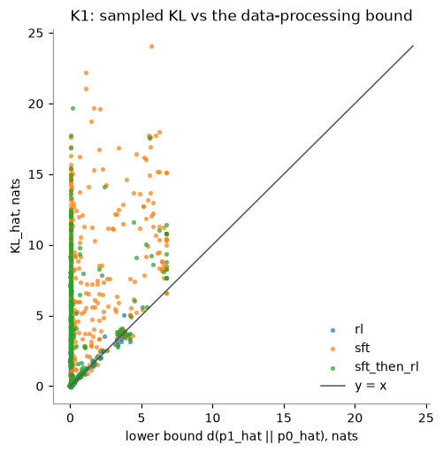
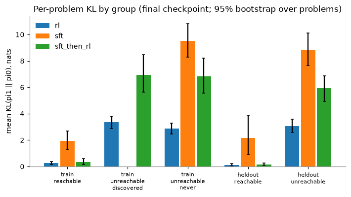
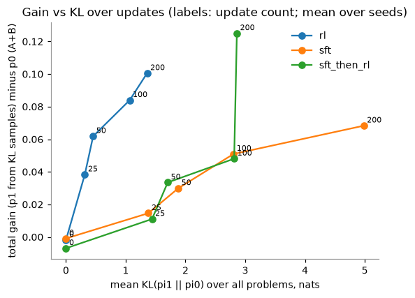

<!-- generated by scripts/publish_lm_kl.sh from results/lm_main_kl; edit answer.md, not this file -->
# Function-space (KL) layer: the answer in plain words

**Question:** does the KL layer show anything the output metric alone does not?

**Answer: yes, two things, both descriptive.**

1. **Movement without progress.** On training problems that stayed unreachable and were never once sampled correct during RL, the success metric shows no change. Yet the output distribution moved far from the base there, by roughly as much as on the problems RL did discover. It moved much more than on problems that were already reachable. The same holds for held-out unreachable problems, where the success gain is near zero but the KL is large for every arm.
   - The success metric cannot see this.
   - It also cannot say what the movement is. An informal diversity check on these problems (RL, one seed, done on interim data and not part of the generated report) found the wrong answers being reshuffled, not collapsed onto one answer. The KL there is large partly because the base spreads its mass over many unlikely wrong answers, so moving that mass costs many nats.
2. **The methods differ in how far they move the model per unit of gain.**
   - RL reaches its gain with much less movement of the output distribution than SFT.
   - SFT moves the distribution furthest of all, including on reachable problems, where its accuracy went down.
   - In SFT-then-RL, the RL phase raises the gain while the total KL stays roughly flat. That fits the RL phase redistributing mass within distance the SFT phase had already moved, though the over-updates estimates are noisy.

**What this does not show.** Nothing here says whether the models learned "little" or "a lot", or gained or lost capability.
- KL measures how far the output distribution moved. It does not measure direction, usefulness or capability.
- The weight descriptors are coordinates and define nothing about capability.

## The pre-registered checks, in order

**K1, the bound check: failed as registered.**
- The violation fraction is well above the pre-registered 5% line, for every arm and with both smoothings.
- Diagnosis: almost all violations are an artefact of the bound check, not of the KL estimator.
  - **Smoothing artefact.** Many violations are cells where the raw success rates are both 0 or both 1. There, smoothing two different sample sizes produces a small positive bound while the KL is about zero.
  - **Bound noise.** The rest are cells where the trained model is near-deterministic, so the KL's standard error is about zero, and the KL sits just under a bound that has sampling noise of its own. The registered rule ignores that noise.
- The post-hoc variant (DECISIONS L34) handles these: it excludes the exactly-degenerate cells and includes the bound's noise. With it, violations are essentially absent.
- The exact-zero checks passed: every fresh adapter gives exactly zero log-ratio.
- The p̂0-from-B-only sensitivity (L33) also lowers the violation rate. This shows the selection effect of classifying with set A.
- The registered K1 result is reported first and unchanged in the generated report below.

**K2, KL by class group:**

| Prediction | Who | Outcome |
|---|---|---|
| (a) For RL, problems discovered in training have the largest KL | user | Supported |
| (b) Never-discovered unreachable problems sit near the reachable problems, and above zero | user | **Contradicted.** They are above zero, but far above the reachable problems, not near them |
| Never-discovered unreachable problems are below reachable ones | mine | **Contradicted** |
| For SFT, the trained-on unreachable problems have the largest KL | mine | Supported |
| For SFT, held-out unreachable exceeds held-out reachable | mine | Supported |

**K3, the held-out gap (descriptive, no new verdict on L2):**
- **Supported:** the held-out unreachable KL interval lies above zero for every arm.
- **Mixed:** the prediction that held-out unreachable efficiency is below held-out reachable efficiency.
  - It holds for RL.
  - For SFT-then-RL it holds in the point estimates, with overlapping intervals.
  - For SFT it does not hold. SFT's held-out reachable gain is negative, so its efficiency there is negative.

**Over updates:**
- **KL rises with updates.** This holds for SFT on every seed. For RL it holds on two seeds; on the third, the step-100 estimate (from fewer samples) is above the step-200 one.
- **RL reaches under half of its final KL by update 25.** Supported on every seed.
- **SFT reaches a larger fraction of its final KL by update 25 than RL.** Not supported consistently; it depends on the seed.

## Independent re-derivation

One KL, one bound and one effective rank were recomputed by `scripts/rederive_kl.py`. That script does not import the KL stage code, rescores the saved token ids in float32 on CPU and reads the raw sample and adapter files. Its output, with the differences from the stage's values, is in `rederivation.txt`.

- **Bound and effective rank:** both match the stage to floating-point rounding.
- **KL:** the independent value is a few percent lower than the stage's.
  - `scripts/kl_precision_check.py` re-scored the same samples with the stage's own code. In float32 on CPU it reproduces the independent value; in float16 on MPS, the run's setting, it reproduces the stored samples exactly.
  - So the gap comes from numeric precision, not from a code difference (`precision_check.txt`, DECISIONS L35).
  - The reported KLs are those of the float16 model that was trained and sampled. Individual log-ratios can differ between precisions by a noticeable fraction of a nat.

## Caveats

- **Scope:** one 0.5B model with LoRA, generated arithmetic only, and 3 seeds.
- **Small group:** only 26 held-out unreachable problems.
- **Estimation:**
  - KL is a sampled estimate from 64 completions per problem at the final checkpoint, and from fewer at the intermediate ones.
  - Completions are truncated at 12 tokens.
  - Heavy-tailed log-ratios can make a few standard errors unreliable.
  - KL values are for the float16 model on MPS. A float32 re-scoring of one problem gave a KL a few percent lower.
- **Interpretation:**
  - Large KL on unreachable problems reflects how spread out the base distribution is there, as much as how much the model changed.
  - The pre-registration was written after the output-metric results were known, so this layer is exploratory.

# Function-space layer (KL to the base): lm_main

Generated by `capsplit.harness.lm.kl` from the completed run's saved adapters and samples; no number below is typed by hand. Exploratory: pre-registered in `preregistration_kl.md` after the main results were known; it gives no verdict on L1-L3.

- p̂0: base sets A and B pooled (400 + 64 samples per problem); p̂1: the trained arm's saved eval samples (64 per problem).
- KL_hat: mean of ln pi1(y) - ln pi0(y) over m completions y ~ pi1 at the reference temperature (m = 64 at the final checkpoint, 16 at checkpoints [25, 50, 100], 4 for the exact-zero checks); standard error = sd / sqrt(m).
- Bound d(p̂1 || p̂0) with jeffreys smoothing (alternative: laplace); a violation is KL_hat + 2 SE < d.

## Exact-zero checks

A fresh adapter (lora_B = 0) is the `none` arm at every step and every arm at step 0; KL must be exactly 0.

| arm | seed | step | m | max |ln pi1 - ln pi0| | mean KL_hat |
|---|---|---|---|---|---|
| none | 0 | 200 | 4 | 0.0 | 0.0 |
| none | 1 | 200 | 4 | 0.0 | 0.0 |
| none | 2 | 200 | 4 | 0.0 | 0.0 |
| rl | 0 | 0 | 4 | 0.0 | 0.0 |
| rl | 1 | 0 | 4 | 0.0 | 0.0 |
| rl | 2 | 0 | 4 | 0.0 | 0.0 |
| sft | 0 | 0 | 4 | 0.0 | 0.0 |
| sft | 1 | 0 | 4 | 0.0 | 0.0 |
| sft | 2 | 0 | 4 | 0.0 | 0.0 |
| sft_then_rl | 0 | 0 | 4 | 0.0 | 0.0 |
| sft_then_rl | 1 | 0 | 4 | 0.0 | 0.0 |
| sft_then_rl | 2 | 0 | 4 | 0.0 | 0.0 |

## K1: bound check

| arm | problems x seeds | violations | fraction | violations (laplace) | fraction (laplace) | violations (p̂0 from B only) | fraction (B only) | min (KL_hat - d) / SE |
|---|---|---|---|---|---|---|---|---|
| rl | 540 | 109 | 0.2019 | 125 | 0.2315 | 62 | 0.1148 | -6.08 |
| sft | 540 | 88 | 0.1630 | 106 | 0.1963 | 32 | 0.0593 | -21.61 |
| sft_then_rl | 540 | 103 | 0.1907 | 131 | 0.2426 | 38 | 0.0704 | -35.63 |
| pooled | 1620 | 300 | 0.1852 | 362 | 0.2235 | 132 | 0.0815 | -35.63 |

Post-hoc K1 variant (DECISIONS L34, added after the registered K1 was seen to exceed its 5% line): cells whose raw success rates are both 0 or both 1 have a raw bound of exactly 0 and are not counted (a positive smoothed bound there comes only from smoothing samples of different sizes), and the violation margin uses the combined standard error sqrt(SE_KL^2 + SE_d^2), with SE_d the delta-method standard error of the bound from the binomial noise in p̂1 and p̂0. The registered K1 above is unchanged.

| arm | problems x seeds | degenerate cells (bound exactly 0) | violations (post-hoc) | fraction (post-hoc) |
|---|---|---|---|---|
| rl | 540 | 249 | 1 | 0.0019 |
| sft | 540 | 144 | 0 | 0.0000 |
| sft_then_rl | 540 | 222 | 0 | 0.0000 |
| pooled | 1620 | 615 | 1 | 0.0006 |

Selection effect (post-hoc sensitivity, DECISIONS L33): set A both classifies each problem and supplies most of the pooled p̂0, so problems classed unreachable on A tend to have p̂0 biased low (and reachable ones high); that inflates d and Δp for the unreachable groups. The 'B only' columns here and in K2 use p̂0 from set B alone, which is independent of the classification. The registered analysis is A + B.

## K2 and K3: KL, gain and efficiency by group (final checkpoint)

Seeds pooled; one observation = one problem in one seed; intervals resample problems (all seeds of a problem together). 'Sampled correct in training' comes from the training log (first_success_update); arms that never sample (sft) have no such split, so all their train unreachable problems are in the 'never' row. Efficiency = mean Δp / mean KL_hat (Δp = p̂1 - p̂0, gain per nat).

| arm | group | obs | problems | KL_hat [95%] | Δp [95%] | Δp / KL [95%] | mean bound d | Δp, p̂0 from B [95%] | Δp / KL, p̂0 from B [95%] | KL_hat per seed |
|---|---|---|---|---|---|---|---|---|---|---|
| rl | train, reachable | 219 | 73 | 0.248 [0.141, 0.373] | +0.144 [+0.093, +0.206] | +0.582 [+0.511, +0.686] | 0.222 | +0.133 [+0.082, +0.191] | +0.536 [+0.476, +0.616] | 0: 0.244, 1: 0.247, 2: 0.252 |
| rl | train, unreachable, sampled correct in training | 18 | 7 | 3.372 [2.888, 3.814] | +0.832 [+0.632, +0.951] | +0.247 [+0.213, +0.268] | 3.200 | +0.838 [+0.618, +0.965] | +0.248 [+0.215, +0.271] | 0: 3.446, 1: 3.097, 2: 3.600 |
| rl | train, unreachable, never sampled correct in training | 123 | 42 | 2.863 [2.460, 3.300] | -0.001 [-0.001, -0.000] | -0.000 [-0.000, -0.000] | 0.008 | -0.001 [-0.002, +0.000] | -0.000 [-0.001, +0.000] | 0: 2.274, 1: 3.511, 2: 2.790 |
| rl | held-out, reachable | 93 | 31 | 0.106 [0.033, 0.208] | +0.040 [+0.001, +0.101] | +0.379 [+0.009, +0.592] | 0.077 | +0.041 [+0.007, +0.100] | +0.392 [+0.096, +0.590] | 0: 0.095, 1: 0.118, 2: 0.104 |
| rl | held-out, unreachable | 78 | 26 | 3.074 [2.560, 3.600] | +0.052 [+0.001, +0.138] | +0.017 [+0.000, +0.046] | 0.209 | +0.053 [+0.002, +0.144] | +0.017 [+0.001, +0.047] | 0: 2.609, 1: 3.371, 2: 3.241 |
| rl | held-out, ambiguous (not one of the five pre-registered groups) | 9 | 3 | 1.810 [1.031, 3.116] | -0.013 [-0.045, +0.033] | -0.007 [-0.044, +0.011] | 0.040 | -0.012 [-0.062, +0.047] | -0.007 [-0.061, +0.015] | 0: 1.146, 1: 3.163, 2: 1.119 |
| sft | train, reachable | 219 | 73 | 1.940 [1.264, 2.686] | -0.131 [-0.216, -0.049] | -0.068 [-0.098, -0.033] | 0.799 | -0.143 [-0.227, -0.063] | -0.074 [-0.102, -0.040] | 0: 1.930, 1: 2.247, 2: 1.644 |
| sft | train, unreachable, never sampled correct in training | 141 | 47 | 9.514 [8.276, 10.838] | +0.520 [+0.421, +0.615] | +0.055 [+0.042, +0.069] | 2.769 | +0.521 [+0.423, +0.617] | +0.055 [+0.043, +0.070] | 0: 9.633, 1: 9.622, 2: 9.286 |
| sft | held-out, reachable | 93 | 31 | 2.185 [0.885, 3.865] | -0.124 [-0.230, -0.029] | -0.057 [-0.105, -0.022] | 0.556 | -0.122 [-0.234, -0.028] | -0.056 [-0.099, -0.019] | 0: 2.168, 1: 2.221, 2: 2.164 |
| sft | held-out, unreachable | 78 | 26 | 8.839 [7.637, 10.098] | +0.044 [+0.006, +0.105] | +0.005 [+0.001, +0.011] | 0.212 | +0.045 [+0.004, +0.099] | +0.005 [+0.000, +0.011] | 0: 8.390, 1: 9.599, 2: 8.526 |
| sft | held-out, ambiguous (not one of the five pre-registered groups) | 9 | 3 | 3.557 [0.073, 6.958] | -0.050 [-0.069, -0.035] | -0.014 [-0.619, -0.010] | 0.030 | -0.049 [-0.062, -0.021] | -0.014 [-0.855, -0.006] | 0: 3.088, 1: 4.565, 2: 3.019 |
| sft_then_rl | train, reachable | 219 | 73 | 0.346 [0.167, 0.595] | +0.106 [+0.056, +0.159] | +0.307 [+0.139, +0.590] | 0.190 | +0.095 [+0.048, +0.151] | +0.274 [+0.119, +0.539] | 0: 0.420, 1: 0.361, 2: 0.258 |
| sft_then_rl | train, unreachable, sampled correct in training | 58 | 23 | 6.945 [5.620, 8.481] | +0.617 [+0.465, +0.757] | +0.089 [+0.060, +0.123] | 3.154 | +0.620 [+0.462, +0.755] | +0.089 [+0.062, +0.123] | 0: 6.351, 1: 7.058, 2: 7.366 |
| sft_then_rl | train, unreachable, never sampled correct in training | 83 | 31 | 6.829 [5.548, 8.217] | +0.001 [-0.001, +0.003] | +0.000 [-0.000, +0.000] | 0.012 | -0.000 [-0.003, +0.002] | -0.000 [-0.000, +0.000] | 0: 6.736, 1: 6.878, 2: 6.878 |
| sft_then_rl | held-out, reachable | 93 | 31 | 0.164 [0.067, 0.276] | +0.019 [-0.034, +0.067] | +0.113 [-0.187, +0.537] | 0.080 | +0.020 [-0.028, +0.067] | +0.121 [-0.141, +0.524] | 0: 0.142, 1: 0.134, 2: 0.215 |
| sft_then_rl | held-out, unreachable | 78 | 26 | 5.920 [4.923, 6.864] | +0.068 [+0.001, +0.172] | +0.011 [+0.000, +0.027] | 0.362 | +0.069 [+0.002, +0.171] | +0.012 [+0.000, +0.028] | 0: 5.818, 1: 5.622, 2: 6.319 |
| sft_then_rl | held-out, ambiguous (not one of the five pre-registered groups) | 9 | 3 | 2.426 [1.867, 3.262] | +0.148 [-0.045, +0.439] | +0.061 [-0.014, +0.204] | 0.331 | +0.149 [-0.062, +0.453] | +0.062 [-0.019, +0.211] | 0: 3.199, 1: 2.875, 2: 1.204 |

Train problems classed ambiguous (in no K2 group): 0.

## Over updates

Mean KL_hat over all problems and the total gain at each saved checkpoint. Here p̂1 comes from the KL samples themselves (the run measured only the final checkpoint), so the step-200 gain differs slightly from the main report's.

| arm | seed | step | m | mean KL_hat | train | held-out | gain |
|---|---|---|---|---|---|---|---|
| rl | 0 | 0 | 4 | 0.0000 | 0.0000 | 0.0000 | -0.0046 |
| rl | 0 | 25 | 16 | 0.4253 | 0.3947 | 0.4865 | +0.0332 |
| rl | 0 | 50 | 16 | 0.4742 | 0.4773 | 0.4679 | +0.0589 |
| rl | 0 | 100 | 16 | 0.7723 | 0.6762 | 0.9645 | +0.0787 |
| rl | 0 | 200 | 64 | 1.1508 | 1.1076 | 1.2371 | +0.1018 |
| rl | 1 | 0 | 4 | 0.0000 | 0.0000 | 0.0000 | +0.0023 |
| rl | 1 | 25 | 16 | 0.2912 | 0.2763 | 0.3208 | +0.0385 |
| rl | 1 | 50 | 16 | 0.3383 | 0.3074 | 0.3999 | +0.0551 |
| rl | 1 | 100 | 16 | 0.8212 | 0.8301 | 0.8034 | +0.0853 |
| rl | 1 | 200 | 64 | 1.5632 | 1.5049 | 1.6797 | +0.0996 |
| rl | 2 | 0 | 4 | 0.0000 | 0.0000 | 0.0000 | -0.0032 |
| rl | 2 | 25 | 16 | 0.2291 | 0.2507 | 0.1860 | +0.0433 |
| rl | 2 | 50 | 16 | 0.5512 | 0.5344 | 0.5848 | +0.0714 |
| rl | 2 | 100 | 16 | 1.6018 | 1.6112 | 1.5831 | +0.0878 |
| rl | 2 | 200 | 64 | 1.3578 | 1.2797 | 1.5140 | +0.1002 |
| sft | 0 | 0 | 4 | 0.0000 | 0.0000 | 0.0000 | +0.0037 |
| sft | 0 | 25 | 16 | 1.3767 | 1.4897 | 1.1507 | +0.0096 |
| sft | 0 | 50 | 16 | 1.8642 | 1.9010 | 1.7907 | +0.0326 |
| sft | 0 | 100 | 16 | 2.8210 | 2.8901 | 2.6827 | +0.0551 |
| sft | 0 | 200 | 64 | 4.9349 | 4.9471 | 4.9106 | +0.0667 |
| sft | 1 | 0 | 4 | 0.0000 | 0.0000 | 0.0000 | -0.0032 |
| sft | 1 | 25 | 16 | 1.3541 | 1.3868 | 1.2889 | +0.0190 |
| sft | 1 | 50 | 16 | 1.9294 | 1.8943 | 1.9996 | +0.0197 |
| sft | 1 | 100 | 16 | 2.8565 | 3.0396 | 2.4903 | +0.0381 |
| sft | 1 | 200 | 64 | 5.2690 | 5.1358 | 5.5355 | +0.0609 |
| sft | 2 | 0 | 4 | 0.0000 | 0.0000 | 0.0000 | -0.0032 |
| sft | 2 | 25 | 16 | 1.4073 | 1.4589 | 1.3041 | +0.0152 |
| sft | 2 | 50 | 16 | 1.8423 | 1.8420 | 1.8428 | +0.0374 |
| sft | 2 | 100 | 16 | 2.7336 | 2.9266 | 2.3476 | +0.0596 |
| sft | 2 | 200 | 64 | 4.7459 | 4.6369 | 4.9639 | +0.0774 |
| sft_then_rl | 0 | 0 | 4 | 0.0000 | 0.0000 | 0.0000 | -0.0046 |
| sft_then_rl | 0 | 25 | 16 | 1.5426 | 1.5865 | 1.4547 | +0.0180 |
| sft_then_rl | 0 | 50 | 16 | 1.7393 | 1.7329 | 1.7522 | +0.0416 |
| sft_then_rl | 0 | 100 | 16 | 2.6915 | 2.7712 | 2.5320 | +0.0551 |
| sft_then_rl | 0 | 200 | 64 | 2.8089 | 2.8360 | 2.7547 | +0.1137 |
| sft_then_rl | 1 | 0 | 4 | 0.0000 | 0.0000 | 0.0000 | +0.0023 |
| sft_then_rl | 1 | 25 | 16 | 1.3498 | 1.4298 | 1.1899 | +0.0117 |
| sft_then_rl | 1 | 50 | 16 | 1.6536 | 1.6530 | 1.6548 | +0.0284 |
| sft_then_rl | 1 | 100 | 16 | 2.8967 | 3.0500 | 2.5900 | +0.0444 |
| sft_then_rl | 1 | 200 | 64 | 2.8455 | 2.9437 | 2.6492 | +0.1352 |
| sft_then_rl | 2 | 0 | 4 | 0.0000 | 0.0000 | 0.0000 | -0.0185 |
| sft_then_rl | 2 | 25 | 16 | 1.4284 | 1.4737 | 1.3377 | +0.0034 |
| sft_then_rl | 2 | 50 | 16 | 1.7148 | 1.7375 | 1.6694 | +0.0305 |
| sft_then_rl | 2 | 100 | 16 | 2.8554 | 3.0296 | 2.5072 | +0.0447 |
| sft_then_rl | 2 | 200 | 64 | 2.9245 | 2.9321 | 2.9094 | +0.1262 |

Fraction of the final mean KL reached at each intermediate checkpoint:

| arm | seed | fraction_at_25 | fraction_at_50 | fraction_at_100 |
|---|---|---|---|---|
| rl | 0 | 0.370 | 0.412 | 0.671 |
| rl | 1 | 0.186 | 0.216 | 0.525 |
| rl | 2 | 0.169 | 0.406 | 1.180 |
| sft | 0 | 0.279 | 0.378 | 0.572 |
| sft | 1 | 0.257 | 0.366 | 0.542 |
| sft | 2 | 0.297 | 0.388 | 0.576 |
| sft_then_rl | 0 | 0.549 | 0.619 | 0.958 |
| sft_then_rl | 1 | 0.474 | 0.581 | 1.018 |
| sft_then_rl | 2 | 0.488 | 0.586 | 0.976 |

## Weight descriptors (descriptive only)

Weights are coordinates: many weight settings give the same behaviour, and these numbers do not define capability. delta_w: (alpha / r) * B @ A per LoRA module; effective_rank: participation ratio (sum s^2)^2 / sum s^4 of the singular values s of DeltaW; cosine: <vec DeltaW_a, vec DeltaW_b> / (|DeltaW_a| |DeltaW_b|) over all modules concatenated (final checkpoint).

| arm | seed | step | ‖ΔW‖_F (all modules) | mean effective rank | mean KL_hat |
|---|---|---|---|---|---|
| rl | 0 | 200 | 0.7876 | 2.778 | 1.1508 |
| rl | 1 | 200 | 0.7948 | 2.857 | 1.5632 |
| rl | 2 | 200 | 0.7576 | 2.690 | 1.3578 |
| sft | 0 | 200 | 1.7709 | 2.306 | 4.9349 |
| sft | 1 | 200 | 1.8072 | 2.141 | 5.2690 |
| sft | 2 | 200 | 1.8094 | 2.173 | 4.7459 |
| sft_then_rl | 0 | 200 | 1.3065 | 2.454 | 2.8089 |
| sft_then_rl | 1 | 200 | 1.3536 | 2.359 | 2.8455 |
| sft_then_rl | 2 | 200 | 1.3886 | 2.290 | 2.9245 |

Cosine between flattened ΔW (final checkpoint):

| pair | pairs | mean cosine | min | max |
|---|---|---|---|---|
| rl, across seeds | 3 | +0.023 | +0.020 | +0.026 |
| rl vs sft | 9 | +0.040 | +0.005 | +0.125 |
| rl vs sft_then_rl | 9 | +0.081 | +0.011 | +0.230 |
| sft, across seeds | 3 | +0.187 | +0.173 | +0.195 |
| sft vs sft_then_rl | 9 | +0.296 | +0.093 | +0.691 |
| sft_then_rl, across seeds | 3 | +0.102 | +0.094 | +0.115 |

Per-layer and per-module norms and effective ranks: `tables/weights_modules.csv`; every checkpoint: `tables/weights_adapters.csv`.

## What this cannot show

- One 0.5B model with LoRA, generated arithmetic, 3 seeds; nothing here generalises beyond that.
- The held-out unreachable group is small (see the K2 table's problem count).
- KL_hat is a sampled estimate from m completions per problem; heavy-tailed log-ratios can make the standard error itself unreliable for a few problems.
- Completions are at most `max_new_tokens` tokens; KL is over these truncated sequences only.
- KL measures how far the output distribution moved, not in which direction or why; a large KL is not evidence of new capability, and the weight descriptors are coordinates, not capability.
