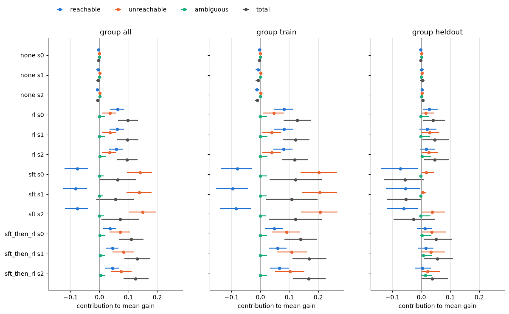
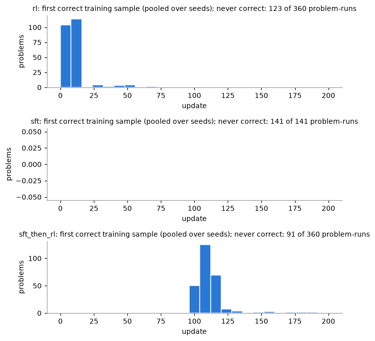
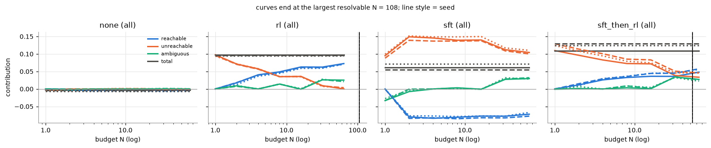
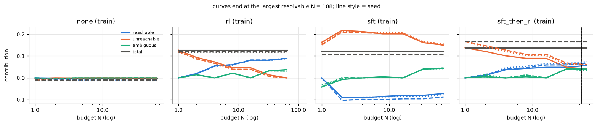
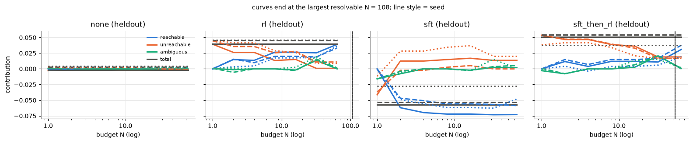

# LM experiment report: lm_main

Generated by `capsplit.harness.lm.report` from the files under this experiment folder; no number below is typed by hand.

## WARNINGS

```
!!!!!!!!!!!!!!!!!!!!!!!!!!!!!!!!!!!!!!!!!!!!!!!!!!!!!!!!!!!!!!!!!!!!!!!!!!!!!!
WARNING: NULL CHECK FAILED for group `all`: a fresh base sample scored as a 'trained' policy gives a total gain interval [-0.0130, -0.0032] that excludes 0. The measurement pipeline reports gains where there are none; treat every gain below with suspicion.
WARNING: NULL CHECK FAILED for group `train`: a fresh base sample scored as a 'trained' policy gives a total gain interval [-0.0156, -0.0043] that excludes 0. The measurement pipeline reports gains where there are none; treat every gain below with suspicion.
WARNING: Stages ['base'] ran from a working tree with uncommitted changes (manifest `dirty`).
!!!!!!!!!!!!!!!!!!!!!!!!!!!!!!!!!!!!!!!!!!!!!!!!!!!!!!!!!!!!!!!!!!!!!!!!!!!!!!
```

## Setup

| stage | model | revision | device | commit | dirty | python | torch | transformers |
|---|---|---|---|---|---|---|---|---|
| data | n/a | n/a | cpu | 4ddf5630eaef75d9cc2554592a7d1769ee131967 | False | 3.12.12 | 2.8.0 | 5.23.0 |
| base | Qwen/Qwen2.5-0.5B-Instruct | 7ae557604adf67be50417f59c2c2f167def9a775 | mps | 590a5595dfc699bf3c1941aadf38e39833471f6b | True | 3.12.12 | 2.8.0 | 5.23.0 |
| measure | Qwen/Qwen2.5-0.5B-Instruct | 7ae557604adf67be50417f59c2c2f167def9a775 | mps | ad4eceb5861a479c43bde466c37af398ea992022 | False | 3.12.12 | 2.8.0 | 5.23.0 |
| train none seed0 | Qwen/Qwen2.5-0.5B-Instruct | 7ae557604adf67be50417f59c2c2f167def9a775 | mps | 4cd48ecff61cd6c3d56f67979145bf0fd65aba67 | False | 3.12.12 | 2.8.0 | 5.23.0 |
| train none seed1 | Qwen/Qwen2.5-0.5B-Instruct | 7ae557604adf67be50417f59c2c2f167def9a775 | mps | 4cd48ecff61cd6c3d56f67979145bf0fd65aba67 | False | 3.12.12 | 2.8.0 | 5.23.0 |
| train none seed2 | Qwen/Qwen2.5-0.5B-Instruct | 7ae557604adf67be50417f59c2c2f167def9a775 | mps | 4cd48ecff61cd6c3d56f67979145bf0fd65aba67 | False | 3.12.12 | 2.8.0 | 5.23.0 |
| train rl seed0 | Qwen/Qwen2.5-0.5B-Instruct | 7ae557604adf67be50417f59c2c2f167def9a775 | mps | ad4eceb5861a479c43bde466c37af398ea992022 | False | 3.12.12 | 2.8.0 | 5.23.0 |
| train rl seed1 | Qwen/Qwen2.5-0.5B-Instruct | 7ae557604adf67be50417f59c2c2f167def9a775 | mps | ad4eceb5861a479c43bde466c37af398ea992022 | False | 3.12.12 | 2.8.0 | 5.23.0 |
| train rl seed2 | Qwen/Qwen2.5-0.5B-Instruct | 7ae557604adf67be50417f59c2c2f167def9a775 | mps | ad4eceb5861a479c43bde466c37af398ea992022 | False | 3.12.12 | 2.8.0 | 5.23.0 |
| train sft seed0 | Qwen/Qwen2.5-0.5B-Instruct | 7ae557604adf67be50417f59c2c2f167def9a775 | mps | ad4eceb5861a479c43bde466c37af398ea992022 | False | 3.12.12 | 2.8.0 | 5.23.0 |
| train sft seed1 | Qwen/Qwen2.5-0.5B-Instruct | 7ae557604adf67be50417f59c2c2f167def9a775 | mps | ad4eceb5861a479c43bde466c37af398ea992022 | False | 3.12.12 | 2.8.0 | 5.23.0 |
| train sft seed2 | Qwen/Qwen2.5-0.5B-Instruct | 7ae557604adf67be50417f59c2c2f167def9a775 | mps | ad4eceb5861a479c43bde466c37af398ea992022 | False | 3.12.12 | 2.8.0 | 5.23.0 |
| train sft_then_rl seed0 | Qwen/Qwen2.5-0.5B-Instruct | 7ae557604adf67be50417f59c2c2f167def9a775 | mps | ad4eceb5861a479c43bde466c37af398ea992022 | False | 3.12.12 | 2.8.0 | 5.23.0 |
| train sft_then_rl seed1 | Qwen/Qwen2.5-0.5B-Instruct | 7ae557604adf67be50417f59c2c2f167def9a775 | mps | ad4eceb5861a479c43bde466c37af398ea992022 | False | 3.12.12 | 2.8.0 | 5.23.0 |
| train sft_then_rl seed2 | Qwen/Qwen2.5-0.5B-Instruct | 7ae557604adf67be50417f59c2c2f167def9a775 | mps | ad4eceb5861a479c43bde466c37af398ea992022 | False | 3.12.12 | 2.8.0 | 5.23.0 |

Model loaded, as recorded by the manifests: `Qwen/Qwen2.5-0.5B-Instruct` @ `7ae557604adf67be50417f59c2c2f167def9a775`.

- Budget N = 16, alpha = 0.05, bootstrap 2000 resamples (seed 0), 20 temperature half-splits.
- Samples per problem: set A 400 (classification only), set B 64 (base rate), trained 64, temperature sweep 32 at T in [0.5, 0.7, 1.0, 1.3]; reference T = 1.0.
- Training budget 200 updates, checkpoints [0, 25, 50, 100, 200], seeds [0, 1, 2].
- Config model: `Qwen/Qwen2.5-0.5B-Instruct` @ `7ae557604adf67be50417f59c2c2f167def9a775` (fallback `HuggingFaceTB/SmolLM2-360M-Instruct`).

Arms:

| arm | trainer | params |
|---|---|---|
| none | lm_none | `{}` |
| rl | lm_rl | `{"group": 8, "lr": 0.0001, "micro_batch": 16, "problems_per_update": 8}` |
| sft | lm_sft | `{"batch": 8, "lr": 0.0001}` |
| sft_then_rl | lm_sft_then_rl | `{"rl": {"group": 8, "lr": 0.0001, "micro_batch": 16, "problems_per_update": 8}, "sft": {"batch": 8, "lr": 0.0001}, "sft_fraction": 0.5}` |

## Data

| split | difficulty | problems |
|---|---|---|
| heldout | d2_add | 10 |
| heldout | d2_mul | 10 |
| heldout | d3_add | 10 |
| heldout | d3_mul | 10 |
| heldout | d4_add | 10 |
| heldout | d4_mul | 10 |
| train | d2_add | 20 |
| train | d2_mul | 20 |
| train | d3_add | 20 |
| train | d3_mul | 20 |
| train | d4_add | 20 |
| train | d4_mul | 20 |

Total problems: 180.

## Base classification

From set A at T = 1.0: reachable iff the 95% Clopper-Pearson lower bound >= 1/N, unreachable iff the upper bound < 1/N (N = 16).

| scope | key | reachable | unreachable | ambiguous | total |
|---|---|---|---|---|---|
| overall | all | 104 | 73 | 3 | 180 |
| split | heldout | 31 | 26 | 3 | 60 |
| split | train | 73 | 47 | 0 | 120 |
| difficulty | d2_add | 30 | 0 | 0 | 30 |
| difficulty | d2_mul | 19 | 9 | 2 | 30 |
| difficulty | d3_add | 28 | 2 | 0 | 30 |
| difficulty | d3_mul | 0 | 30 | 0 | 30 |
| difficulty | d4_add | 27 | 2 | 1 | 30 |
| difficulty | d4_mul | 0 | 30 | 0 | 30 |
| split:difficulty | heldout:d2_add | 10 | 0 | 0 | 10 |
| split:difficulty | heldout:d2_mul | 4 | 4 | 2 | 10 |
| split:difficulty | heldout:d3_add | 9 | 1 | 0 | 10 |
| split:difficulty | heldout:d3_mul | 0 | 10 | 0 | 10 |
| split:difficulty | heldout:d4_add | 8 | 1 | 1 | 10 |
| split:difficulty | heldout:d4_mul | 0 | 10 | 0 | 10 |
| split:difficulty | train:d2_add | 20 | 0 | 0 | 20 |
| split:difficulty | train:d2_mul | 15 | 5 | 0 | 20 |
| split:difficulty | train:d3_add | 19 | 1 | 0 | 20 |
| split:difficulty | train:d3_mul | 0 | 20 | 0 | 20 |
| split:difficulty | train:d4_add | 19 | 1 | 0 | 20 |
| split:difficulty | train:d4_mul | 0 | 20 | 0 | 20 |

Base success rate (set B): all 0.5073; by split heldout 0.4690, train 0.5264.

## Split of the gain (final checkpoint)

Per arm and seed: total gain = mean(p̂1 - p̂0) and its three class contributions (each sums its class's gains and divides by all problems in the group), with bootstrap intervals (level 0.95; problems resampled, set-A counts redrawn and reclassified). E_1 / E_N: trained minus the base at the best temperature T* (chosen on the other half of a random split; T* is the modal choice and its frequency). Per-difficulty groups are in `tables/split.csv`.

| arm | seed | group | total | reachable | unreachable | ambiguous | E_1 [lo, hi] | T*(E_1) | E_N [lo, hi] | label |
|---|---|---|---|---|---|---|---|---|---|---|
| none | 0 | all | -0.0032 [-0.0074, +0.0014] | -0.0030 [-0.0071, +0.0015] | -0.0002 [-0.0010, +0.0003] | +0.0000 [-0.0006, +0.0008] | -0.0116 [-0.0218, -0.0016] | 0.5 (88%) | -0.0224 [-0.0444, -0.0003] | pure_sharpening |
| none | 0 | train | -0.0038 [-0.0096, +0.0026] | -0.0033 [-0.0090, +0.0030] | -0.0005 [-0.0013, +0.0001] | +0.0000 [-0.0008, +0.0000] | -0.0141 [-0.0267, +0.0014] | 0.5 (98%) | -0.0070 [-0.0327, +0.0120] | pure_sharpening |
| none | 0 | heldout | -0.0021 [-0.0073, +0.0031] | -0.0026 [-0.0076, +0.0021] | +0.0005 [-0.0010, +0.0016] | +0.0000 [-0.0013, +0.0023] | -0.0070 [-0.0224, +0.0029] | 0.5 (50%) | -0.0458 [-0.0875, +0.0026] | pure_sharpening |
| none | 1 | all | -0.0043 [-0.0105, +0.0009] | -0.0051 [-0.0109, -0.0001] | +0.0009 [-0.0003, +0.0017] | -0.0001 [-0.0006, +0.0009] | -0.0127 [-0.0229, -0.0031] | 0.5 (88%) | -0.0086 [-0.0283, +0.0126] | pure_sharpening |
| none | 1 | train | -0.0081 [-0.0161, -0.0012] | -0.0083 [-0.0161, -0.0016] | +0.0003 [-0.0008, +0.0010] | +0.0000 [-0.0005, +0.0008] | -0.0184 [-0.0303, -0.0031] | 0.5 (98%) | +0.0053 [-0.0143, +0.0257] | pure_sharpening |
| none | 1 | heldout | +0.0031 [-0.0039, +0.0104] | +0.0013 [-0.0049, +0.0081] | +0.0021 [-0.0005, +0.0049] | -0.0003 [-0.0013, +0.0026] | -0.0018 [-0.0172, +0.0094] | 0.5 (50%) | -0.0293 [-0.0709, +0.0229] | pure_sharpening |
| none | 2 | all | -0.0063 [-0.0116, -0.0016] | -0.0072 [-0.0123, -0.0028] | +0.0007 [-0.0002, +0.0016] | +0.0003 [-0.0001, +0.0007] | -0.0146 [-0.0255, -0.0043] | 0.5 (88%) | -0.0047 [-0.0238, +0.0164] | pure_sharpening |
| none | 2 | train | -0.0116 [-0.0186, -0.0051] | -0.0117 [-0.0186, -0.0053] | +0.0001 [-0.0008, +0.0009] | +0.0000 [-0.0003, +0.0004] | -0.0219 [-0.0350, -0.0060] | 0.5 (98%) | +0.0035 [-0.0164, +0.0226] | pure_sharpening |
| none | 2 | heldout | +0.0044 [+0.0003, +0.0089] | +0.0018 [-0.0018, +0.0055] | +0.0018 [+0.0003, +0.0042] | +0.0008 [+0.0000, +0.0018] | -0.0005 [-0.0133, +0.0091] | 0.5 (50%) | -0.0139 [-0.0555, +0.0382] | pure_sharpening |
| rl | 0 | all | +0.0980 [+0.0646, +0.1323] | +0.0628 [+0.0370, +0.0856] | +0.0358 [+0.0098, +0.0583] | -0.0006 [-0.0010, +0.0180] | +0.0896 [+0.0524, +0.1260] | 0.5 (88%) | +0.0096 [-0.0236, +0.0418] | capability |
| rl | 0 | train | +0.1271 [+0.0807, +0.1760] | +0.0810 [+0.0460, +0.1122] | +0.0461 [+0.0081, +0.0819] | +0.0000 [+0.0000, +0.0234] | +0.1168 [+0.0682, +0.1692] | 0.5 (98%) | +0.0402 [+0.0024, +0.0799] | capability |
| rl | 0 | heldout | +0.0398 [+0.0070, +0.0833] | +0.0266 [+0.0047, +0.0570] | +0.0151 [-0.0016, +0.0427] | -0.0018 [-0.0042, +0.0271] | +0.0349 [-0.0013, +0.0810] | 0.5 (50%) | -0.0442 [-0.1027, +0.0190] | compounded_sharpening |
| rl | 1 | all | +0.0962 [+0.0613, +0.1342] | +0.0613 [+0.0347, +0.0846] | +0.0358 [+0.0102, +0.0585] | -0.0009 [-0.0014, +0.0184] | +0.0878 [+0.0508, +0.1280] | 0.5 (88%) | +0.0052 [-0.0244, +0.0358] | capability |
| rl | 1 | train | +0.1215 [+0.0772, +0.1695] | +0.0819 [+0.0462, +0.1136] | +0.0396 [+0.0073, +0.0717] | +0.0000 [+0.0000, +0.0236] | +0.1112 [+0.0632, +0.1619] | 0.5 (98%) | +0.0318 [-0.0023, +0.0697] | capability |
| rl | 1 | heldout | +0.0456 [+0.0034, +0.0964] | +0.0201 [-0.0073, +0.0524] | +0.0281 [-0.0005, +0.0617] | -0.0026 [-0.0047, +0.0297] | +0.0407 [-0.0070, +0.0938] | 0.5 (50%) | -0.0407 [-0.1008, +0.0201] | compounded_sharpening |
| rl | 2 | all | +0.0944 [+0.0616, +0.1309] | +0.0589 [+0.0331, +0.0813] | +0.0347 [+0.0095, +0.0576] | +0.0009 [-0.0003, +0.0208] | +0.0861 [+0.0501, +0.1253] | 0.5 (88%) | +0.0231 [-0.0000, +0.0482] | capability |
| rl | 2 | train | +0.1185 [+0.0742, +0.1647] | +0.0796 [+0.0443, +0.1111] | +0.0389 [+0.0070, +0.0704] | +0.0000 [+0.0000, +0.0237] | +0.1082 [+0.0604, +0.1595] | 0.5 (98%) | +0.0318 [+0.0027, +0.0645] | capability |
| rl | 2 | heldout | +0.0464 [+0.0091, +0.0953] | +0.0174 [-0.0052, +0.0474] | +0.0263 [+0.0005, +0.0576] | +0.0026 [-0.0010, +0.0339] | +0.0415 [-0.0024, +0.0927] | 0.5 (50%) | +0.0129 [-0.0211, +0.0550] | compounded_sharpening |
| sft | 0 | all | +0.0619 [-0.0002, +0.1271] | -0.0774 [-0.1215, -0.0388] | +0.1400 [+0.0951, +0.1821] | -0.0007 [-0.0017, +0.0146] | +0.0535 [-0.0117, +0.1208] | 0.5 (88%) | +0.1155 [+0.0336, +0.1915] | compounded_sharpening |
| sft | 0 | train | +0.1215 [+0.0312, +0.2114] | -0.0801 [-0.1374, -0.0282] | +0.2016 [+0.1392, +0.2634] | +0.0000 [-0.0013, +0.0227] | +0.1112 [+0.0190, +0.2062] | 0.5 (98%) | +0.2132 [+0.1061, +0.3148] | capability |
| sft | 0 | heldout | -0.0573 [-0.1302, +0.0081] | -0.0721 [-0.1406, -0.0130] | +0.0169 [+0.0003, +0.0425] | -0.0021 [-0.0042, +0.0013] | -0.0622 [-0.1391, +0.0042] | 0.5 (50%) | -0.0725 [-0.1551, +0.0086] | compounded_sharpening |
| sft | 1 | all | +0.0546 [-0.0106, +0.1198] | -0.0823 [-0.1255, -0.0430] | +0.1378 [+0.0931, +0.1793] | -0.0009 [-0.0021, +0.0133] | +0.0462 [-0.0203, +0.1126] | 0.5 (88%) | +0.0985 [+0.0197, +0.1745] | compounded_sharpening |
| sft | 1 | train | +0.1085 [+0.0197, +0.1981] | -0.0956 [-0.1548, -0.0426] | +0.2040 [+0.1426, +0.2642] | +0.0000 [-0.0013, +0.0214] | +0.0982 [+0.0068, +0.1908] | 0.5 (98%) | +0.2083 [+0.1005, +0.3114] | capability |
| sft | 1 | heldout | -0.0531 [-0.1193, +0.0000] | -0.0557 [-0.1211, -0.0042] | +0.0052 [-0.0021, +0.0164] | -0.0026 [-0.0052, +0.0000] | -0.0580 [-0.1279, -0.0055] | 0.5 (50%) | -0.1138 [-0.1930, -0.0354] | compounded_sharpening |
| sft | 2 | all | +0.0718 [+0.0063, +0.1376] | -0.0772 [-0.1196, -0.0392] | +0.1498 [+0.1007, +0.1944] | -0.0009 [-0.0019, +0.0157] | +0.0634 [-0.0022, +0.1314] | 0.5 (88%) | +0.1179 [+0.0397, +0.1941] | compounded_sharpening |
| sft | 2 | train | +0.1214 [+0.0290, +0.2139] | -0.0849 [-0.1392, -0.0336] | +0.2062 [+0.1409, +0.2665] | +0.0000 [-0.0013, +0.0180] | +0.1110 [+0.0170, +0.2050] | 0.5 (98%) | +0.2054 [+0.0983, +0.3095] | capability |
| sft | 2 | heldout | -0.0273 [-0.0961, +0.0466] | -0.0617 [-0.1193, -0.0133] | +0.0370 [+0.0008, +0.0833] | -0.0026 [-0.0047, +0.0307] | -0.0322 [-0.1050, +0.0417] | 0.5 (50%) | -0.0499 [-0.1172, +0.0236] | compounded_sharpening |
| sft_then_rl | 0 | all | +0.1089 [+0.0671, +0.1526] | +0.0363 [+0.0134, +0.0575] | +0.0718 [+0.0349, +0.1047] | +0.0009 [-0.0014, +0.0180] | +0.1006 [+0.0569, +0.1462] | 0.5 (88%) | +0.0418 [-0.0021, +0.0836] | capability |
| sft_then_rl | 0 | train | +0.1380 [+0.0828, +0.1960] | +0.0484 [+0.0155, +0.0791] | +0.0896 [+0.0401, +0.1370] | +0.0000 [-0.0012, +0.0232] | +0.1277 [+0.0684, +0.1909] | 0.5 (98%) | +0.0758 [+0.0142, +0.1359] | capability |
| sft_then_rl | 0 | heldout | +0.0508 [+0.0073, +0.1052] | +0.0120 [-0.0141, +0.0352] | +0.0362 [+0.0005, +0.0841] | +0.0026 [-0.0031, +0.0328] | +0.0459 [-0.0039, +0.1037] | 0.5 (50%) | -0.0189 [-0.0794, +0.0406] | compounded_sharpening |
| sft_then_rl | 1 | all | +0.1297 [+0.0866, +0.1754] | +0.0444 [+0.0211, +0.0656] | +0.0831 [+0.0446, +0.1182] | +0.0022 [-0.0004, +0.0195] | +0.1213 [+0.0758, +0.1676] | 0.5 (88%) | +0.0655 [+0.0201, +0.1095] | capability |
| sft_then_rl | 1 | train | +0.1673 [+0.1112, +0.2275] | +0.0592 [+0.0283, +0.0910] | +0.1081 [+0.0560, +0.1603] | +0.0000 [-0.0013, +0.0230] | +0.1570 [+0.0980, +0.2197] | 0.5 (98%) | +0.1179 [+0.0521, +0.1837] | capability |
| sft_then_rl | 1 | heldout | +0.0544 [+0.0086, +0.1096] | +0.0148 [-0.0125, +0.0422] | +0.0331 [-0.0010, +0.0820] | +0.0065 [-0.0010, +0.0365] | +0.0495 [-0.0008, +0.1070] | 0.5 (50%) | -0.0319 [-0.0891, +0.0222] | compounded_sharpening |
| sft_then_rl | 2 | all | +0.1241 [+0.0831, +0.1690] | +0.0450 [+0.0202, +0.0681] | +0.0747 [+0.0398, +0.1104] | +0.0044 [-0.0005, +0.0199] | +0.1158 [+0.0720, +0.1638] | 0.5 (88%) | +0.0523 [+0.0106, +0.0924] | capability |
| sft_then_rl | 2 | train | +0.1672 [+0.1116, +0.2251] | +0.0655 [+0.0336, +0.0983] | +0.1017 [+0.0500, +0.1518] | +0.0000 [-0.0013, +0.0233] | +0.1569 [+0.0973, +0.2176] | 0.5 (98%) | +0.0973 [+0.0386, +0.1572] | capability |
| sft_then_rl | 2 | heldout | +0.0380 [-0.0026, +0.0922] | +0.0039 [-0.0232, +0.0333] | +0.0208 [+0.0000, +0.0656] | +0.0133 [-0.0010, +0.0380] | +0.0331 [-0.0151, +0.0891] | 0.5 (50%) | -0.0307 [-0.0855, +0.0230] | compounded_sharpening |



## Format validity

Fraction of sampled completions containing an integer (valid) and the fraction correct, so that format effects stay separate from arithmetic ability (DECISIONS L6).

| arm | tag | split | samples | valid | correct | correct given valid |
|---|---|---|---|---|---|---|
| base | base | all | 11520 | 0.9905 | 0.5073 | 0.5122 |
| base | base | train | 7680 | 0.9919 | 0.5264 | 0.5307 |
| base | base | heldout | 3840 | 0.9875 | 0.4690 | 0.4749 |
| none | none/seed0/step200 | all | 11520 | 0.9918 | 0.5041 | 0.5083 |
| none | none/seed0/step200 | train | 7680 | 0.9928 | 0.5227 | 0.5264 |
| none | none/seed0/step200 | heldout | 3840 | 0.9896 | 0.4669 | 0.4718 |
| none | none/seed1/step200 | all | 11520 | 0.9911 | 0.5030 | 0.5074 |
| none | none/seed1/step200 | train | 7680 | 0.9915 | 0.5184 | 0.5228 |
| none | none/seed1/step200 | heldout | 3840 | 0.9904 | 0.4721 | 0.4767 |
| none | none/seed2/step200 | all | 11520 | 0.9923 | 0.5010 | 0.5049 |
| none | none/seed2/step200 | train | 7680 | 0.9935 | 0.5148 | 0.5182 |
| none | none/seed2/step200 | heldout | 3840 | 0.9898 | 0.4734 | 0.4783 |
| rl | rl/seed0/step200 | all | 11520 | 0.9896 | 0.6053 | 0.6117 |
| rl | rl/seed0/step200 | train | 7680 | 0.9928 | 0.6535 | 0.6582 |
| rl | rl/seed0/step200 | heldout | 3840 | 0.9831 | 0.5089 | 0.5176 |
| rl | rl/seed1/step200 | all | 11520 | 0.9928 | 0.6035 | 0.6079 |
| rl | rl/seed1/step200 | train | 7680 | 0.9934 | 0.6479 | 0.6522 |
| rl | rl/seed1/step200 | heldout | 3840 | 0.9917 | 0.5146 | 0.5189 |
| rl | rl/seed2/step200 | all | 11520 | 0.9801 | 0.6017 | 0.6139 |
| rl | rl/seed2/step200 | train | 7680 | 0.9871 | 0.6449 | 0.6533 |
| rl | rl/seed2/step200 | heldout | 3840 | 0.9661 | 0.5154 | 0.5334 |
| sft | sft/seed0/step200 | all | 11520 | 0.9987 | 0.5692 | 0.5699 |
| sft | sft/seed0/step200 | train | 7680 | 0.9999 | 0.6479 | 0.6480 |
| sft | sft/seed0/step200 | heldout | 3840 | 0.9964 | 0.4117 | 0.4132 |
| sft | sft/seed1/step200 | all | 11520 | 0.9984 | 0.5619 | 0.5628 |
| sft | sft/seed1/step200 | train | 7680 | 0.9997 | 0.6349 | 0.6351 |
| sft | sft/seed1/step200 | heldout | 3840 | 0.9958 | 0.4159 | 0.4176 |
| sft | sft/seed2/step200 | all | 11520 | 0.9990 | 0.5791 | 0.5797 |
| sft | sft/seed2/step200 | train | 7680 | 0.9997 | 0.6478 | 0.6480 |
| sft | sft/seed2/step200 | heldout | 3840 | 0.9974 | 0.4417 | 0.4428 |
| sft_then_rl | sft_then_rl/seed0/step200 | all | 11520 | 1.0000 | 0.6162 | 0.6162 |
| sft_then_rl | sft_then_rl/seed0/step200 | train | 7680 | 1.0000 | 0.6645 | 0.6645 |
| sft_then_rl | sft_then_rl/seed0/step200 | heldout | 3840 | 1.0000 | 0.5198 | 0.5198 |
| sft_then_rl | sft_then_rl/seed1/step200 | all | 11520 | 0.9995 | 0.6370 | 0.6373 |
| sft_then_rl | sft_then_rl/seed1/step200 | train | 7680 | 0.9999 | 0.6937 | 0.6938 |
| sft_then_rl | sft_then_rl/seed1/step200 | heldout | 3840 | 0.9987 | 0.5234 | 0.5241 |
| sft_then_rl | sft_then_rl/seed2/step200 | all | 11520 | 0.9985 | 0.6314 | 0.6324 |
| sft_then_rl | sft_then_rl/seed2/step200 | train | 7680 | 1.0000 | 0.6936 | 0.6936 |
| sft_then_rl | sft_then_rl/seed2/step200 | heldout | 3840 | 0.9956 | 0.5070 | 0.5093 |

## Stage durations

Wall-clock time of each stage, measured by the command itself (`timing/<stage>.jsonl`, one line per invocation; a resumed stage has several). A stage with no file was run by a version that did not record its duration.

| stage | invocations | total wall s | total wall h |
|---|---|---|---|
| speedtest | 0 | not recorded | not recorded |
| data | 0 | not recorded | not recorded |
| base | 0 | not recorded | not recorded |
| train | 1 | 4265 | 1.18 |
| measure | 1 | 4920 | 1.37 |
| report | 1 | 1 | 0.00 |
| verdicts | 1 | 1 | 0.00 |

## Training

Arms are matched on optimizer updates, not on samples (H20): the episodes and tokens each arm sampled are listed. N_train = mean episodes per training problem the arm sampled (H51). Timings are measured wall-clock times from `timing.json`.

| arm | seed | log | updates | episodes | tokens | problems sampled | ever correct | N_train | wall s | s / update |
|---|---|---|---|---|---|---|---|---|---|---|
| none | 0 | present | 200 | 0 | 0 | 0 | 0 | n/a | 0.4 | 0.00 |
| none | 1 | present | 200 | 0 | 0 | 0 | 0 | n/a | 0.3 | 0.00 |
| none | 2 | present | 200 | 0 | 0 | 0 | 0 | n/a | 0.3 | 0.00 |
| rl | 0 | present | 200 | 12800 | 75087 | 120 | 80 | 106.7 | 837.1 | 4.19 |
| rl | 1 | present | 200 | 12800 | 74409 | 120 | 79 | 106.7 | 909.3 | 4.55 |
| rl | 2 | present | 200 | 12800 | 74066 | 120 | 78 | 106.7 | 833.6 | 4.17 |
| sft | 0 | present | 200 | 0 | 0 | 0 | 0 | 0.0 | 74.5 | 0.37 |
| sft | 1 | present | 200 | 0 | 0 | 0 | 0 | 0.0 | 89.2 | 0.45 |
| sft | 2 | present | 200 | 0 | 0 | 0 | 0 | 0.0 | 94.9 | 0.47 |
| sft_then_rl | 0 | present | 200 | 6400 | 37078 | 120 | 87 | 53.3 | 434.0 | 2.17 |
| sft_then_rl | 1 | present | 200 | 6400 | 36865 | 120 | 91 | 53.3 | 521.3 | 2.61 |
| sft_then_rl | 2 | present | 200 | 6400 | 36637 | 120 | 91 | 53.3 | 465.7 | 2.33 |

First update in which training sampled a correct answer, per training problem (`tables/first_success.csv`):



## Null check

The same pipeline with a fresh base sample (set `null`) in place of the trained policy. It passes iff the total gain's interval contains 0.

| group | total [lo, hi] | result |
|---|---|---|
| all | -0.0078 [-0.0130, -0.0032] | **FAILED** |
| train | -0.0098 [-0.0156, -0.0043] | **FAILED** |
| heldout | -0.0039 [-0.0133, +0.0042] | PASS |

## Budget curve

Contributions as a function of N (log axis), reclassifying at each N from the same counts. The curve is truncated at the largest resolvable N = 108: with 400 set-A samples per problem no problem can be classified unreachable beyond it (the Clopper-Pearson upper bound for 0 successes exceeds 1/N). The vertical line marks N_train from the training log.





Full values: `tables/budget_curve.csv`.

## What this cannot show

- **One small model.** Every result is for one ~0.5B instruct checkpoint at one revision; nothing here says how larger or differently trained models behave.
- **Generated problems.** The problems are synthetic arithmetic; reachability on them need not transfer to natural tasks.
- **Sampled, not exact.** Success probabilities and the reachable / unreachable classes are estimated from finitely many samples; 'unreachable' means 'upper bound below 1/N at 95% confidence', and nothing beyond N = 108 can be resolved.
- **LoRA only.** Training updates a low-rank adapter on a few projection matrices; full fine-tuning could behave differently.
- **Finite budget and few seeds.** One update budget and the listed seeds; slower effects or rare runs are not covered.

## Files

- `tables/base_classes.csv`
- `tables/budget_curve.csv`
- `tables/data.csv`
- `tables/first_success.csv`
- `tables/format_validity.csv`
- `tables/null_check.csv`
- `tables/setup.csv`
- `tables/split.csv`
- `tables/training.csv`
- `figures/budget_curve_all.png`
- `figures/budget_curve_heldout.png`
- `figures/budget_curve_train.png`
- `figures/contributions.png`
- `figures/first_success.png`
