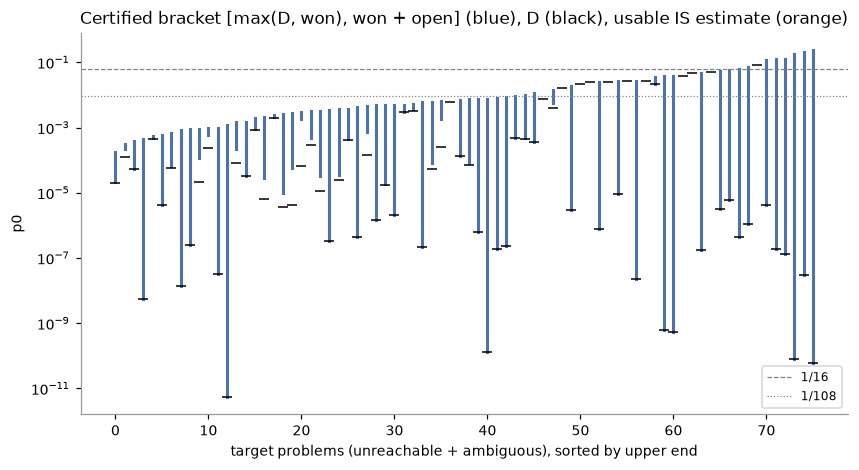
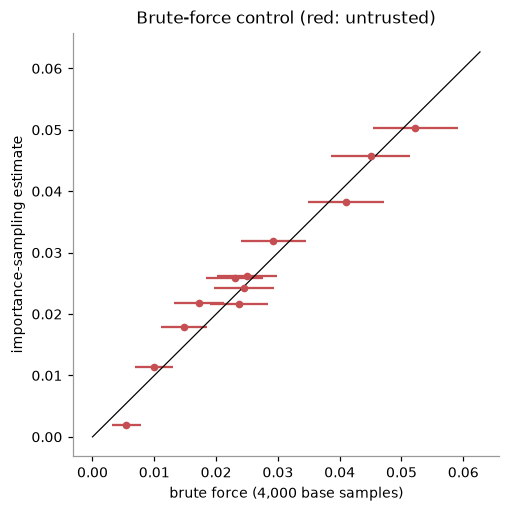
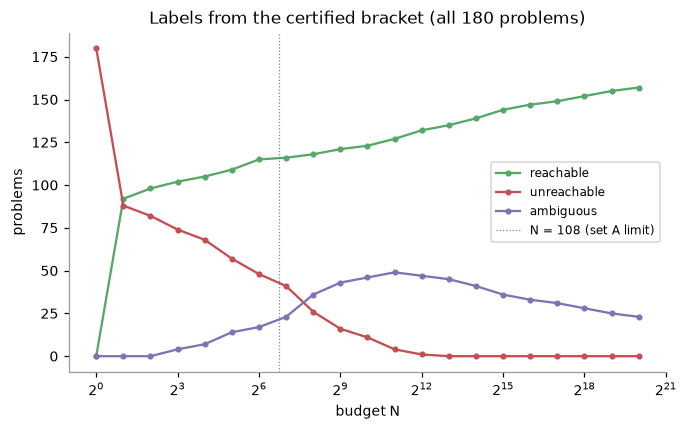

<!-- generated by scripts/publish_lm_tail.sh from results/lm_main_tail; edit answer.md, not this file -->
# Base-model tail probability: the answer in plain words

**Question:** for the problems the base model almost never solves, how likely is it to solve one, and does knowing that change the reachability labels or the discovery test?

**Answer:**
- **Certified intervals.** Every problem has one: an exact bracket, exact up to the model's float16 arithmetic.
  - About two problems in five of the target set have a tight bracket. These are mostly addition and smaller multiplication.
  - The rest, mostly 4-digit multiplication, are loose. Their upper end is limited by the unexpanded mass, not by the model.
  - The counts are in the generated report below.
- **Importance-sampling estimates: none usable.** The registered stop gate failed, so this layer reports brackets only.
- **Labels:** they change once the budget goes past the old curve's end. Problems called unreachable at the main run's budgets become ambiguous or reachable, and well before the largest budget no problem remains certified unreachable.
- **Discovery test:** it gains nothing decisive. Where RL saw no correct base sample, the bracket allows anywhere from about one predicted discovery to many, against none observed. The bracket is too loose to say whether zero discoveries is surprising.

## Negative results, stated first

1. **The stop gate failed on both controls** (DECISIONS L43). Neither failure points to a bug in the bracket or the estimator.
   - **Known-answer control.** It failed on one problem, and across the trusted problems its z values lean negative. The diagnosis (`diagnostics.txt`) points to three things:
     - **A rare draw.** On the failing problem, the proposal component that produces almost all correct samples was drawn unusually rarely.
     - **Float16 numerics.** On the Mac GPU, a completion's log-probability depends on the batch it is scored in, by up to about a tenth of a nat. That was enough to push this problem over the line. The noise averages out across problems, but the estimator's standard errors do not include it. In float32 on CPU it disappears.
     - **An unexplained lean.** After both effects are accounted for, a small downward lean of the estimates against D remains.
     - The proposal densities themselves check out: the scored and sampled values agree.
   - **Brute-force control.** No problem met the trust rule.
     - This was a flaw in my design. The control problems were ones where the bracket had already resolved nearly all the mass, so importance sampling had almost nothing left to estimate.
     - The brute-force rates did agree with the brackets themselves. That comparison was not registered as a check.
2. **Your prediction P2 is not supported as certified.** Most never-correct problems do not have a certified upper end below one in a thousand. Their lower bound D is below that level for all of them, so the claim may well be true, but this budget cannot certify it. P2 as estimated cannot be assessed, because there are no usable estimates.
3. **Your prediction P3 is not supported.** The predicted discovery count at the bracket's upper end is far above the registered line. My counter-prediction P3' holds: the bracket is too loose to rule discoveries out.
4. **Your prediction P1 is not supported in the registered form.** Tight and loose multiplication brackets have practically the same first-token digit probability: the model almost always starts with a digit. What separates them is how many digit paths are left unexpanded, not the opening token.

## What held

- **Checks against the samples:** the lower bound D and every bracket agree with the base samples at the registered level, so no bug was flagged. Gate 1 passed: D captures nearly all of the measured success where that success is measurable.
- **P1' (mine), fewer than half of the targets tight:** supported.
- **Discovery, with all unreachable observations pooled:** the bracket's lower end already predicts at least as many discoveries as the earlier sampled estimate. The observed count sits at its low edge.
- **Problem 178:** its brute-force rate sat above its bracket's upper end. A re-draw and a second seed showed this was a high draw, not a bug (L44).

## Independent re-derivation

`scripts/rederive_tail.py` recomputes one D, one bracket and one importance-sampling estimate without importing the tail code. Its output and the differences from the stage are in `rederivation.txt`.
- **D:** in float16 on the GPU, the re-derivation reproduces the stage's value to rounding. In float32 on CPU it comes out a few percent lower.
  - Measured against the float32 D, the failing known-answer problem would no longer cross the line.
  - So whether the known-answer control fails depends on numeric precision.
- **Bracket:** the independent implementation, run at a smaller budget, is sound and contains the stage's bracket.
- **Importance-sampling estimates:** they match exactly.
- **Not re-derived:** the tree region of each sample, and the teacher-forced log-probabilities, which were taken from the stored rows.

## Caveats

- **Scope:** one 0.5B model and 12-token arithmetic completions.
- **Unresolved:** the main run's null-check failure (z = −3.2).
- **Precision:** "certified" means exact for the float16 model on MPS. The same strings differ by a noticeable fraction of a nat in float32, and between batch compositions in float16.
- **Silent misses:** importance sampling can miss success strings its proposals never visit. The bracket cannot, but it is only as tight as its budget.
- **Order:** the pre-registration was written after the main results were known. The diagnosis of the failed gate was done after seeing it.

# Tail success probability of the base model: lm_main

Generated by `capsplit.harness.lm.tail_report` from `results/<name>_tail/`; no number is typed by hand. Pre-registered in `preregistration_tail.md` (tag `lm-tail-prereg`). Method credit: sequence-level importance sampling for rare LM outputs follows Angell et al., *Estimating Tail Risks in Language Model Output Distributions* (ICML 2026, arXiv:2604.22167); here it is applied to per-problem correctness.

Reference base samples (temperature 1 draws from pi0): {'A': 72000, 'B': 11520, 'C': 5760, 'null': 11520}.

## Step 1: exact lower bound D

- D above the one-sided CP upper bound at level 1 - 0.05/180 (a bug if any): none; at the unadjusted one-sided 95% level: [14, 77, 126].
- Gate 1 (D / p-hat >= 0.1 on the 116 problems with p-hat >= 0.01): **passed**; failing problems: none; quantiles of D / p-hat: 0.0: 0.456, 0.1: 0.973, 0.5: 0.998, 0.9: 1.04, 1.0: 1.66.

## Step 2: exact bracket

- Bracket outside the two-sided CP interval at level 1 - 0.05/180 (a bug if any): none; at the unadjusted 95% level: [14, 44, 126, 135].
- Largest |1 - total mass| over problems: 7.89e-07.

Target problems (unreachable + ambiguous): 76. Upper / lower ratio: <= 2 for 20, <= 10 for 30, infinite (lower end 0) for 0. Median width 0.00333; median upper end 0.00724; median lower end 3.44e-05.

## Step 3: importance sampling of the open remainder

Per-token gap between sampling-time and teacher-forced log q of the sampled component: max 0.215, mean 0.00381.

- Known-answer control (estimate D from the same samples): 46 problems pass the trust rule; |z| > 3.5 for [138] -> **FAILED**.
- Brute-force control (12 problems, 4,000 base samples each): 0 trusted; |z| > 3.0 for none -> **FAILED**.
- **Stop gate: FAILED: only the exact brackets are used.**

| problem | p-hat (560) | brute force | IS estimate [95%] | trusted | z | bracket |
|---|---|---|---|---|---|---|
| 5 | 0.0161 | 0.023 (92/4000) | 0.0259 ± 0 | False | 1.2 | [0.0259, 0.026] |
| 42 | 0.0357 | 0.0522 (209/4000) | 0.0503 ± 0 | False | -0.56 | [0.0503, 0.0506] |
| 44 | 0.0161 | 0.0293 (117/4000) | 0.032 ± 0 | False | 1 | [0.032, 0.0331] |
| 45 | 0.0232 | 0.0147 (59/4000) | 0.0179 ± 0 | False | 1.7 | [0.0179, 0.018] |
| 56 | 0.0196 | 0.0245 (98/4000) | 0.0242 ± 0 | False | -0.13 | [0.0242, 0.0242] |
| 80 | 0.0429 | 0.045 (180/4000) | 0.0458 ± 0 | False | 0.24 | [0.0458, 0.046] |
| 97 | 0.0161 | 0.0238 (95/4000) | 0.0216 ± 0 | False | -0.9 | [0.0216, 0.0218] |
| 100 | 0.0393 | 0.041 (164/4000) | 0.0383 ± 0 | False | -0.85 | [0.0384, 0.0394] |
| 113 | 0.0161 | 0.0173 (69/4000) | 0.0218 ± 0 | False | 2.2 | [0.0218, 0.0348] |
| 139 | 0.0161 | 0.01 (40/4000) | 0.0114 ± 0 | False | 0.87 | [0.0114, 0.0116] |
| 165 | 0.0339 | 0.025 (100/4000) | 0.0263 ± 0 | False | 0.52 | [0.0263, 0.0263] |
| 178 | 0.00714 | 0.0055 (22/4000) | 0.00189 ± 0 | False | -3.1 | [0.00189, 0.00299] |

Target problems with a usable estimate (trust rule passed and stop gate passed): 0 of 76; the rest are bracket-only. Estimates outside their bracket: none. Samples whose tree region contradicts the checker: 0.

| problem | difficulty | split | class | k/560 | D | bracket | IS estimate | trust |
|---|---|---|---|---|---|---|---|---|
| 111 | d4_add | train | unreachable | 0 | 2.01e-05 | [2.21e-05, 0.000172] | 2.21e-05 ± 0 | bracket only |
| 19 | d2_mul | heldout | unreachable | 0 | 0.000127 | [0.000214, 0.000321] | 0.000214 ± 0 | bracket only |
| 134 | d3_mul | heldout | unreachable | 0 | 5.46e-05 | [5.51e-05, 0.000385] | 5.51e-05 ± 0 | bracket only |
| 8 | d4_mul | train | unreachable | 0 | 5.43e-09 | [5.43e-09, 0.000457] | 4.6e-09 ± 8.05e-10 | bracket only |
| 1 | d3_add | heldout | unreachable | 0 | 0.00046 | [0.000488, 0.000554] | 0.000488 ± 0 | bracket only |
| 36 | d3_mul | train | unreachable | 0 | 4.07e-06 | [4.07e-06, 0.000573] | 3.86e-06 ± 0 | bracket only |
| 16 | d3_mul | train | unreachable | 0 | 5.95e-05 | [6.55e-05, 0.000663] | 6.55e-05 ± 0 | bracket only |
| 151 | d4_mul | train | unreachable | 0 | 1.4e-08 | [1.4e-08, 0.000819] | 1.53e-08 ± 1.74e-09 | bracket only |
| 65 | d4_mul | train | unreachable | 0 | 2.51e-07 | [2.53e-07, 0.000873] | 2.53e-07 ± 0 | bracket only |
| 29 | d3_mul | train | unreachable | 0 | 2.12e-05 | [0.000118, 0.000877] | 0.000118 ± 0 | bracket only |
| 18 | d2_mul | train | unreachable | 0 | 0.000237 | [0.000609, 0.000956] | 0.000609 ± 0 | bracket only |
| 155 | d4_mul | train | unreachable | 0 | 3.22e-08 | [3.22e-08, 0.000995] | 3.2e-08 ± 3.92e-09 | bracket only |
| 74 | d4_mul | train | unreachable | 0 | 5.54e-12 | [5.54e-12, 0.00121] | 5.26e-12 ± 1.11e-12 | bracket only |
| 73 | d2_mul | train | unreachable | 0 | 8.36e-05 | [0.000218, 0.00148] | 0.000218 ± 0 | bracket only |
| 71 | d3_mul | heldout | unreachable | 0 | 3.25e-05 | [3.26e-05, 0.00149] | 3.26e-05 ± 0 | bracket only |
| 83 | d3_mul | train | unreachable | 1 | 0.000839 | [0.000904, 0.00194] | 0.000904 ± 0 | bracket only |
| 128 | d3_mul | heldout | unreachable | 0 | 6.32e-06 | [2.82e-05, 0.00205] | 2.82e-05 ± 0 | bracket only |
| 63 | d2_mul | heldout | unreachable | 1 | 0.00197 | [0.00207, 0.00245] | 0.00207 ± 0 | bracket only |
| 164 | d3_mul | heldout | unreachable | 0 | 3.66e-06 | [9.54e-06, 0.00253] | 9.54e-06 ± 0 | bracket only |
| 81 | d3_mul | train | unreachable | 0 | 4.16e-06 | [5.57e-05, 0.00287] | 5.57e-05 ± 0 | bracket only |
| 178 | d3_mul | train | unreachable | 4 | 6.42e-05 | [0.00189, 0.00299] | 0.00189 ± 0 | bracket only |
| 116 | d3_mul | train | unreachable | 1 | 0.000295 | [0.000484, 0.00314] | 0.000484 ± 0 | bracket only |
| 120 | d3_mul | train | unreachable | 0 | 1.11e-05 | [3.33e-05, 0.00332] | 3.33e-05 ± 0 | bracket only |
| 122 | d4_mul | heldout | unreachable | 0 | 3.38e-07 | [3.38e-07, 0.00337] | 3.33e-07 ± 0 | bracket only |
| 12 | d3_mul | train | unreachable | 0 | 2.54e-05 | [3.55e-05, 0.00363] | 3.55e-05 ± 0 | bracket only |
| 138 | d3_mul | train | unreachable | 0 | 0.000417 | [0.000442, 0.00368] | 0.000442 ± 0 | bracket only |
| 92 | d3_mul | train | unreachable | 0 | 4.53e-07 | [4.53e-07, 0.00437] | 4.51e-07 ± 6.72e-08 | bracket only |
| 141 | d3_mul | train | unreachable | 0 | 0.000149 | [0.000733, 0.00453] | 0.000733 ± 0 | bracket only |
| 158 | d4_mul | heldout | unreachable | 0 | 1.43e-06 | [1.43e-06, 0.00478] | 1.42e-06 ± 0 | bracket only |
| 157 | d3_mul | heldout | unreachable | 0 | 1.69e-05 | [1.87e-05, 0.00492] | 1.87e-05 ± 0 | bracket only |
| 166 | d3_mul | heldout | unreachable | 0 | 2.01e-06 | [2.03e-06, 0.00492] | 2.03e-06 ± 0 | bracket only |
| 161 | d3_mul | heldout | unreachable | 1 | 0.00298 | [0.00298, 0.00507] | 0.00293 ± 0 | bracket only |
| 57 | d3_mul | train | unreachable | 2 | 0.00327 | [0.00374, 0.00509] | 0.00374 ± 0 | bracket only |
| 58 | d4_mul | heldout | unreachable | 0 | 2.15e-07 | [2.15e-07, 0.00612] | 0 ± 0 | bracket only |
| 130 | d3_mul | train | unreachable | 0 | 5.32e-05 | [8.43e-05, 0.00614] | 8.43e-05 ± 0 | bracket only |
| 72 | d3_mul | heldout | unreachable | 1 | 0.000245 | [0.00186, 0.00632] | 0.00186 ± 0 | bracket only |
| 119 | d2_mul | heldout | unreachable | 1 | 0.0062 | [0.00659, 0.00668] | 0.00659 ± 0 | bracket only |
| 70 | d4_mul | train | unreachable | 0 | 0.000136 | [0.000136, 0.007] | 0.000135 ± 0 | bracket only |
| 79 | d3_mul | heldout | unreachable | 0 | 7.04e-05 | [8.39e-05, 0.00748] | 8.39e-05 ± 0 | bracket only |
| 76 | d4_mul | train | unreachable | 0 | 6.09e-07 | [6.09e-07, 0.0075] | 5e-07 ± 6.92e-07 | bracket only |
| 160 | d4_mul | heldout | unreachable | 0 | 1.35e-10 | [1.35e-10, 0.00763] | 0 ± 0 | bracket only |
| 47 | d4_mul | heldout | unreachable | 0 | 1.88e-07 | [1.88e-07, 0.00796] | 0 ± 0 | bracket only |
| 172 | d4_mul | train | unreachable | 0 | 2.38e-07 | [2.38e-07, 0.00846] | 2.21e-07 ± 2.37e-08 | bracket only |
| 67 | d3_mul | train | unreachable | 0 | 0.000477 | [0.000493, 0.00943] | 0.000493 ± 0 | bracket only |
| 34 | d3_mul | train | unreachable | 2 | 0.000435 | [0.000469, 0.00979] | 0.000469 ± 0 | bracket only |
| 129 | d3_mul | train | unreachable | 0 | 0.000354 | [0.000362, 0.0112] | 0.000362 ± 0 | bracket only |
| 139 | d3_mul | heldout | unreachable | 9 | 0.00733 | [0.0114, 0.0116] | 0.0114 ± 0 | bracket only |
| 148 | d3_mul | train | unreachable | 1 | 0.00385 | [0.00553, 0.0137] | 0.00553 ± 0 | bracket only |
| 45 | d2_mul | train | unreachable | 13 | 0.0166 | [0.0179, 0.018] | 0.0179 ± 0 | bracket only |
| 66 | d4_mul | heldout | unreachable | 0 | 2.92e-06 | [2.92e-06, 0.0194] | 0 ± 0 | bracket only |
| 97 | d2_mul | heldout | unreachable | 9 | 0.0212 | [0.0216, 0.0218] | 0.0216 ± 0 | bracket only |
| 56 | d2_mul | train | unreachable | 11 | 0.0241 | [0.0242, 0.0242] | 0.0242 ± 0 | bracket only |
| 154 | d4_mul | train | unreachable | 0 | 7.54e-07 | [7.54e-07, 0.0256] | 7.24e-07 ± 4.46e-07 | bracket only |
| 5 | d2_mul | train | unreachable | 9 | 0.025 | [0.0259, 0.026] | 0.0259 ± 0 | bracket only |
| 101 | d4_mul | heldout | unreachable | 0 | 9.19e-06 | [9.49e-06, 0.0263] | 9.49e-06 ± 0 | bracket only |
| 165 | d3_add | train | unreachable | 19 | 0.0263 | [0.0263, 0.0263] | 0.0263 ± 0 | bracket only |
| 9 | d4_mul | train | unreachable | 0 | 2.31e-08 | [2.31e-08, 0.0266] | 2.65e-08 ± 5.86e-09 | bracket only |
| 44 | d3_mul | train | unreachable | 9 | 0.0266 | [0.032, 0.0331] | 0.032 ± 0 | bracket only |
| 113 | d3_mul | train | unreachable | 9 | 0.0212 | [0.0218, 0.0348] | 0.0218 ± 0 | bracket only |
| 3 | d4_mul | train | unreachable | 0 | 6.13e-10 | [6.13e-10, 0.0377] | 1.57e-09 ± 3.07e-09 | bracket only |
| 149 | d4_mul | train | unreachable | 0 | 5.34e-10 | [5.34e-10, 0.0383] | 4.89e-10 ± 4.78e-10 | bracket only |
| 100 | d2_mul | heldout | ambiguous | 22 | 0.0384 | [0.0384, 0.0394] | 0.0383 ± 0 | bracket only |
| 80 | d4_add | heldout | ambiguous | 24 | 0.0458 | [0.0458, 0.046] | 0.0458 ± 0 | bracket only |
| 64 | d4_mul | train | unreachable | 0 | 1.77e-07 | [1.77e-07, 0.0487] | 1.87e-07 ± 6.29e-08 | bracket only |
| 42 | d4_add | heldout | unreachable | 20 | 0.0493 | [0.0503, 0.0506] | 0.0503 ± 0 | bracket only |
| 89 | d4_mul | train | unreachable | 0 | 3.16e-06 | [3.16e-06, 0.0533] | 5.3e-06 ± 4.23e-06 | bracket only |
| 177 | d4_mul | train | unreachable | 0 | 6.21e-06 | [6.21e-06, 0.0571] | 0 ± 0 | bracket only |
| 146 | d4_mul | train | unreachable | 0 | 4.38e-07 | [4.38e-07, 0.0614] | 4.59e-07 ± 1.52e-07 | bracket only |
| 49 | d4_mul | train | unreachable | 0 | 1.1e-06 | [1.1e-06, 0.0717] | 1.15e-06 ± 1.77e-07 | bracket only |
| 55 | d2_mul | heldout | ambiguous | 40 | 0.0838 | [0.0838, 0.0848] | 0.0836 ± 0 | bracket only |
| 112 | d4_mul | train | unreachable | 0 | 4.25e-06 | [4.25e-06, 0.116] | 3.41e-06 ± 1.11e-06 | bracket only |
| 82 | d4_mul | train | unreachable | 0 | 1.87e-07 | [1.87e-07, 0.125] | 1.76e-07 ± 1.4e-07 | bracket only |
| 43 | d4_mul | heldout | unreachable | 0 | 1.37e-07 | [1.37e-07, 0.129] | 0 ± 0 | bracket only |
| 30 | d4_mul | train | unreachable | 0 | 8.15e-11 | [8.15e-11, 0.182] | 8.62e-11 ± 1.6e-11 | bracket only |
| 125 | d4_mul | heldout | unreachable | 0 | 3.04e-08 | [3.04e-08, 0.214] | 0 ± 0 | bracket only |
| 127 | d4_mul | heldout | unreachable | 0 | 6.22e-11 | [6.22e-11, 0.233] | 0 ± 0 | bracket only |

## Step 4: discovery with bracketed p0

Waiting-time model as in `discovery_lm.md`: predicted discoveries sum_i [1 - (1 - p_i)^(G D_i)]. For the unreachable observations with p-hat_A = 0, p_i runs over the certified bracket (and the bracket narrowed by usable IS intervals).

| arm | earlier: predicted / observed (all unreachable) | p-hat_A = 0: observations (problems) | observed | predicted, bracket | predicted, bracket narrowed by IS | all unreachable, bracket |
|---|---|---|---|---|---|---|
| rl | 20.10 / 18 | 105 (35) | 0 | [1.06, 54.6] | [1.06, 54.6] | [21.16, 74.73] vs 18 |

## Step 4: budget curve past N = 108 (labels from the certified bracket)

reachable iff lower end >= 1/N; unreachable iff upper end < 1/N; ambiguous otherwise. Contributions: mean over problems of (p-hat1 eval - p-hat0 set B) x 1[label], averaged over seeds.

| N | reachable | unreachable | ambiguous | rl: unreachable contrib. | sft: unreachable contrib. | sft_then_rl: unreachable contrib. | rl: ambiguous contrib. | sft: ambiguous contrib. | sft_then_rl: ambiguous contrib. |
|---|---|---|---|---|---|---|---|---|---|
| 1 | 0 | 180 | 0 | +0.0962 | +0.0628 | +0.1209 | +0.0000 | +0.0000 | +0.0000 |
| 2 | 92 | 88 | 0 | +0.0761 | +0.1463 | +0.1075 | +0.0000 | +0.0000 | +0.0000 |
| 4 | 98 | 82 | 0 | +0.0573 | +0.1438 | +0.0927 | +0.0000 | +0.0000 | +0.0000 |
| 8 | 102 | 74 | 4 | +0.0448 | +0.1431 | +0.0832 | +0.0000 | +0.0019 | +0.0000 |
| 16 | 105 | 68 | 7 | +0.0353 | +0.1354 | +0.0787 | +0.0000 | +0.0067 | +0.0000 |
| 32 | 109 | 57 | 14 | +0.0201 | +0.1224 | +0.0639 | +0.0053 | +0.0130 | +0.0053 |
| 64 | 115 | 48 | 17 | +0.0037 | +0.0977 | +0.0417 | +0.0000 | +0.0098 | +0.0000 |
| 128 | 116 | 41 | 23 | +0.0037 | +0.0825 | +0.0409 | -0.0001 | +0.0251 | +0.0008 |
| 256 | 118 | 26 | 36 | +0.0035 | +0.0649 | +0.0332 | +0.0001 | +0.0398 | +0.0082 |
| 512 | 121 | 16 | 43 | +0.0021 | +0.0473 | +0.0264 | +0.0016 | +0.0520 | +0.0100 |
| 1024 | 123 | 11 | 46 | +0.0021 | +0.0330 | +0.0212 | -0.0001 | +0.0637 | +0.0153 |
| 2048 | 127 | 4 | 49 | +0.0000 | +0.0082 | +0.0056 | +0.0020 | +0.0749 | +0.0245 |
| 4096 | 132 | 1 | 47 | +0.0000 | +0.0056 | +0.0056 | +0.0000 | +0.0649 | +0.0170 |
| 8192 | 135 | 0 | 45 | +0.0000 | +0.0000 | +0.0000 | +0.0000 | +0.0620 | +0.0174 |
| 16384 | 139 | 0 | 41 | +0.0000 | +0.0000 | +0.0000 | +0.0000 | +0.0545 | +0.0136 |
| 32768 | 144 | 0 | 36 | +0.0000 | +0.0000 | +0.0000 | +0.0000 | +0.0445 | +0.0086 |
| 65536 | 147 | 0 | 33 | +0.0000 | +0.0000 | +0.0000 | +0.0000 | +0.0390 | +0.0030 |
| 131072 | 149 | 0 | 31 | +0.0000 | +0.0000 | +0.0000 | +0.0000 | +0.0390 | +0.0030 |
| 262144 | 152 | 0 | 28 | +0.0000 | +0.0000 | +0.0000 | +0.0000 | +0.0348 | +0.0027 |
| 524288 | 155 | 0 | 25 | +0.0000 | +0.0000 | +0.0000 | +0.0000 | +0.0346 | +0.0027 |
| 1048576 | 157 | 0 | 23 | +0.0000 | +0.0000 | +0.0000 | +0.0000 | +0.0307 | +0.0027 |

Secondary version with brackets narrowed by usable IS intervals: `tables/budget_curve_is.csv`.

## d(p1 || p0) / KL per arm (target problems; p0 = bracket upper end)

d is the Bernoulli KL with the raw eval p-hat1; it is undefined (infinite) when p0 = 0 and p-hat1 > 0, and those cells are left out and counted.

| arm | cells | undefined cells | sum d / sum KL |
|---|---|---|---|
| rl | 228 | 0 | 0.113 |
| sft | 228 | 0 | 0.176 |
| sft_then_rl | 228 | 0 | 0.149 |

## Predictions

- P1 (user): 3- and 4-digit multiplication targets: 14 tight (upper/lower <= 10), 46 loose; mean first-token digit probability tight 0.996 vs loose 0.997.
- P1' (mine): fewer than half of the 76 targets tight: 30 tight -> supported.
- P2 (user): of 54 never-correct problems, 12 have a certified upper end < 1e-3 (not supported as certified); 0 have usable estimates, of which 0 are < 1e-3 (not supported as estimated); D < 1e-3 for 54.
- P3 (user): predicted discoveries among p-hat_A = 0 (rl, pooled seeds) at the bracket's upper end 54.6 (lower end 1.06) -> not supported (> 2).

## Caveats

- One 0.5B model, 12-token arithmetic completions; p0 is that of the float16 model on MPS.
- The main run's null-check failure (z = -3.2) is unresolved.
- Importance sampling can silently miss success strings its proposal never visits; the bracket cannot, but it is only as tight as the expansion budget allows.
- 'Certified' bounds are exact up to the numerics of the forward pass.
