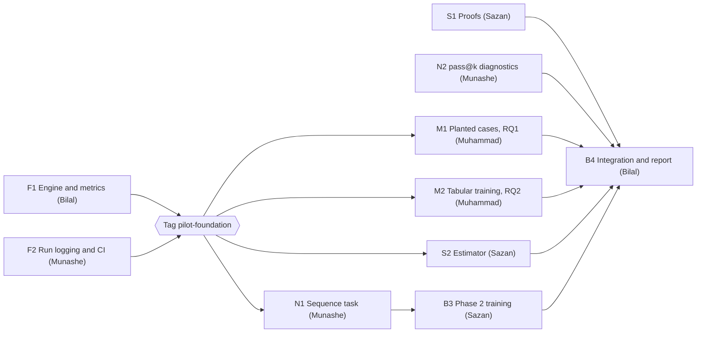

# capsplit pilot: implementation plan and team tasks

> **For coding agents:** you are implementing exactly one task from this file. Read [Start here](#start-here-for-coding-agents), then the [shared contract](#shared-contract), then your task. Steps use checkbox (`- [ ]`) syntax. Use superpowers:executing-plans if your agent has it.

**Goal:** build one thin, working path through the whole project, from task to metric to training to results, so the full Phase 1 and Phase 2 experiments can build on it.

**Architecture:** every task compiles to a `TrajectoryTable`, and every policy is a logits array over its states. Metrics only see tables and probabilities, so grid worlds, sequence tasks, planted policies and trained policies all go through the same code.

**Tech stack:** Python 3.10+, numpy, pytest. `torch` is used only in `train/sequence.py` and `seqtask/` network code.

**Spec:** [docs/blueprint.md](blueprint.md) and [docs/project-plan.pdf](project-plan.pdf). If they conflict with this file, this file wins for the pilot.

**Dates:** these assume the Dec 4 final deadline in the blueprint. The pilot review is Nov 15, the blueprint's Gate 2 date.

---

## What the pilot is

The pilot proves the design works on small problems and measures what the full run will cost. It does not produce the project's final results.

| In the pilot | Not in the pilot |
|---|---|
| Exact engine, metrics, the 2×2 label and run logging | Full Target-level sweeps |
| RQ1 planted cases in 3 world sizes | Q-learning, entropy, teacher and hint interventions |
| RQ2 time-to-cross, isolated and competing | Phase 2 interventions and the full shared-structure sweep |
| Sequence task at $V=6, L=5$, with on-policy RLOO | $V=8, L=6$ training (cost is measured, not run) |
| Estimator bound check | Importance sampling |
| pass@k rule on multi-prompt runs | SRR and NDR implementation (definitions only) |
| Proposition write-ups | Phase 3 |

### Pilot exit criteria

The pilot passes on Nov 15 when all of these hold, and `docs/pilot-report.md` records the numbers:

1. `pytest` passes on a clean clone, and CI runs on every PR.
2. `python experiments/run_pilot.py --quick` regenerates every pilot result from a clean clone.
3. RQ1: every gated family lands in its cell in all 3 world sizes, with any miss listed and explained.
4. RQ2: the isolated-route slope is between −1.0 and −0.7, and the competing arm's crossing and censoring table exists.
5. The sampled estimator meets its bound in at least 95% of repeats.
6. Propositions 1 to 3 are written up, and a second teammate has re-derived them.
7. The sequence task and RLOO run through the same `evaluate` as grid worlds, with measured per-update cost at $V=8, L=6$.
8. The report gives a go, change or cut recommendation for the full sweep.

---

## Team and tasks

The workload is split at about 30% each for Bilal and Sazan, and about 20% each for Muhammad and Munashe. Every task has reference values to check against, so agents can work without guessing.

| Owner | Tasks | Size |
|---|---|---|
| **Bilal** | F1 engine and metrics, B4 integration and report | About 30% |
| **Sazan** | S1 proofs, S2 estimator, B3 Phase 2 training | About 30% |
| **Muhammad** | M1 planted cases and RQ1, M2 tabular training and RQ2 | About 20% |
| **Munashe** | F2 run logging and CI, N1 sequence task, N2 pass@k diagnostics and SRR/NDR notes | About 20% |

Muhammad is assigned to the grid work because their commits built the existing grid code. Sazan is assigned the proofs because they wrote the plan that derives them. The shares are rough estimates of effort, counting a task of size S as 1, M as 2 and L as 3, which gives 28%, 33%, 22% and 17% in the order above. Tasks weren't split further just to hit exact numbers.

### Before anyone starts

- [ ] **Bilal:** give Sazan access. The repo is private, and on Nov 6 its collaborators were `pinktownscavenger`, `MohammadYassin03` and `Munashe22`.
- [ ] **Team:** confirm the provisional decisions below at kickoff.

### Provisional decisions

The blueprint's decisions aren't ratified yet. The pilot needs a working default, so it adopts these for now. Rejecting one later affects only the listed place.

| Decision | Pilot default | Where it can change |
|---|---|---|
| D1 | Sequence tempering runs on trajectories | `tempering.sequence_probs` |
| D2 | Beyond reach: $\Delta_{\text{cap}} \ge c/N$. Beyond temperature: $J$ gap above $10^{-9}$ | `evaluate.label_cell` only |
| D3 | $\beta$ grid plus golden-section refinement | `tempering.frontier` |
| D4 | Loop-erased routes as the grid solution map | `worlds.compile_grid(phi=...)` |
| D5 | Benchmarks as a list of tables, with one shared $\beta$ | `evaluate.evaluate_benchmark` |
| D6 | RQ2 has isolated and competing arms | `experiments/pilot_rq2.py` |
| D7 | Invalid $(H, N)$ pairs set `e_n_valid = False` | `evaluate.evaluate` |
| D8 | RQ1 uses frozen generators, never hand-tuned cases | `planted.py` |
| D10 | pass@k rule as defined in N2 | `diagnostics.passk_rule` |
| D11 | Bound is $\eta \max(m, \mu)$ on each mean | `estimator.py` |

---

## Order of work



| Wave | Dates | Tasks | Relationship |
|---|---|---|---|
| **0** | Nov 7 to 8 | F1, F2, S1, N2 | **All parallel.** S1 and N2 don't depend on any new code. |
| **Gate** | Nov 8 | Merge F1 and F2, tag `pilot-foundation` | **Sequential.** M1, M2, S2 and N1 wait for this tag. |
| **1** | Nov 9 to 11 | M1, M2, S2, N1 | **All parallel.** They touch separate files. |
| **2** | Nov 10 to 12 | B3 | **Sequential after N1.** Runs alongside M1, M2 and S2. |
| **3** | Nov 12 to 14 | B4 | **Sequential after everything.** |
| **Review** | Nov 15 | Team reads `docs/pilot-report.md` | Decides on ratification and the full sweep. |

Muhammad's two tasks can run at once, in separate worktrees or clones. Munashe's F2 and N2 can too. Sazan's S2 and B3 overlap in Wave 2, so S2 should finish first, since it's the smaller task.

### File ownership

Only a file's owner edits it. This is what makes the parallel waves safe. If you need a change to someone else's file, ask them.

| Path | Owner |
|---|---|
| `pyproject.toml`, `src/capsplit/__init__.py`, `README.md` | Bilal |
| `src/capsplit/engine.py`, `tempering.py`, `evaluate.py`, `worlds.py` | Bilal |
| `src/capsplit/planted.py`, `train/tabular.py`, `experiments/pilot_rq1.py`, `experiments/pilot_rq2.py` | Muhammad |
| `docs/proofs.md`, `src/capsplit/estimator.py`, `experiments/pilot_estimator.py` | Sazan |
| `src/capsplit/runlog.py`, `.github/`, `experiments/pilot_smoke.py`, `src/capsplit/seqtask/verifier.py`, `src/capsplit/diagnostics.py`, `docs/notes/` | Munashe |
| `src/capsplit/seqtask/policy.py`, `seqtask/pretrain.py`, `train/sequence.py`, `experiments/pilot_seq.py` | Sazan |
| `experiments/pilot_rq4.py`, `experiments/run_pilot.py`, `docs/pilot-report.md` | Bilal |

Each task's tests go in its own new test file, named in the task. Import from submodules such as `from capsplit.engine import ...`, and don't edit `__init__.py`.

### Review pairs

Every PR needs one teammate's approval, per the README.

| Author | Reviewer |
|---|---|
| Bilal: F1 | Muhammad |
| Bilal: B4 | Sazan |
| Muhammad: M1, M2 | Bilal |
| Sazan: S1 | Munashe, who re-derives the proofs by hand |
| Sazan: S2 | Muhammad |
| Sazan: B3 | Bilal |
| Munashe: F2, N1, N2 | Bilal |

### Paste this into your coding agent

Replace `<TASK>` with your task ID, such as `M1`.

```text
Read docs/pilot-blueprint.md in this repo. Implement task <TASK> only.
Follow its "Start here" rules, the shared contract and every step of the task,
in order. Don't edit files you don't own under that document's file ownership
table. If an acceptance value doesn't match, or you need a contract change,
stop and report it instead of changing the value, the contract or a
generator's parameters. When finished, open a PR and give me the completion
report the document asks for.
```

---

## Start here (for coding agents)

### Setup

```bash
git checkout main && git pull
python -m venv .venv
source .venv/bin/activate      # Windows: .venv\Scripts\activate
pip install -e ".[dev]"
pytest
```

All tests must pass before you begin. For tasks after Wave 0, also confirm the foundation exists:

```bash
git tag --list pilot-foundation
```

If that prints nothing and your task requires it, stop and tell your teammate that the foundation isn't ready.

### Rules

1. **One task, one branch, one PR.** Use the branch named in your task. Never push to `main`.
2. **Test first.** Write the listed test, see it fail, implement, see it pass.
3. **Reference values are not targets to tune toward.** They come from a prototype of this design. If yours differ beyond the stated tolerance, stop and report it. Never change generator parameters, thresholds or expected values so a check passes, because that would make RQ1 meaningless (blueprint D8).
4. **Don't change the shared contract.** If it blocks you, stop and ask Bilal.
5. **Stay in scope.** Nothing from the "Not in the pilot" list, and no extra options, abstractions or dependencies.
6. **Commit small and often,** using Conventional Commits: `type(scope): imperative summary`, such as `feat(engine): add trajectory table`. The commit history is graded, so commit under the teammate's own name. Do not add `Co-Authored-By` trailers for an AI assistant.
7. **Determinism.** Every random function takes a `seed` or a `numpy.random.Generator`. Never use global random state.
8. **Experiments** must write through `capsplit.runlog`, and must not write figures or data into tracked folders.

### Completion report

End your PR description with this, filled in:

```text
Task:
Acceptance values: expected vs. got, for each one
pytest: full-suite result
Runtime and machine: for any experiment
Misses or deviations: list each, or "none"
Stopped for anything? what and why
```

---

## Shared contract

F1 and F2 implement these signatures. Every other task relies on them. Code samples elsewhere in this file show interfaces and tests, so write the function bodies yourself.

### `capsplit.engine`

```python
@dataclass(frozen=True)
class TrajectoryTable:
    index: np.ndarray         # int32 (T, H): state * n_actions + action; padding == n_states * n_actions
    solution_ids: np.ndarray  # int32 (T,): index into `solutions`, or -1 if the verifier rejects
    solutions: tuple          # the correct solutions only; may be empty
    n_states: int
    n_actions: int
    horizon: int

def log_policy(logits: np.ndarray, beta: float = 1.0) -> np.ndarray: ...       # (S, A), stable at extreme logits
def trajectory_probs(table, logits, beta: float = 1.0) -> np.ndarray: ...      # (T,), per-step tempering at beta
def solution_probs(table, probs: np.ndarray) -> np.ndarray: ...                # (len(solutions),)
def table_success_prob(table, probs: np.ndarray) -> float: ...                 # J
```

Every policy is a float array of logits, shaped `(n_states, n_actions)`. A planted or sequence-tempered policy is a trajectory probability array, shaped `(T,)`, summing to 1.

### `capsplit.tempering`

```python
DEFAULT_BETAS: np.ndarray  # 25 log-spaced points on [0.25, 8], plus 1.0

def sequence_probs(table, logits, beta: float) -> np.ndarray: ...  # P(tau)^beta over all trajectories, normalized

@dataclass(frozen=True)
class Frontier:
    best_j: float
    best_beta: float
    best_family: str     # "per_step" or "sequence"
    boundary_hit: bool   # best_beta is at either end of the range

def frontier(table, logits, betas=DEFAULT_BETAS, refine: bool = True) -> Frontier: ...
```

**The frontier depends only on $\pi_0$.** Compute it once per base policy and pass it to `evaluate` at each logging point. It never needs recomputing during training.

### `capsplit.evaluate`

```python
@dataclass(frozen=True)
class Report:
    delta_rel: float
    delta_cap: float
    delta_j: float
    excess: float          # E_N
    j_gap: float           # J(pi1) - frontier.best_j
    label: str             # pure_sharpening | compounded_sharpening | reweighting | capability
    improved: bool         # delta_j > 0
    best_beta: float
    best_family: str
    boundary_hit: bool
    saturated: bool        # 1 - best pass@N < 0.05
    e_n_valid: bool        # n_actions ** horizon >= 100 * n
    crossed: dict          # solution -> (q0, q1), for s below c/N under pi0 and at or above it under pi1
    n: int
    c: float

def label_cell(delta_cap: float, j_gap: float, reach_threshold: float, eps: float = 1e-9) -> str: ...

def evaluate(table, logits0, probs1, n: int, *, c: float = 1.0, frontier_result=None,
             reach_threshold: float | None = None, betas=DEFAULT_BETAS) -> Report: ...
    # reach_threshold defaults to c / n. Raises ValueError if probs1 doesn't sum to 1 within 1e-6.

@dataclass(frozen=True)
class BenchmarkReport:
    delta_rel: float       # mean over prompts
    delta_cap: float       # mean over prompts
    delta_j: float         # mean over prompts
    excess: float          # mean pass@N(pi1) - best mean pass@N over one shared beta and family
    label: str             # beyond reach: delta_cap >= c/n. Beyond temperature: excess > 1e-9
    per_prompt_j0: tuple
    per_prompt_j1: tuple
    n: int
    c: float

def evaluate_benchmark(tables, logits0s, probs1s, n: int, *, c: float = 1.0,
                       betas=DEFAULT_BETAS) -> BenchmarkReport: ...
```

### `capsplit.worlds` additions

```python
def loop_erased(path: tuple) -> tuple: ...   # remove stays and loops from a visited-state path
def raw_path(path: tuple) -> tuple: ...      # identity, for sensitivity runs
def compile_grid(world: GridWorld, phi=loop_erased) -> tuple[TrajectoryTable, dict]: ...  # (table, cell -> state index)
def logits_to_array(state_index: dict, logits: dict) -> np.ndarray: ...
```

The existing `enumerate_paths`, `enumerate_actions`, `policy_from_routes` and `GridWorld` stay. The first two are the test oracle for the engine.

### `capsplit.runlog`

```python
def run_dir(experiment: str, config: dict, root: str = "results") -> pathlib.Path: ...
    # results/<experiment>/<sha256 of canonical JSON config, first 12 chars>/; writes manifest.json once
def save_seed(directory: pathlib.Path, seed: int, **arrays) -> pathlib.Path: ...   # seed-<n>.npz
def load_seeds(directory: pathlib.Path) -> list[dict]: ...
```

`manifest.json` holds the config, the git commit, a flag for a dirty tree, and the Python and numpy versions.

---

## Tasks

Sizes: **S** is under half a day with an agent, **M** is about a day, **L** is more.

### Task F1: Engine and metrics

**Owner:** Bilal. **Size:** L. **Wave:** 0. **Blocked by:** nothing. **Branch:** `feat/exact-engine`.

**Files:**
- Create: `src/capsplit/engine.py`, `src/capsplit/tempering.py`, `src/capsplit/evaluate.py`
- Modify: `src/capsplit/worlds.py`, `pyproject.toml` (add a `viz = ["matplotlib"]` extra, and register a `slow` pytest marker, which M2 uses)
- Test: `tests/test_engine.py`, `tests/test_evaluate.py`

**Interfaces:** produces everything in the shared contract except `runlog`. Consumes the existing `worlds.py` and `experiments/phase1_rq1.py` constants in tests.

**Reference world:** `phase1_rq1.WORLD` (4×4, wall at (1,1), $H=6$). "Trap" is `rq1.trap(3.2, 3.2, 0.0)`, "easy" is `rq1.lg(2.5, 2.0, 0.0)`, "weak" is `rq1.lg(1.0, 0.0, 0.0)`.

- [ ] **Step 1: Write the engine tests**

```python
def test_table_shape():            # WORLD: index.shape == (4096, 6), 8 solutions, n_states == 15
def test_matches_oracle():         # per-step q from the table equals enumerate_paths(trap, beta=2.0), max diff < 1e-12
def test_sizes():                  # no walls: 4x4/H6 T=4096, 20 solutions; 5x5/H8 T=65536, 70; 6x6/H10 T=1048576, 252
def test_loop_erased():            # 4x4, wall at (1,1), H=8: 288 raw solutions, 18 loop-erased
def test_no_solutions():           # H too short (4x4, H=3): solutions == (), J == 0.0, evaluate labels without crashing
def test_extreme_logits_stable():  # logits * 1000: probs finite, sum to 1 within 1e-9
```

- [ ] **Step 2: Write the tempering test, with these values at 3 decimals on the trap base**

| $\beta$ | Sequence $J$ | Per-step $J$ |
|---|---|---|
| 0.25 | 0.00928 | 0.00989 |
| 0.5 | 0.03250 | 0.03970 |
| 2 | 0.10089 | 0.03124 |
| 4 | 0.01133 | 0.00055 |

Also assert that `frontier(trap)` gives `best_j ≈ 0.13255`, `best_beta ≈ 1.361`, family `"sequence"`, `boundary_hit=False`. The refined values matter: at grid-only resolution `best_j` is lower, so this test proves refinement runs.

- [ ] **Step 3: Write the label test, at $N=20$, with values within 0.001**

| Base | $\pi_1$ | $\Delta J$ | $\Delta_{\text{cap}}$ | $J$ gap | Label |
|---|---|---|---|---|---|
| Easy | Per-step $\beta=3$ | +0.7231 | −0.0125 | −0.0139 | `pure_sharpening` |
| Easy | Sequence $\beta=3$ | +0.7287 | −0.0128 | −0.0083 | `pure_sharpening` |
| Weak | Per-step $\beta=3$ | +0.4261 | +0.4261 | −0.5524 | `compounded_sharpening` |
| Weak | Sequence $\beta=3$ | +0.4597 | +0.4597 | −0.5189 | `compounded_sharpening` |
| Trap | `rq1.lg(2.0, 5.0, 0.0)` | +0.7497 | +0.0009 | +0.7298 | `reweighting` |
| Trap | `rq1.lg(3.2, 3.2, 4.0)` | +0.7173 | +0.6073 | +0.6973 | `capability` |

Also assert: easy and weak report `boundary_hit=True` (best $\beta$ is 8), and $\Delta_{\text{rel}} + \Delta_{\text{cap}} = \Delta J$ within $10^{-12}$ on every row.

- [ ] **Step 4: Write the edge-case tests from Review Focus**

`e_n_valid` is False at $N=100$ on $H=6$. `abs(excess) < 1e-6` while `j_gap` is about −0.014 for the easy per-step row, and the label still comes from `j_gap`. `probs1` summing to 0.9 raises `ValueError`. A one-prompt `evaluate_benchmark` gives the same `delta_rel`, `delta_cap` and `delta_j` as `evaluate`.

- [ ] **Step 5: Implement, keeping these choices**

Probabilities: append a `0.0` to the flattened `log_policy` so the padding index contributes nothing, then sum `flat[table.index]` across each row. Sequence family: multiply log-probabilities by $\beta$ and subtract the maximum before exponentiating. Frontier: evaluate the grid, then for each family run 25 golden-section steps in $\log\beta$ around its top 2 grid points. Maximize $J$, not pass@N. In `evaluate_benchmark`, search the same grid for the best mean pass@N with one shared $\beta$, without refinement.

- [ ] **Step 6: Run `pytest`. Expected: all pass, including the original 20**

- [ ] **Step 7: Open the PR.** Muhammad reviews.

### Task F2: Run logging and CI

**Owner:** Munashe. **Size:** S. **Wave:** 0, parallel with F1. **Blocked by:** nothing. **Branch:** `feat/run-logging`.

**Files:**
- Create: `src/capsplit/runlog.py`, `.github/workflows/test.yml`, `experiments/pilot_smoke.py`
- Test: `tests/test_runlog.py`

**Interfaces:** produces `capsplit.runlog` from the contract.

- [ ] **Step 1: Write the tests**

```python
def test_same_config_same_dir(tmp_path):      # key order doesn't change the hash
def test_different_config_different_dir(tmp_path):
def test_manifest_fields(tmp_path):           # config, commit, dirty, python, numpy
def test_save_load_roundtrip(tmp_path):       # arrays survive; load_seeds returns them sorted by seed
def test_works_outside_git(tmp_path):         # commit is None, no crash
```

- [ ] **Step 2: Implement `runlog.py`.** Use `subprocess` for git, and treat any git failure as `commit=None`.

- [ ] **Step 3: Add CI.** Run `pip install -e ".[dev]"` and `pytest` on Python 3.10 and 3.12, for every PR and every push to `main`.

- [ ] **Step 4: Open the PR with the completion report.** Bilal reviews. `runlog` doesn't depend on F1, so this doesn't wait for it.

- [ ] **Step 5: Once F1 is on `main`, add `experiments/pilot_smoke.py` in a small follow-up PR.** It evaluates the 4×4 trap case and writes one result through `runlog`. Run it and confirm the result file and manifest exist, then tell Bilal.

- [ ] **Step 6 (Bilal): after the smoke script runs on `main`, tag and push, then tell the team**

```bash
git tag pilot-foundation && git push origin pilot-foundation
```

### Task M1: Planted cases and RQ1

**Owner:** Muhammad. **Size:** M. **Wave:** 1. **Blocked by:** `pilot-foundation`. **Branch:** `exp/pilot-rq1`.

**Files:**
- Create: `src/capsplit/planted.py`, `experiments/pilot_rq1.py`
- Test: `tests/test_planted.py`

**Interfaces:**
- Consumes: `compile_grid`, `logits_to_array`, `trajectory_probs`, `sequence_probs`, `frontier`, `evaluate`, `runlog`.
- Produces: `sample_cases(n: int, seed: int, table, state_index) -> PlantedSet`, where `PlantedSet` has `budget: int` and `cases: dict[str, tuple[np.ndarray, np.ndarray]]`, mapping case names to `(logits0, probs1)`. It also produces `SIZES` and `EXPECTED`.

**Generator specification, frozen.** Commit this before running the sweep. Worlds have no walls, with start at the top left and goal at the bottom right.

| Grid | $H$ | $N$ | Trials |
|---|---|---|---|
| 4×4 | 6 | 20 | 50 |
| 5×5 | 8 | 50 | 20 |
| 6×6 | 10 | 100 | 8 |

Use one `random.Random(seed)` per trial, with seeds `0..trials-1`.

1. **Routes:** a correct route is one of `table.solutions`. Pick route `a` (first move right) and route `d` (first move down) uniformly from pairs that share no cells except start and goal. Draw $\beta \sim U(3, 5)$.
2. **Easy base:** bonuses `(3j, 2.5j)` on `(a, d)`, where $j \sim U(0.8, 1.2)$. Cases `a_per` and `a_seq` use per-step and sequence $\beta$.
3. **Weak base:** bonus $U(1.0, 1.3)$ on `a`. Cases `ap_per` and `ap_seq` use per-step and sequence $\beta$.
4. **Trap base:** bonus $b$ on both `a` and `d`, then set the start state's logits to `[3.0, 0.95, 0.0, 0.95]`. Find $b$ with 40 bisection steps on $[0, 14]$, as the smallest value giving $\min(q(a), q(d)) \ge 1.2/N$.
5. **Rare route:** pick uniformly from routes with first move right, other than `a`, with base probability below $0.5/N$.
6. **Trained cases, from the trap base:**
   - `b_param`: bonuses $(b-1, b+2)$ on `(a, d)`, with the standard logits (no trap at the start).
   - `c_param`: bonuses $(b, b, b+1)$ on `(a, d, rare)`, with the standard logits.
   - `b_direct`: move mass $\alpha$ from incorrect trajectories proportionally onto `d`'s trajectories, where $\alpha$ is half of the base's incorrect mass.
   - `c_direct`: the same, onto the rare route.

```python
EXPECTED = {"a_per": "pure_sharpening", "a_seq": "pure_sharpening",
            "ap_per": "compounded_sharpening", "ap_seq": "compounded_sharpening",
            "b_param": "reweighting", "b_direct": "reweighting",
            "c_param": "capability", "c_direct": "capability"}
```

- [ ] **Step 1: Write the tests**

```python
def test_cases_are_distributions():    # every probs1 sums to 1 within 1e-9
def test_a_d_are_state_disjoint():     # across 20 seeds on 4x4
def test_trap_preconditions():         # q(a), q(d) >= 1.2/N; q(rare) < 0.5/N
def test_b_direct_exact_zero_cap():    # delta_cap == 0 within 1e-12
def test_4x4_all_cases_land():         # 5 seeds, label == EXPECTED[name]
```

- [ ] **Step 2: Implement `planted.py`, then commit it before running any sweep**

- [ ] **Step 3: Write `experiments/pilot_rq1.py`.** It computes one `frontier` per base and saves one row per case and seed. Add `--quick`, which runs 5, 2 and 1 trials by size.

- [ ] **Step 4: Run the full sweep and compare.** Prototype landing counts:

| Case | 4×4 | 5×5 | 6×6 |
|---|---|---|---|
| `a_per`, `a_seq`, `ap_per`, `ap_seq`, `b_direct`, `c_direct`, `c_param` | 50/50 | 20/20 | 8/8 |
| `b_param` | 50/50 | 20/20 | **3/8** |

Expected runtime: 2 s, 11 s and 78 s by size, on the prototype's Apple Silicon laptop.

**Pass:** everything other than 6×6 `b_param` lands at 95% or more. **The 6×6 `b_param` misses are expected, so report them and don't fix them.** They occur because small leakage onto other routes ($\Delta_{\text{cap}}$ of 0.011 to 0.017) passes the $c/N = 0.01$ threshold at $N=100$. That's real evidence about D2 for the team to judge. For any other miss, stop and report it.

- [ ] **Step 5: Add the threshold-sensitivity table.** For each case, recompute labels at `reach_threshold` of `0`, `0.1 * c / N` and `c / N`, and at $c \in \{0.5, 1, 3, 5\}$.

- [ ] **Step 6: Open the PR with the completion report.** Bilal reviews.

### Task M2: Tabular training and RQ2

**Owner:** Muhammad. **Size:** M. **Wave:** 1, parallel with M1. **Blocked by:** `pilot-foundation`. **Branch:** `exp/pilot-rq2`.

**Files:**
- Create: `src/capsplit/train/__init__.py`, `src/capsplit/train/tabular.py`, `experiments/pilot_rq2.py`
- Test: `tests/test_train_tabular.py`

**Interfaces:**

```python
def exact_pg_gradient(table, logits) -> tuple[np.ndarray, float]: ...  # (gradient (S, A), J)
def train_exact_pg(table, logits0, lr: float, steps: int, on_step=None) -> np.ndarray: ...
def reinforce(table, logits0, seed: int, steps: int = 400, batch: int = 32,
              lr: float = 0.5, baseline_decay: float = 0.9) -> np.ndarray: ...
```

`on_step(step, logits)` lets experiments log. `train/__init__.py` stays empty, because Sazan owns `train/sequence.py` in the same package.

**Gradient method:** $\partial J / \partial \theta(s, a) = N(s, a) - \pi(a \mid s) \sum_b N(s, b)$, where $N(s, a)$ is the probability-weighted count of $(s, a)$ across correct trajectories. `np.bincount` over `table.index` computes it. Discard the padding slot.

**Isolated-route world:** 5×5, $H=8$, walls at every cell of rows 1 to 3 × columns 1 to 3, plus `(0, 1)`. This leaves one correct route, down the left column then along the bottom. Set the base with a per-step bonus on that route, found by bisection on $[-8, 8]$ to hit the target $q_{\pi_0}$.

**Competing world:** 3×3, $H=4$, wall at `(1, 1)`. It has two correct routes: A along the top then right side, and B down the left then along the bottom.

- [ ] **Step 1: Write the tests**

```python
def test_gradient_matches_finite_differences():  # competing world, normal logits, seed 0, max diff < 1e-8
def test_isolated_route_updates():               # updates to J >= 0.1, lr=1: see table
def test_competing_symmetric():                  # bonuses (0,0), lr=2, 6000 steps: q(A), q(B) within 0.01 of 0.4998
def test_competing_asymmetric():                 # (3,2): q0(B)=0.0902; final q(B) < 1e-3, q(A) > 0.99
def test_reinforce_learns():                     # (1,0): J0 = 0.054; seeds 0-4 give J > 0.9
```

Isolated route, at $\text{lr}=1$, within 2%:

| $q_{\pi_0}$ | $10^{-5}$ | $10^{-4}$ | $10^{-3}$ | $10^{-2}$ |
|---|---|---|---|---|
| Updates | 17,837 | 2,358 | 362 | 63 |

The $10^{-5}$ value comes from an integral that matched the others closely. Mark that test `slow`. It should take about 40 s.

- [ ] **Step 2: Implement `tabular.py`**

- [ ] **Step 3: Write `experiments/pilot_rq2.py` with three parts**

1. **Arm A:** the updates table at $q_{\pi_0} \in \{10^{-5}, 10^{-4}, 10^{-3}, 10^{-2}\}$, with the log-log slope. It must fall between −1.0 and −0.7.
2. **Arm B:** bonuses `(0,0), (1,0), (2,0), (3,0), (3,1), (3,2), (2,1.5)` for route A and B, each logging $q(B)$ at every update, plus peak, final and whether it crossed $10 \times q_{\pi_0}$ within 6,000 steps, counting no crossing as censored. Prototype: only `(0,0)` crossed.
3. **Dynamics:** on a 4×4 trap base from `rq1.trap(3.2, 3.2, 0.0)`, log `delta_rel`, `delta_cap` and `excess` at every update for exact PG, and for REINFORCE across 5 seeds, at $N=20$. Compute `frontier` once and reuse it.

`--quick` skips the $10^{-5}$ point and uses 1,000 steps in arm B.

- [ ] **Step 4: Run it and write down what RQ2's prediction looks like against your output.** Early gain mostly in `delta_rel`, with `delta_cap` late or absent, is the plan's prediction. Report what you see, whichever way it goes.

- [ ] **Step 5: Open the PR with the completion report.** Bilal reviews.

### Task S1: Proofs

**Owner:** Sazan. **Size:** M. **Wave:** 0. **Blocked by:** nothing. **Branch:** `docs/proofs`.

**Files:**
- Create: `docs/proofs.md`

Agents can draft this, but a person must check every step. This is the Minimum-level theory, and Gate 1 depends on it.

- [ ] **Step 1: Write each result with a complete proof, in this order**

1. **Proposition 1:** exact split.
2. **Proposition 2, per-step family:** $U = |A|^{-H}$, via Jensen at each state. Cover early termination at the goal.
3. **Proposition 2, sequence family:** $U = 1/T$, via Jensen on the normalizer, and show that this bound is at least as tight.
4. **Corollary, solution level:** if every $\tau \in \phi^{-1}(s)$ has $P_{\pi_0}(\tau) < U$, every $\beta > 1$ strictly lowers $q(s)$. Include a small example where $q_{\pi_0}(s) > U$ while every trajectory is below $U$.
5. **Lemma, single-task sign:** for one task and $N \ge 1$, the sign of $E_N$ equals the sign of $J(\pi_1) - \sup_\beta J(\pi_0^\beta)$. Also, if $\mathcal{R}_N$ is non-empty at $c=1$, then $E_N \le (1 - 1/N)^N \le 1/e$.
6. **Proposition 3:** benchmark version, using power sums and Newton's identities on $\{1 - J_i\}$, plus the plan's example.
7. **Estimator bound:** the multiplicative Chernoff form in blueprint D11, with $\delta/8$ per tail and error $\eta \max(m, \mu)$ for $\eta \le 1$. Derive the bound on each $\Delta$.

- [ ] **Step 2: Check the numbers.** Chernoff at $\mu=10^{-3}, \eta=0.1, \delta=0.05$ gives $M = 1{,}522{,}553$. Hoeffding at $\varepsilon = 10^{-4}, \delta = 0.05$ gives $M = 253{,}758{,}691$. The Proposition 3 example gives $(+0.4, -0.003)$ and $(-0.5, +0.897)$, both summing to $0.397$.

- [ ] **Step 3: State limits next to each result:** $\beta < 1$ for Proposition 2, deterministic dynamics, and that a relative bound on a mean isn't one on a difference.

- [ ] **Step 4: Open the PR.** Munashe re-derives the proofs by hand and approves. The plan says that nobody has checked these yet, so this review is what passes Gate 1.

### Task S2: Sample estimator

**Owner:** Sazan. **Size:** S. **Wave:** 1. **Blocked by:** `pilot-foundation`. **Branch:** `feat/estimator`.

**Files:**
- Create: `src/capsplit/estimator.py`, `experiments/pilot_estimator.py`
- Test: `tests/test_estimator.py`

**Interfaces:**

```python
def chernoff_size(mu: float, eta: float, delta: float) -> int: ...  # ceil(3 ln(8/delta) / (eta^2 mu)); requires eta <= 1
def hoeffding_size(eps: float, delta: float) -> int: ...            # ceil(ln(8/delta) / (2 eps^2))

@dataclass(frozen=True)
class SplitEstimate:
    delta_rel: float
    delta_cap: float
    means: np.ndarray    # [reach_pi0, unreach_pi0, reach_pi1, unreach_pi1]

def exact_means(table, logits0, probs1, n: int, c: float = 1.0) -> np.ndarray: ...
def estimate_split(table, logits0, probs1, n: int, m: int, rng, c: float = 1.0) -> SplitEstimate: ...
def within_bound(estimate, exact: np.ndarray, eta: float, mu: float) -> bool: ...  # every mean within eta * max(m, mu)
```

Classification uses the exact $q_{\pi_0}$ from the table. Only the means are estimated.

- [ ] **Step 1: Write the tests**

```python
def test_sizes():         # chernoff_size(1e-3, 0.1, 0.05) == 1522553; hoeffding_size(1e-4, 0.05) == 253758691;
                          # chernoff_size(1e-2, 0.2, 0.05) == 38064
def test_eta_validated(): # eta > 1 raises ValueError
def test_means_exact():   # exact_means reproduces evaluate's delta_rel and delta_cap
def test_coverage():      # reference case below, 200 repeats, seed 0: bound holds >= 95%
```

**Reference case:** `phase1_rq1.WORLD`, routes `R_COMMON, R_MID, R_RARE`, bonuses `(2.5, 2.0, 0.0)` for $\pi_0$ and `(2.0, 2.0, 3.0)` for $\pi_1$, $N=20$. Exact means: $\pi_0$ `[0.25019, 0.01281]`, $\pi_1$ `[0.09489, 0.49799]`. With $\mu=0.01, \eta=0.2, \delta=0.05$, the prototype covered 200 of 200 repeats in 0.6 s.

- [ ] **Step 2: Implement `estimator.py`**

- [ ] **Step 3: Write `experiments/pilot_estimator.py`.** Report coverage at both a generous and a Chernoff-sized $M$, the Hoeffding size for the same target (computed only, not sampled), and the ratio between them. Also run one trained pair from `train/tabular.py`, because the bound must hold on a real pair. If M2 hasn't merged when you're otherwise done, open your PR and add this run in a small follow-up PR.

- [ ] **Step 4: Open the PR with the completion report.** Muhammad reviews.

### Task N1: Sequence task

**Owner:** Munashe. **Size:** S. **Wave:** 1. **Blocked by:** `pilot-foundation`. **Branch:** `feat/sequence-task`.

**Files:**
- Create: `src/capsplit/seqtask/__init__.py`, `src/capsplit/seqtask/verifier.py`
- Test: `tests/test_seqtask.py`

`seqtask/__init__.py` stays empty, because Sazan adds other modules to this package in B3.

**Interfaces:**

```python
@dataclass(frozen=True)
class SeqTask:
    vocab: int
    length: int
    common: tuple    # tuple of token tuples
    rare: tuple
    distractors: tuple
    shared_prefix: int

    def is_accepted(self, seq: tuple) -> bool: ...

def make_task(vocab, length, n_common, n_rare, shared_prefix, seed, n_distractors: int = 30) -> SeqTask: ...
def make_benchmark(vocab, length, prompts, n_common, n_rare, shared_prefix, seed) -> list[SeqTask]: ...   # task i uses seed + i
def node_offsets(vocab: int, length: int) -> np.ndarray: ...                                             # (length,), first node id per level
def compile_sequence(task: SeqTask) -> TrajectoryTable: ...
```

**Solution rules:**
- **Common** sequences use only tokens from the lower half of the vocabulary, sampled distinct.
- **Rare** sequence `i` copies the first `shared_prefix` tokens of common sequence `i % n_common`, and fills the rest from the upper half. All are distinct.
- **Distractors** are random, and never accepted.
- Raise `ValueError` if the request can't be met or `shared_prefix` is outside `0..length-1`.

**State ids:** a prefix of length $\ell$ with base-$V$ value $x$ has node id `node_offsets[l] + x`. `index[tau, l] = node * vocab + token`. Build it with numpy, with no Python loop over trajectories. `solutions` are the accepted sequences, in sorted order. No padding is needed, since all sequences have the full length.

- [ ] **Step 1: Write the tests**

```python
def test_sizes():                # V=8, L=6: T=262144, n_states=37449; V=6, L=5: T=7776, n_states=1555
def test_compile_is_fast():      # V=8, L=6 compiles in under 2 s
def test_uniform_j():            # zero logits: J == accepted / V**L within 1e-12
def test_rare_shares_prefix():   # every k in 0..L-1: rare[i][:k] == common[i % n_common][:k]
def test_rare_differs_after_k(): # rare tokens after position k are all in the upper half
def test_disjoint_sets():        # common, rare and distractors don't overlap
def test_seed_determinism():     # same seed equal; different prompts differ
def test_invalid_args():         # k=L, or too many sequences requested: ValueError
def test_evaluate_runs():        # evaluate() on uniform logits vs. a moved-mass policy returns a Report
```

- [ ] **Step 2: Implement `verifier.py`**

- [ ] **Step 3: Tell Sazan as soon as this merges.** B3 is waiting on it.

- [ ] **Step 4: Open the PR with the completion report.** Bilal reviews.

### Task N2: pass@k diagnostics and SRR/NDR notes

**Owner:** Munashe. **Size:** S. **Wave:** 0. **Blocked by:** nothing. **Branch:** `feat/passk-diagnostics`.

**Files:**
- Create: `src/capsplit/diagnostics.py`, `docs/notes/invisible-leash-scores.md`
- Test: `tests/test_diagnostics.py`

**Interfaces:**

```python
def passk_curve(js, ks) -> np.ndarray: ...   # mean over prompts of 1 - (1 - J_i)^k

def passk_rule(js0, js1, ks, k_large: int, tol: float = 1e-9) -> str: ...
    # "sharpening"   if pi1 is below pi0 by more than tol at any k >= k_large
    # "capability"   otherwise, if pi1 is never below by more than tol and is above by more than tol at some k
    # "undetermined" otherwise

def score_rule(rule_outputs: list[str], cells: list[str]) -> dict: ...
```

`score_rule` returns `primary`, `secondary`, `undetermined_rate` and `per_cell`. **Primary:** a run agrees when the rule says `capability` and the cell is `capability`, or when the rule says `sharpening` and the cell isn't. `undetermined` always counts as disagreement. **Secondary:** a run agrees when the rule says `capability` and the cell is `capability`, or when it says `sharpening` and the cell is `pure_sharpening` or `compounded_sharpening`.

This rule replaces the wording in blueprint section 9. Saturated curves tie at large $k$, so requiring "strictly above at every $k$" would make `capability` impossible.

- [ ] **Step 1: Write the tests, with `K = [1, 2, 5, 10, 20, 50, 100, 1000]`**

```python
def test_curve_values():        # {.99, .01} minus {.4, .4} at k=1,2,5,10,20,100: +0.1000, -0.1301, -0.3977, -0.4461, -0.4089, -0.1830
def test_rule_sharpening():     # js0=[.4,.4], js1=[.99,.01], k_large=10
def test_rule_capability():     # js0=[.2], js1=[.3]; and js0=[.2,.3], js1=[.4,.5]
def test_rule_undetermined():   # js0=[.4,.5], js1=[.5,.4]: identical curves
def test_single_prompt_never_crosses():  # 100 random pairs: curve difference never changes sign
def test_score_primary_secondary():      # a hand-built 6-run list covering each rule output and cell
```

- [ ] **Step 2: Implement `diagnostics.py`.** It needs only numpy, so it doesn't depend on the foundation.

- [ ] **Step 3: Write `docs/notes/invisible-leash-scores.md`.** A person must read the paper for this. For SRR and NDR, record: the exact definition with its section or equation number, what inputs each needs, and whether the score can be computed from a `TrajectoryTable` and sample counts. Don't implement the scores in the pilot, and don't infer their definitions from their names.

- [ ] **Step 4: Open the PR with the completion report.** Bilal reviews.

### Task B3: Phase 2 training

**Owner:** Sazan. **Size:** L. **Wave:** 2. **Blocked by:** F1, F2, N1. **Branch:** `exp/pilot-seq`.

**Files:**
- Create: `src/capsplit/seqtask/policy.py`, `src/capsplit/seqtask/pretrain.py`, `src/capsplit/train/sequence.py`, `experiments/pilot_seq.py`
- Test: `tests/test_seq_training.py`, skipped when `torch` isn't installed

**Interfaces:**

```python
class SequencePolicy(torch.nn.Module): ...   # embedding 16, GRU 64, linear to vocab; start token id == vocab
def node_logits(policy, vocab, length) -> np.ndarray: ...         # (n_states, vocab), node order from node_offsets
def tabular_base_logits(task, weights: dict, alpha: float) -> np.ndarray: ...   # log(prefix counts + alpha)
def pretrain(policy, task, rare_weight: float, steps: int = 300, lr: float = 3e-3) -> None: ...
def calibrate(task, n: int, seed: int, target_ratio: float = 0.2) -> tuple[SequencePolicy, dict]: ...
def rloo_train(policy, task, updates: int, group: int = 16, lr: float = 1e-3, seed: int = 0) -> None: ...
```

**Pilot configuration:** $V=6, L=5, N=50$ (valid, because $7776 \ge 5000$), 3 common, 3 rare, $k \in \{0, 2, 4\}$, 5 seeds, on-policy only, 600 updates.

**Pre-training weights:** common total 0.25, distractors total 0.75, rare per-sequence weight set by calibration. **Calibration:** 8 bisection steps on $\log_{10}$ of the rare weight over $[-8, -1]$, targeting median rare $q_{\pi_0} = 0.2/N$.

**Prototype values** (2 seeds per level, 2.5 s per run): $J_0 \approx 0.258$, median rare $q_{\pi_0} \approx 0.0038$ to $0.0043$, $J_1 \approx 0.999$. Rare mass fell in all 6 runs, to below $10^{-4}$. That's a prototype observation, not a result: it uses too few seeds, and only one prompt.

- [ ] **Step 1: Write the tests.** `node_logits` agrees with a direct forward pass per node. Probabilities from `node_logits` sum to 1 within $10^{-5}$ (float32 network). Calibration lands median rare $q_{\pi_0}$ within $[0.1/N, 0.4/N]$ for every $k$. RLOO raises $J$ on a small task. Same seed gives same result.

- [ ] **Step 2: Implement the four modules**

- [ ] **Step 3: Write `experiments/pilot_seq.py`.** Run the configuration above through `evaluate`, plus the prefix-tree tabular control with exact PG from `train/tabular.py` if M2 has merged. Report $\Delta_{\text{rel}}$, $\Delta_{\text{cap}}$, the label and rare $q_{\pi_0}$ per level. Include $q_{\pi_0}$ per level, since D13 is about keeping it matched.

- [ ] **Step 4: Measure full-size cost at $V=8, L=6$.** Prototype figures on one laptop, for one prompt, $G=16$: 43 ms per RLOO update, 0.1 s for all node logits, 0.8 s per frontier, under 0.01 s to compile. Measure with 4 prompts too, and record the machine.

- [ ] **Step 5: Open the PR with the completion report.** Bilal reviews.

### Task B4: Integration and pilot report

**Owner:** Bilal. **Size:** M. **Wave:** 3. **Blocked by:** all other tasks. **Branch:** `exp/pilot-integration`.

**Files:**
- Create: `experiments/pilot_rq4.py`, `experiments/run_pilot.py`, `docs/pilot-report.md`
- Modify: `src/capsplit/__init__.py`, `README.md` (status and commands)

- [ ] **Step 1: Write `pilot_rq4.py`.** Build benchmarks of $P=4$ tasks: 4×4 grids with different base dials, and $V=6, L=5$ sequence prompts. Train with M2 and B3, score with `evaluate_benchmark`, `passk_rule` and `score_rule`, and report per cell. The rule's $k$ grid stops at the largest valid $N$. Set `k_large` to 10 and commit it before running.

- [ ] **Step 2: Write `run_pilot.py`.** It runs every pilot experiment. With `--quick`, it finishes in under 10 minutes.

- [ ] **Step 3: Verify from a clean clone.** Clone, install, run `pytest`, and run `python experiments/run_pilot.py --quick`.

- [ ] **Step 4: Write `docs/pilot-report.md`.** One section per exit criterion with the measured values. Then add:
  - each provisional decision, with its evidence and a keep-or-change recommendation;
  - the measured cost of the full 400-run sweep. As a starting estimate, one prompt at 43 ms per update and 2,000 updates is about 9.6 CPU-hours, and 4 prompts could be about 38 if cost scales linearly;
  - a go, change or cut recommendation for the Phase 2 sweep.

- [ ] **Step 5: Update `docs/blueprint.md`** with whatever the pilot changed.

- [ ] **Step 6: Open the PR, then hold the Nov 15 review.** Sazan reviews.

---

## Global constraints

- Python 3.10 or later. Core library dependency is numpy only. `torch` stays in the `deep` extra.
- Budgets must satisfy $|A|^H \ge 100N$ for $E_N$ to be reported.
- $\beta$ range: 0.25 to 8, log-spaced, including 1.
- Reported training curves at Target level need at least 20 seeds. Pilot runs use fewer, and must say so.
- `results/` and `data/` stay git-ignored. Notebooks, when added, read results and never train.
- No AI co-author trailers on commits.

## Review Focus

These are the failures most likely to affect real use. Each has a test in the listed task.

1. **A budget too large for the task:** $E_N$ would look meaningful but isn't, so `e_n_valid` must be False. Test in F1.
2. **A task with no correct solutions:** a horizon too short to reach the goal should give $J=0$ and a label, with no crash. Test in F1.
3. **Saturated pass@N:** `excess` rounds to 0 while the real gap is non-zero, so labels must come from `j_gap`. Test in F1.
4. **Near-deterministic policies:** very large logits after training must not produce NaN or underflow to invalid probabilities. Test in F1.
5. **A `probs1` that isn't a distribution:** a planted case with a bug must raise, not produce a plausible label. Test in F1.

## Prototype notes

Reference values come from a throwaway prototype of this design, run on Nov 6 on an Apple Silicon laptop with Python 3.12 and not kept in the repo. Runtimes will vary, and a different random stream may shift sweep counts slightly, though tests with exact values shouldn't be affected.

The prototype changed the design in four ways:

- **Frontier cost:** the frontier depends only on $\pi_0$, so it's computed once per base. Blueprint D12 was too pessimistic about logging $E_N$ during training.
- **Generators:** the first version missed in many cases. Compounded cases need bonuses and $\beta$ high enough to concentrate on the route. Trap routes must not share cells, or they can't both reach the line. The rare route must be checked to be below the line. These are stated up front in M1, as preconditions.
- **pass@k rule:** "above at every $k$" fails on saturated curves, so N2 redefines it.
- **Sequence base:** an early distractor weighting left $J_0$ near 0.6. The weights in B3 give about 0.26, within the blueprint's 0.1 to 0.3 target.
