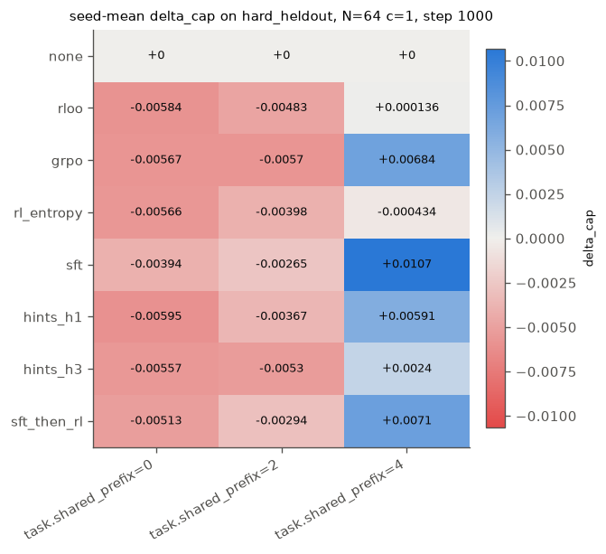
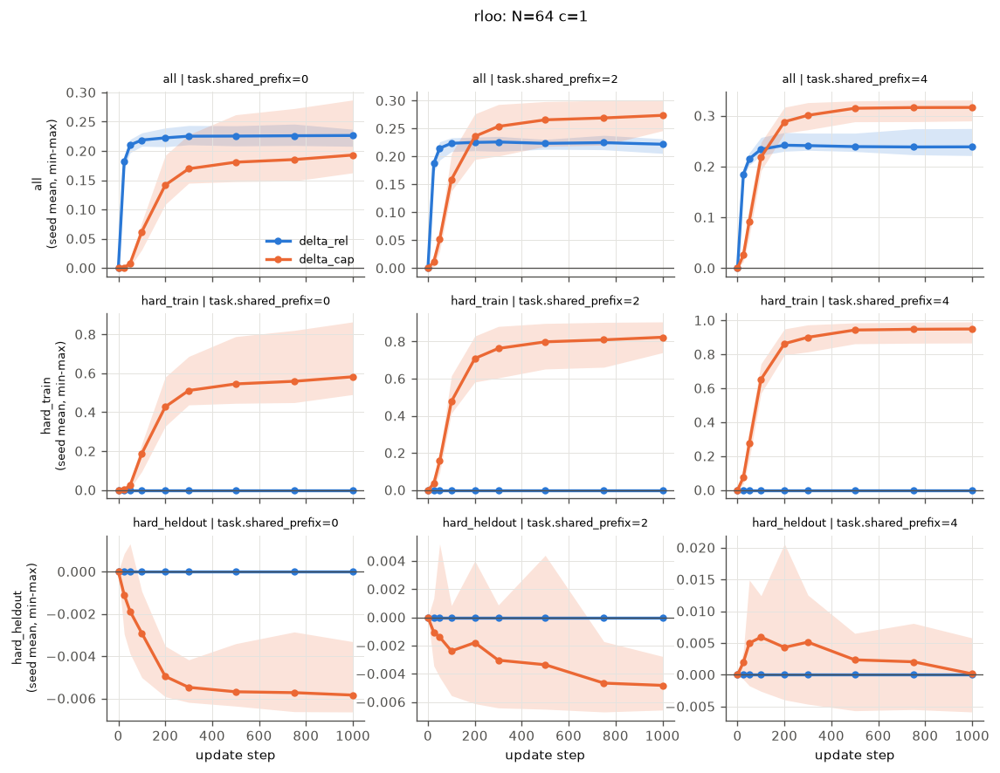
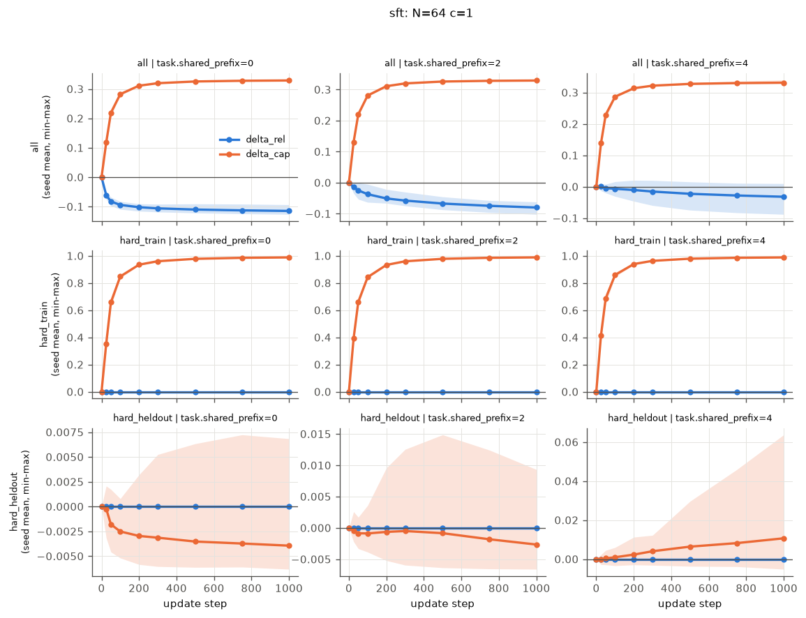
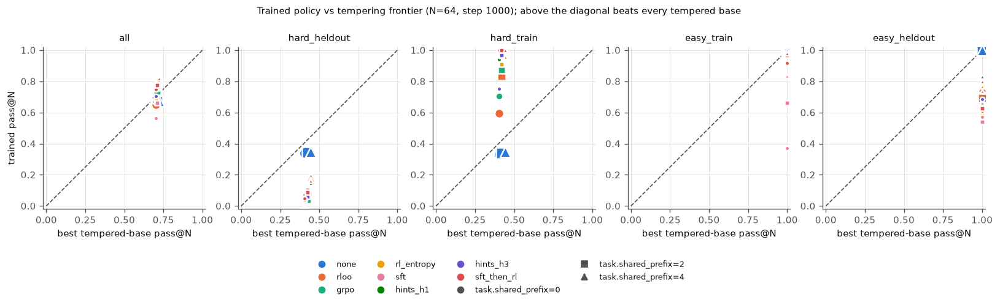

# Capability or reliability? A controlled comparison of post-training signals

Final project report for the graduate RL class (Prof. Hickman), branch `harness/capability-vs-reliability`.

Every number here is copied from a generated file:
- `docs/experiment_main/tables/main.csv`
- `docs/experiment_main/verdicts.md` and `verdicts.json`
- `docs/experiment_main/tables/frontier.csv` and `labels.csv`
- `docs/base_verification.md` and `docs/gate2.md`
- the decisions log, `docs/DECISIONS.md`
- the per-run metrics files under `results/main/`

Section 5 shows how to trace any of them.

---

## 1. Question

When post-training makes a policy better at a task, where does the extra success come from? There are two possibilities:

- **Reliability.** The policy moves probability onto correct answers the starting ("base") policy could already produce if you let it try N times. The improvement is real, but a patient user with a verifier could have got it from the base.
- **Capability.** The policy puts probability on correct answers the base essentially never produces within N tries.

This distinction is at the centre of a current debate about whether reinforcement learning (RL) on language models teaches new skills or only sharpens existing ones. We do not try to settle that debate for language models. Instead we build a small world where the answer can be computed *exactly*. We then compare seven post-training signals against a no-training control, under one pre-registered metric: three RL variants, supervised imitation, two hint-guided RL variants, and imitation followed by RL.

---

## 2. RL framing

| RL object | In this project |
|---|---|
| Episode | One prompt (type, a, b). The policy writes L = 5 tokens, each from a vocabulary of V = 6 symbols. |
| State | The prompt plus the tokens written so far. |
| Action | The next token (one of 6). |
| Reward | 1 at the end of the episode if a rule-based verifier accepts the 5-token sequence, else 0. No intermediate rewards. |
| Return / objective J | The return equals the final reward, so the expected return on a prompt is J = P(correct). The training objective is the average of J over training prompts. |
| Policy | One recurrent network (a small GRU: embedding 16, hidden size 64) conditioned on the prompt, shared by all 72 prompts. |
| π0 (base) | The policy after pre-training by weighted maximum likelihood, i.e. fitting the network to a designed data distribution (Section 3.2). |
| π1 (trained) | The policy after an arm's post-training. |

**Update rules of the eight arms.** All gradient arms use Adam with learning rate 1e-3 and the same number of optimizer updates (1,000). RL arms sample a group of G = 16 episodes per training prompt per update, and have no KL penalty to the base (decision H18).

| Arm | Update rule, in words |
|---|---|
| `none` | No update; the trained policy is the base. This is the control, and its gain must be exactly zero. |
| `rloo` | REINFORCE with a leave-one-out baseline. Each episode's *advantage* (how much better it did than expected) is its reward minus the mean reward of the other 15 episodes in its group. The update raises each episode's log-probability in proportion to its advantage. If all 16 episodes on a prompt fail, every advantage is zero and that prompt contributes no gradient. |
| `grpo` | The same, but the advantage is "group-normalised": (reward − group mean) / (group standard deviation + 1e-6). One on-policy step per batch, so no clipping is active. A robustness check on `rloo`. |
| `rl_entropy` | `rloo` plus an entropy bonus of 0.01. Entropy measures how spread out the policy's choices are; the bonus rewards keeping them spread out, regardless of the verifier. |
| `sft` | Supervised fine-tuning: maximum-likelihood imitation of correct teacher sequences on the hard training prompts only. It never samples and never sees a reward. |
| `hints_h1`, `hints_h3` | `rloo`, except that when all 16 episodes on a prompt fail, the group is re-rolled with the first 1 (or 3) tokens of a correct solution forced in, and the rest sampled by the policy. The gradient covers only the tokens the policy generated, never the forced ones (decisions H4, H17). No hints are given at evaluation. |
| `sft_then_rl` | `sft` for the first 500 updates, then `rloo` for the remaining 500, with the optimizer reset between phases (H25). |

---

## 3. Method

### 3.1 Task

- **Prompts:** 72 prompts (type, a, b). Type is easy or hard, and a and b each range over 0–5, giving 36 easy and 36 hard prompts.
- **Split:** a seeded third of each type is held out, leaving 24 easy-train, 12 easy-held-out, 24 hard-train and 12 hard-held-out prompts.
- **Answers:** every prompt has exactly two correct 5-token sequences, which differ only in the last token. There are 6^5 = 7,776 possible sequences per prompt.

The rules that define the correct sequences:

- **Easy rule** (decision H33): token i is (a + i·b + i(i+1)/2) mod 6.
- **Hard rule:** token i is the easy-rule token plus an offset between 1 and 4, so it never equals the easy-rule token.
- **Shared structure k ∈ {0, 2, 4}:** a hard prompt's correct sequence follows the easy rule for its first k tokens and the hard rule after that. At k = 0 a hard solution has nothing in common with the easy skill; at k = 4 it shares all but the last position. k is the experimental dial for "how much of the hard skill is built from the easy skill".

### 3.2 The base policy and its verified properties

The base is designed, not found:

- **Pre-training covers all prompts.** The base is pre-trained on all 72 prompts, train and held-out (H8). Held-out prompts therefore measure transfer of *post-training*, not of pre-training.
- **Wrong answers are the most likely.** Each prompt's most likely sequence is a wrong "trap" (H10). For hard prompts the trap is the easy rule applied everywhere (the easy skill misapplied); for easy prompts it is a memorised wrong sequence.
- **Engineered data and fit.** Hard prompts' training data is a "noisy trap": the trap plus all of its single-token mutations (H34). The fit uses label smoothing of 0.08 (H35).
- **Calibration.** The weight on hard solutions is calibrated per (k, seed) so that the median hard solution has probability 0.2/64 (H36).

These choices were made so that the base meets five criteria. `docs/base_verification.md` checks them on all 30 bases (k ∈ {0, 2, 4} × seeds 0–9), and all 30 pass.

| Criterion | What it requires | Min .. max over the 30 bases |
|---|---|---|
| a | One network serves all prompts; each difficulty has train and held-out prompts | pass |
| b | Every hard correct sequence has base probability < 0.5/N (N = 64); the most likely sequence is wrong; and no temperature (any β in a 26-value grid from 0.25 to 8.00, in either tempering family) lifts a hard solution to 0.5/N | max hard probability × N: 0.2737 .. 0.3816; max *tempered* hard probability × N: 0.3286 .. 0.4331; hard prompts whose most likely sequence is correct: 0 .. 0 |
| c | Easy solutions are reachable (probability ≥ 1/N) but not saturated (mean easy J ≤ 0.6, max ≤ 0.8) | min easy probability × N: 8.36 .. 8.652; mean easy J (worst split): 0.2743 .. 0.2761; max easy J: 0.2767 .. 0.2805 |
| d | No single temperature makes the base good overall: best mean J over all prompts ≤ 0.6 | 0.1834 .. 0.1864 |
| e | Hard solutions share exactly their first k tokens with the easy-rule sequence; median hard probability within 2× of the target | median / target: 0.9569 .. 1.088 |

"Tempering" means rescaling the base's probabilities, in one of two ways:

- **Per-step family:** multiply the network's logits (the scores before the softmax) by β.
- **Sequence family:** raise each whole-sequence probability to the power β and renormalise.

β > 1 sharpens toward the most likely answers; β < 1 flattens. Criterion b says no such rescaling of the base reaches the hard solutions. The tightest margin is criterion b: 0.4331 against the limit of 0.5 (H38).

### 3.3 Measurement

**Exact enumeration.** For each prompt we compute the probability q(s) of every one of its 7,776 sequences, under the base (q0) and under the trained policy (q1). Nothing is sampled at measurement time, so there is no measurement noise.

**Reachable at budget N.** A correct solution s is *reachable* if q0(s) ≥ c/N, i.e. the base would be expected to produce it at least c times in N tries. The primary setting is N = 64, c = 1. We also report every combination of N ∈ {16, 64} and c ∈ {0.5, 1, 2}. The correct solutions split into a reachable set R and an unreachable set U.

**The exact split** (Proposition 1, `docs/proofs.md` §1):

- Δrel = sum over s in R of (q1(s) − q0(s)): the gain on solutions the base already reaches.
- Δcap = sum over s in U of (q1(s) − q0(s)): the gain on solutions it does not.
- Δrel + Δcap = J(π1) − J(π0) exactly, because R and U partition the correct solutions. Either term can be negative. The identity is bookkeeping, and the report checks it on every record (worst residual 3.89e-16).

**Temperature baselines.** Proposition 2 (`docs/proofs.md` §2) shows that sharpening (β ≥ 1) cannot raise a sequence much above where the base already puts it, so a sharpened base cannot fake capability. To be fair to the base the other way round, we compare the trained policy against the best tempered base:

- **E_N** = trained pass@N minus the best pass@N any tempered base achieves, with one β shared by all prompts in a group (H13). pass@N is the probability that at least one of N tries is correct. E_N > 0 means the trained policy beats every retempered base at budget N.
- **E_1** = trained mean J minus the best mean J any tempered base achieves (one shared β). This is the same comparison at a single try.

**Label rule** (H12, as amended by H39). Each group gets one of four labels from two yes/no questions:

- **Beyond reach:** did at least one correct solution that was unreachable under the base become reachable (q1(s) ≥ c/N)?
- **Beyond temperature:** is E_1 > 1e-9?

| | beyond temperature | not beyond temperature |
|---|---|---|
| **beyond reach** | capability | compounded_sharpening |
| **not beyond reach** | reweighting | pure_sharpening |

**Why E_1 and not E_N: the saturation finding.**
- The original rule used E_N. At Gate 1, a planted test case (a known pure "reweighting" policy) exposed a blind spot. On easy prompts the base's pass@64 is already about 1, so E_64 cannot see any improvement there, however large.
- The rule was changed to E_1 before any experiment ran (H39, H42).
- E_N is still reported for every arm, and the E_N-based label is kept alongside (`extra.label_en`).

### 3.4 The grid

- **Size:** 8 arms × 3 values of k × 10 seeds = 240 runs, each of 1,000 updates.
- **Checkpoints:** every run is measured exactly at updates 0, 25, 50, 100, 200, 300, 500, 750 and 1,000 (`configs/main.json`).
- **Shared bases:** for a given (k, seed), every arm starts from the same base.
- **Seeds:** the seed changes only the network initialisation and the training randomness. The task data are fixed (H37).
- **Training prompts:** all arms train only on train prompts, and `sft` only on hard-train prompts.

### 3.5 Pre-registration and budget pilot

The hypotheses, tests, thresholds and decision rule were written in `docs/preregistration.md` and frozen at Gate 1 (git tag `gate1-frozen`), before `configs/main.json` was run.

The decision rule for a claim "X > τ":
- **supported** if the lower end of the 95% bootstrap interval is above τ;
- **not supported** if the upper end is at or below τ;
- **inconclusive** otherwise.

"Near zero" means τ0 = 0.02 of probability mass. The intervals are percentile bootstraps of the seed mean over the 10 seeds (10,000 resamples).

The update budget was fixed by one pilot run, on seed 100 (not an experiment seed). The pilot looked only at `rloo`'s J on easy-train prompts at k = 0, with the rule "reach J ≥ 0.9". It reached 0.957 by update 100 and 0.998 by update 1,000 (H40). No hard-prompt number was looked at.

### 3.6 Verification

- **Per task:** each component (interfaces, runner, exact backend, base, each trainer, report generator) counted as done only after a *different* subagent verified it, typically by re-deriving numbers with its own code (`docs/TASKS.md`).
- **Gate 1:**
  - The full test suite passed (405 tests at the time), and the base was frozen.
  - Planted cases with known answers (sharpening, capability, reweighting) were labelled correctly and independently re-checked.
  - The proofs were checked step by step by one team member and independently re-derived by another (`docs/proofs.md`).
- **Gate 2** (`docs/gate2.md`):
  - A subagent that did not build or run the experiment recomputed results from the saved base models and step-1000 checkpoints.
  - It used its own forward pass and its own construction of the correct solutions, without the harness's report or verdict code.
  - All 240 runs agree with the metrics files to within 3.4e-7, and it re-checked all four verdicts with a fresh bootstrap.

---

## 4. Results

### 4.1 Verdicts (primary N = 64, c = 1, update 1,000)

Negative and null results are reported as prominently as positive ones. Each verdict comes with the caveat that must travel with it (from `docs/gate2.md`).

| Hypothesis | Verdict | What it means, and the caveat |
|---|---|---|
| **H1** RL alone produces mostly reliability, with near-zero capability at k = 0 | **not supported** | It fails on hard **train** prompts only: `rloo` Δcap(hard_train) = +0.5819 [+0.5317, +0.6564], where RL found rare solutions over about 16,000 training samples per prompt. On held-out hard prompts Δcap = −0.0058 [−0.0063, −0.0052], which *meets* the "near zero" part. Part (a), Δrel ≥ 90% of the total, held in 0/10 seeds: Δrel(all) +0.2264, Δcap(all) +0.1930. `grpo` gets the same verdict. **This is not evidence that RL creates capability in general.** |
| **H2** Under RL alone, capability rises with shared structure | **not supported** (primary test, hard held-out) | The effect is real but tiny: Δcap(k=4) − Δcap(k=0) = +0.0060 [+0.0040, +0.0081], below τ0 = 0.02. The secondary test on hard **train** prompts is supported (+0.3668 [+0.2798, +0.4324]), and must not be presented ahead of the primary. |
| **H3** SFT and hints produce capability on hard train prompts, and transfer to held-out hard prompts depends on k | **supported** | Part (a) holds clearly: Δcap(hard_train) is between +0.7389 and +0.9902 for all three arms at all k. Part (b)'s transfer effects (k=4 minus k=0 on hard held-out) are +0.0146 (`sft`), +0.0119 (`hints_h1`) and +0.0080 (`hints_h3`): statistically detectable, but **below** the plan's own near-zero threshold of 0.02. The `sft` result leans on one seed (+0.0693). "Supported" is the literal reading of the plan (H45). |
| **H4** SFT then RL beats either alone on held-out hard prompts (J) | **inconclusive** | All paired differences are within ±0.007, and every interval includes 0. `sft_then_rl` − `sft` is negative on average at every k (−0.0012, −0.0003, −0.0036). |

**No verdict changes** at any of the six (N, c) settings (`verdicts.md`, sensitivity table).

### 4.2 Main numbers

Values are the seed mean [95% bootstrap interval over 10 seeds], at N = 64, c = 1 and update 1,000, from `docs/experiment_main/tables/main.csv`. The `none` rows give the base.

| Arm | k | Δcap, hard train | Δcap, hard held-out | J1, easy train |
|---|---|---|---|---|
| none | 0 | +0.0000 | +0.0000 | +0.2741 [+0.2738, +0.2743] |
| none | 2 | +0.0000 | +0.0000 | +0.2747 [+0.2745, +0.2749] |
| none | 4 | +0.0000 | +0.0000 | +0.2746 [+0.2744, +0.2747] |
| rloo | 0 | +0.5819 [+0.5317, +0.6564] | −0.0058 [−0.0063, −0.0052] | +0.9975 [+0.9973, +0.9977] |
| rloo | 2 | +0.8231 [+0.7899, +0.8564] | −0.0048 [−0.0055, −0.0041] | +0.9978 [+0.9976, +0.9980] |
| rloo | 4 | +0.9488 [+0.9198, +0.9738] | +0.0001 [−0.0019, +0.0023] | +0.9982 [+0.9981, +0.9983] |
| grpo | 0 | +0.6950 [+0.6411, +0.7530] | −0.0057 [−0.0063, −0.0048] | +0.9981 [+0.9979, +0.9982] |
| grpo | 2 | +0.8654 [+0.8157, +0.9150] | −0.0057 [−0.0061, −0.0050] | +0.9984 [+0.9983, +0.9985] |
| grpo | 4 | +0.9494 [+0.9286, +0.9701] | +0.0068 [+0.0003, +0.0147] | +0.9986 [+0.9984, +0.9987] |
| rl_entropy | 0 | +0.7225 [+0.6807, +0.7707] | −0.0057 [−0.0064, −0.0046] | +0.9965 [+0.9963, +0.9967] |
| rl_entropy | 2 | +0.8968 [+0.8635, +0.9260] | −0.0040 [−0.0057, −0.0009] | +0.9972 [+0.9970, +0.9974] |
| rl_entropy | 4 | +0.9430 [+0.9112, +0.9723] | −0.0004 [−0.0027, +0.0024] | +0.9977 [+0.9976, +0.9978] |
| sft | 0 | +0.9886 [+0.9884, +0.9888] | −0.0039 [−0.0056, −0.0013] | +0.0298 [+0.0213, +0.0397] |
| sft | 2 | +0.9884 [+0.9883, +0.9885] | −0.0027 [−0.0047, +0.0005] | +0.1331 [+0.1198, +0.1441] |
| sft | 4 | +0.9890 [+0.9888, +0.9891] | +0.0107 [+0.0013, +0.0241] | +0.2270 [+0.1901, +0.2599] |
| hints_h1 | 0 | +0.9250 [+0.9077, +0.9417] | −0.0060 [−0.0063, −0.0056] | +0.9967 [+0.9965, +0.9969] |
| hints_h1 | 2 | +0.9517 [+0.9227, +0.9767] | −0.0037 [−0.0054, −0.0009] | +0.9977 [+0.9975, +0.9978] |
| hints_h1 | 4 | +0.9861 [+0.9779, +0.9903] | +0.0059 [−0.0014, +0.0146] | +0.9981 [+0.9979, +0.9982] |
| hints_h3 | 0 | +0.7389 [+0.6812, +0.7925] | −0.0056 [−0.0061, −0.0050] | +0.9971 [+0.9970, +0.9972] |
| hints_h3 | 2 | +0.9516 [+0.9347, +0.9684] | −0.0053 [−0.0058, −0.0049] | +0.9975 [+0.9973, +0.9976] |
| hints_h3 | 4 | +0.9902 [+0.9899, +0.9904] | +0.0024 [−0.0022, +0.0072] | +0.9980 [+0.9978, +0.9981] |
| sft_then_rl | 0 | +0.9878 [+0.9875, +0.9881] | −0.0051 [−0.0060, −0.0041] | +0.9113 [+0.8703, +0.9484] |
| sft_then_rl | 2 | +0.9891 [+0.9889, +0.9893] | −0.0029 [−0.0052, −0.0002] | +0.9626 [+0.9417, +0.9834] |
| sft_then_rl | 4 | +0.9901 [+0.9900, +0.9903] | +0.0071 [−0.0014, +0.0194] | +0.9757 [+0.9506, +0.9964] |

On hard prompts Δrel is exactly 0 for every arm, because by design no hard solution is reachable under the base. On easy prompts Δcap is exactly 0, because every easy solution is reachable. So on hard prompts *all* change counts as capability, and on easy prompts all change is reliability.



*Figure 1. Δcap on held-out hard prompts. Every cell is within about ±0.011 of zero; the colour scale makes small effects look large.*

### 4.3 Findings in plain language

**(i) "Unreachable at N = 64" is not the same as "unreachable during training".**

- **The surprise.** Plain RL (`rloo`, k = 0) put +0.5819 of mass on hard training solutions the base could not reach at N = 64. This does not mean RL invented something from nothing.
- **Why.** "Unreachable" was defined at an evaluation budget of N = 64 samples, but RL's *training* budget is far larger: 16 episodes per prompt per update × 1,000 updates = 16,000 sampled episodes per training prompt. The base's success rate on hard-train prompts is about 0.0063 per episode (the `none` row of J1, hard train). So during training RL sees correct hard sequences many times, and the leave-one-out gradient amplifies each one.
- **What it implies.** Measured at N = 64, this looks like capability; measured at the training budget, it would look like reliability.
- **The per-run evidence.** In seed 0 at k = 0, 21 of the 24 hard-train prompts end with Δcap above 0.98, and the other 3 are slightly negative (`results/main/07feaf655290/seed-0.metrics.json`, `extra.delta_cap`). The training curves (Figure 2, middle row) show hard-train Δcap rising from about update 50, after Δrel has already levelled off.



*Figure 2. `rloo`, N = 64, c = 1: Δrel (blue) and Δcap (orange) over updates. Rows are all prompts, hard train and hard held-out; columns are k = 0, 2, 4. Bands show min–max over seeds.*

**(ii) Almost no transfer to held-out hard prompts, for any arm.**

- **The numbers.** On the 12 held-out hard prompts, no arm reaches a Δcap of 0.02 at any k. The largest seed-mean value is +0.0107 (`sft`, k = 4), and most cells at k = 0 and 2 are slightly *negative*. This includes `sft` and both hint arms, which see correct hard solutions directly or nearly directly.
- **pass@64 narrows too.** On hard held-out prompts at k = 0, the base solves a prompt at least once in 64 tries with probability 0.3388; `rloo` does so with probability 0.0317 (`frontier.csv`).
- **No arm beats the tempered base there.** Every arm has negative E_N on hard held-out prompts (Figure 3).
- **In short,** training on some hard prompts made the policy *worse* at producing the rare correct answers on hard prompts it did not train on.

**(iii) Shared structure helps on the trained prompts.**

- For every RL-type arm, hard-train Δcap rises with k. For `rloo` it goes +0.5819 → +0.8231 → +0.9488 at k = 0, 2, 4 (the supported secondary test of H2).
- Hints of length 3 benefit most: +0.7389 → +0.9902.
- On held-out hard prompts the same direction appears (e.g. `rloo` −0.0058 → −0.0048 → +0.0001), but it stays far below the 0.02 threshold.

**(iv) SFT on hard prompts collapses easy prompts; SFT→RL recovers them.**

- **The collapse.** `sft` essentially solves the hard-train prompts (J1 +0.9949 at k = 0). But easy-train J1 falls from the base's +0.2741 to +0.0298, a Δrel(easy_train) of −0.2443, and easy-train pass@64 drops from about 1 to 0.3706 (`frontier.csv`). Imitation on one kind of prompt destroyed a skill the base already had.
- **It shrinks as k grows.** Easy-train J1 is +0.1331 at k = 2 and +0.2270 at k = 4. That is plausibly because at larger k the hard demonstrations themselves contain more easy-rule tokens.
- **RL afterwards repairs it.** Following SFT with 500 RLOO updates brings easy-train J1 back to +0.9113 / +0.9626 / +0.9757 (k = 0, 2, 4), while keeping hard-train Δcap near +0.99.
- **Where to see it.** Figure 4 shows the collapse in the `sft` training curves (top row, blue line below zero).

A related negative result: post-training lowers J on **held-out easy** prompts for every arm. At k = 0 the base scores +0.2745, against `rloo` +0.1861, `grpo` +0.1285 and `sft` +0.0745 (`main.csv`, easy_heldout j1). Gains on easy-train prompts did not carry over to easy prompts the policy did not train on.



*Figure 4. `sft`: hard-train Δcap rises to about 0.99 within 200 updates; overall Δrel goes negative (easy prompts lost); hard held-out stays within ±0.01 on average.*

**(v) E_N vs E_1, and saturation.**

- **Saturation.** On easy prompts the best tempered base already has pass@64 ≈ 1 (0.9999999999983041 on easy-train at k = 0), so no policy can beat it at N = 64.
- **Example.** `rloo` raised easy-train J from +0.2741 to +0.9975, yet its E_N on easy-train is 1.7e-12, i.e. zero. The report flags 720 such *saturated* records at the primary setting.
- **Effect on labels.** Under the E_N label, the `rloo` easy-train cell would be called "pure_sharpening". Under the E_1 label it is "reweighting" in 10/10 seeds (for seed 0: E_1 = +0.6351, `label_en` = pure_sharpening, `saturated` = true). This is why the label rule uses E_1 (H39).
- **Sensitivity warnings.** Out of 648 headline conclusions, 30, 36 and 39 flip at N = 16 (c = 0.5, 1 and 2), and 13 and 10 flip at N = 64 with c = 0.5 and 2.
  - The flips are mostly signs of E_N on easy prompts at N = 16, where pass@N is not saturated.
  - The rest are majority labels on hard held-out cells that sit near ties (`sensitivity_flips.csv`).
  - None of these flips changes an H1–H4 verdict.



*Figure 3. Trained pass@64 against the best tempered base's pass@64, per group. Points above the diagonal beat every tempered base. Hard-train points clear it by a wide margin; hard held-out points all fall well below it.*

---

## 5. Traceability

- **Raw data.** Each of the 240 runs writes `results/main/<run_dir>/seed-<s>.metrics.json`, with one record per (checkpoint, group, N, c) holding Δrel, Δcap, J0, J1, E_N, E_1 and the labels. Each run directory has a `manifest.json` with the git commit, a `dirty` flag and the full resolved config. `results/` is git-ignored because of its size; the run command in Section 8 regenerates it.
- **Index.** `docs/experiment_main/index.json` (identical to `results/main/index.json`) lists all 240 runs with arm, k, seed, base cache id, `run_dir` and file paths.
- **Tables and verdicts.**
  - `python -m capsplit.harness report results/main` writes `results/main/report/`: `report.md`, `summary.json`, `tables/*.csv` and `figures/*.png`.
  - `python -m capsplit.harness verdicts results/main` writes `verdicts.json` and `verdicts.md` to the same folder.
  - `docs/experiment_main/` is a committed copy of that folder, plus `index.json` and `config.json`.

**Worked example: `rloo`, k = 0, hard train, Δcap = +0.5819.**

1. In `docs/experiment_main/tables/main.csv`, row `rloo,rloo,task.shared_prefix=0,hard_train,delta_cap` gives mean 0.5819450795806658, min 0.4907595325568311, max 0.8639174982292378 and interval [0.5317027083703034, 0.6564292573117824].
2. In `docs/experiment_main/index.json`, the `runs` entries with `arm = rloo` and `factors.task.shared_prefix = 0` are ten entries, seeds 0–9, all with `run_dir = 07feaf655290`.
3. `results/main/07feaf655290/manifest.json` has `commit = dc59770785dadb825d7518045fdd7e0d3be25895`, `dirty = false`, and the config (arm rloo, group 16, lr 0.001; task `shared_prefix = 0`).
4. In `results/main/07feaf655290/seed-0.metrics.json`, the record with `step = 1000`, `n = 64`, `c = 1.0` and `group = hard_train` has `delta_cap = 0.8639174982292378`, `delta_rel = 0.0`, `n_prompts = 24` and `label = capability`. The ten seeds give 0.8639, 0.5746, 0.4921, 0.5326, 0.5321, 0.5331, 0.6139, 0.5702, 0.4908 and 0.6161, whose mean is the 0.5819 in step 1.

Gate 2 recomputed this same number from the saved policies with independent code and got +0.5819 (+0.4908..+0.8639), with a maximum per-seed difference of 5.6e-9.

---

## 6. Limitations

These are listed bluntly, because several of them limit what the positive results mean.

- **This is a toy world.** A GRU with a 64-unit hidden state, 6 symbols, 5-token answers, 72 prompts and two correct answers each. We chose it because every one of the 7,776 sequences per prompt can be enumerated, which makes Δrel and Δcap exact. That is impossible for a language model, whose answer space is astronomically large.
- **What does not transfer to large language models.** None of the following exist here, so our results say nothing direct about any of them:
  - scale (billions of parameters, long reasoning traces);
  - natural pre-training data instead of a designed distribution;
  - measurement by *sampling*, with its own noise about what counts as "reachable", instead of enumeration;
  - contamination of benchmarks by pre-training data;
  - verifier noise, such as answer-extraction errors.
- **The base was engineered to meet the criteria.** Label smoothing, the noisy trap, the calibration target and the trap design were all chosen (H33–H36) so that hard solutions are unreachable under any temperature and easy ones are reachable but unsaturated. A naturally pre-trained model need not look like this. The tightest criterion margin was 0.4331 against 0.5.
- **Arms are matched on updates, not samples (H20).** The pre-registration (§4) asked for the number of sampled episodes per arm. **The harness did not log it, so that pre-registered item was not met.** The counts that follow from the design are:
  - `rloo`, `grpo` and `rl_entropy` sample exactly 16 × 48 = 768 episodes per update (16 per training prompt), 768,000 over 1,000 updates, i.e. 16,000 per training prompt;
  - `sft` samples none, and instead receives the correct answers;
  - `sft_then_rl` samples half as many as `rloo`, since it samples only in its RL phase;
  - the hint arms sample at least as many as `rloo`, plus an extra group of 16 for every all-fail prompt in every update. That extra count was not recorded.
  
  Finding (i) shows the sample budget matters a great deal, so this mismatch is substantive.
- **Hints never train the forced tokens (H17).** A hint of length h gives no gradient to the first h tokens of that prompt. The hint arms are "RL from a better starting point within the episode", not imitation, and a different hint design could behave differently.
- **Ten seeds, percentile bootstrap.** The intervals describe seed-to-seed spread only. A percentile bootstrap over 10 seeds tends to give intervals that are too narrow. Several H3(b) intervals exclude zero by a few thousandths, and one `sft` seed (+0.0693) drives much of that effect.
- **The label rule changed at Gate 1 (H39).** The beyond-temperature axis moved from E_N to E_1 after a planted test case exposed the saturation blind spot. This happened before any experiment run, and the E_N label is still reported, but it is a change from the earlier design.
- **The budget came from a pilot on easy-train J only (H40).** 1,000 updates was chosen so that `rloo` would reach J ≥ 0.9 on easy-train prompts. Nothing was tuned for hard prompts. But a different budget would change the training sample count, and so, by finding (i), the hard-train result.
- **Verdict H3 "supported" is a literal reading (H45).** Its transfer part is detectable, but below the plan's own "near zero" threshold. Read it as: SFT and hints learn the trained hard prompts, and transfer is tiny.

---

## 7. Prior work and what we claim

Prior work studies this question on real language models, by sampling. The evidence levels below are as recorded in our literature notes (`rl-project-analysis/literature_matrix.md`, `addendum_notes.md`).

- **Yue et al., arXiv 2504.13837** (read in full; curve values only in figures). Compares base and RL models by pass@k at large k. RL models win at small k and base models win at large k; on AIME24 at k = 1024, 0.0% of problems are solved only by the RL model. They conclude that RL with verifiable rewards does not expand the reasoning boundary.
- **The Invisible Leash, arXiv 2507.14843** (read in full). Classifies problems by whether any of n samples is correct before and after RL (preservation, expansion, shrinkage, out-of-support). RL mostly preserves support, and shrinkage exceeds expansion in every model aggregate. In a separate study, SFT expands support more than DAPO (an RL method).
- **Reachability Is Not Realization, arXiv 2608.03219** (read in full; supplement unavailable). Splits benchmark gains into base-reachable and not, counting questions rather than probability mass. All newly produced correct answers in their RL pairs came from questions the base could reach.
- Related hint-guided RL: arXiv 2509.25666.

How our results relate:
- Our held-out results (no arm transfers capability; RL lowers pass@64 on held-out hard prompts) resemble the shrinkage these papers report.
- Finding (i) offers one mechanism by which a gain can be labelled "capability" at a small evaluation N while resting on solutions the base does produce at the training budget.
- The settings are too different for our numbers to confirm or refute theirs.

**What we claim:** a controlled comparison of eight training signals under one exact, pre-registered metric, in a world built so that the split can be computed exactly, with every number traceable and independently re-derived.

**What we do not claim:** a new training method, or any conclusion about large language models.

---

## 8. Reproduce

From the repository root, on branch `harness/capability-vs-reliability`, with Python 3.10–3.12:

```bash
pip install -e ".[dev,deep,viz]"
python -m capsplit.harness run configs/main.json --out results --workers 6   # 6 h 26 min on the authors' laptop with 6 workers (H46)
python -m capsplit.harness report results/main      # writes results/main/report/ (tables, figures, report.md, summary.json)
python -m capsplit.harness verdicts results/main    # writes results/main/report/verdicts.{json,md}
pytest
```

- **Determinism.** Runs are deterministic given the seed: torch runs single-threaded and all generators are seeded (H22).
- **Resuming.** An interrupted run resumes by skipping runs whose metrics file already exists (H23).
- **Not repeated.** A full byte-identical re-run of the 240-run grid has not been done; determinism is covered by the runner tests.
- **Base design alone:** `python -m capsplit.harness.bases.verify configs/base_v1.json --seeds 0-9 --out docs/base_verification.md`.
