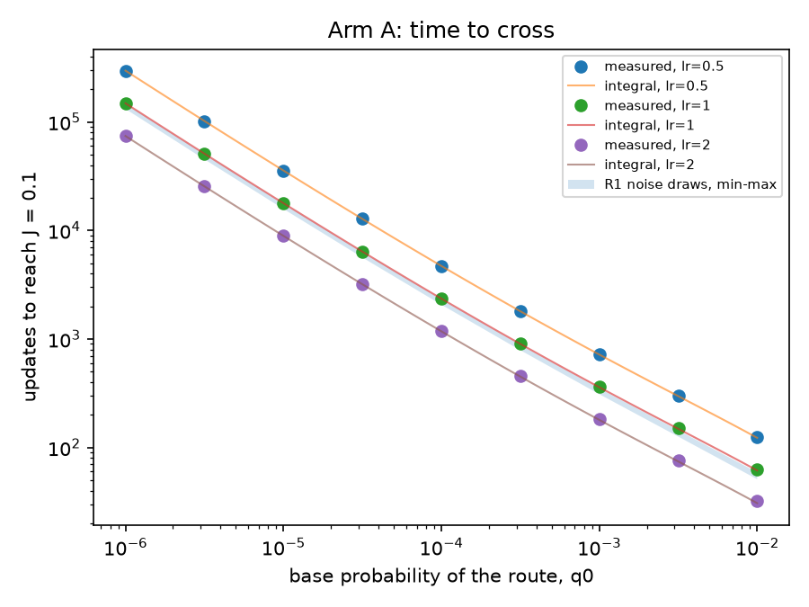
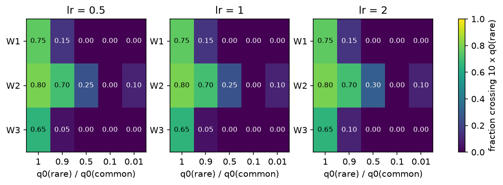
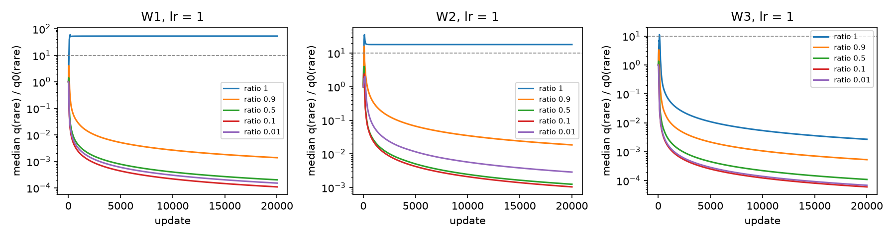

# RQ2: time to cross

Results of the pre-registered RQ2 time-to-cross experiment. The pre-registration is `docs/rq2-preregistration.md` (git tag `rq2-frozen`), and the design is `docs/rq2-time-to-cross-design.md`. All runs used commit `88d0395` (the tag) with a clean tree.

**Where the numbers come from.** The verdicts, the tables in §2–§4 and the figures come from the generated files in `docs/rq2/` (`verdicts.md`, `tables/*.csv`, `figures/`), which are a copy of `results/rq2_report/`. Some numbers come from ad-hoc analysis of the raw run files under `results/rq2_*` (git-ignored; regenerated by the commands in §7), and the `report` command does not produce them:
- the R1 medians and percentages in §3;
- the "ends ahead" counts, final-probability ranges, W2 peak multiples and W2 q₀(common) values in §4;
- the sampled-against-exact slopes in §5.

The whole-branch review re-derived each of these from the raw files.

This is one piece of RQ2. RQ2's training-dynamics part (Δrel and Δcap curves for several algorithms) is not covered here.

## 1. Question

How many policy-gradient updates does it take for a rare correct route to cross the reach line, and how does that depend on its base probability q₀? Crossing the line is the event the capability split counts as "beyond reach", so this measures how much on-policy training it takes before capability gain can appear at all. The plan predicted that time to cross grows roughly as 1/q₀.

## 2. Verdicts

All three validity checks pass: the full-table runs equal the scalar recursion, every base hits its target within 1%, and every arm B run's primary rule is achievable.

| | Prediction | Verdict | Numbers |
|---|---|---|---|
| **P1** | Time to cross grows roughly as 1/q₀ (isolated route) | **Supported**, but settled by the derivation, not tested | Fitted slope −0.844; smallest-pair local slope −0.928 |
| **P2** | It holds off the symmetric world | **Supported** | 20/20 noise draws have slope ≤ −0.7 (−0.855 to −0.846); H = 10 slope −0.874 |
| **P3** | Time scales as 1/lr | **Holds** | lr × updates varies by at most 3.2% across lr ∈ {0.5, 1, 2} (at q₀ = 10⁻²; under 0.3% for q₀ ≤ 10⁻⁴) |
| **P4** | A rarer competing route does not cross under exact PG | **Inconclusive** | Disjoint routes (W1, W3): 0 of 20 draws cross at every ratio ≤ 0.5. Overlapping routes (W2): 25–30% cross at ratio 0.5 and 10% at 0.01, all temporarily (§4) |

**P1 is not evidence on its own.** `docs/proofs.md` §7 shows that on the isolated route, exact PG reduces exactly to a one-variable recursion, and the full-table runs match it to the update at all 27 points. So P1 was settled before the run. The checks that could have failed are P2 and P4.

## 3. Arm A: an isolated route



Updates for J to reach 0.1, at lr = 1 (`tables/arm_a.csv`):

| q₀ | 10⁻⁶ | 3.2·10⁻⁶ | 10⁻⁵ | 3.2·10⁻⁵ | 10⁻⁴ | 3.2·10⁻⁴ | 10⁻³ | 3.2·10⁻³ | 10⁻² |
|---|---|---|---|---|---|---|---|---|---|
| Exact PG (= scalar recursion) | 148,409 | 50,995 | 17,842 | 6,389 | 2,358 | 904 | 362 | 151 | 63 |
| Integral (continuous time) | 148,403 | 50,990 | 17,837 | 6,385 | 2,354 | 901 | 359 | 149 | 61 |
| R1 median of 20 noise draws | 137,854 | 47,385.5 | 16,574 | 5,925 | 2,174 | 825.5 | 326.5 | 135 | 55.5 |
| R2, horizon 10 | 134,953 | 45,615 | 15,643 | 5,466 | 1,957 | 722 | 277 | 109 | 43 |

- **The prediction holds, with a known shape.** The curve is close to 1/q₀ but not equal to it. The local slope runs from −0.93 at the smallest q₀ to −0.76 at the largest, because the time spent climbing from about 10⁻² to the line is a fixed cost that matters more when q₀ is large. The derivation says the slope reaches −1 only as q₀ → 0, and slowly, since the correction is of order q₀^(1/8).
- **It is robust.** Random off-route logits (R1) make the median crossing 7–12% faster, but every draw's slope is between −0.855 and −0.846. A longer horizon (R2), where detours that loop back also count as the route, makes crossing faster again and the slope slightly steeper (−0.874).
- **Learning rate only rescales time.** Doubling lr halves the updates (P3), so the curve is really a curve in lr × updates.

## 4. Arm B: competing routes



Fraction of 20 noise draws in which the rarer route reached 10 × its start (primary rule), at lr = 1. The other learning rates differ by at most 0.05 (`tables/arm_b.csv`).

| q₀(rare) / q₀(common) | 1 | 0.9 | 0.5 | 0.1 | 0.01 |
|---|---|---|---|---|---|
| W1 (3×3, disjoint) | 0.75 | 0.15 | 0 | 0 | 0 |
| W2 (4×4, routes share 2 moves) | 0.80 | 0.70 | 0.25 | 0 | 0.10 |
| W3 (5×5, disjoint) | 0.65 | 0.05 | 0 | 0 | 0 |

- **On disjoint routes, the richer route wins.** At ratio ≤ 0.5, no draw in W1 or W3 crossed at any learning rate. In every one of those runs, the rarer route's probability ended at 1.1 × 10⁻⁵ or below by update 20,000, and as low as 10⁻⁹. This confirms the pilot's single-world result across two worlds, three learning rates and noise.
- **Near a tie, noise decides.** At ratio 1 the two routes start equal, and the off-route noise breaks the tie. The route labelled "rare" ends ahead in 12 of 20 draws in W1 and 8 of 20 in W3, at every learning rate. At ratio 0.9 it ends ahead in 0 of 20 draws in W1 and 1 of 20 in W3. W2 is different: there the rare route ends ahead of the common one in 16 of 20 draws at ratio 1 and 12 of 20 at ratio 0.9 (at lr = 1). So on overlapping routes, the richer route does not reliably win near a tie.
- **Overlapping routes give temporary lifts.** This is why P4 is inconclusive. In W2, the common and rare routes share their first two moves. While the common route grows, it raises the probability of those shared moves, which also raises the rare route. In every W2 run that crossed at ratio 0.5 or 0.01, at any learning rate, the rare route peaked at 10–27 × its start (at most 0.055 in absolute terms), never reached 0.1, and then collapsed to between 4 × 10⁻⁸ and 2 × 10⁻⁴ by the end. No W2 run at ratio ≤ 0.5 reached the secondary line of 0.1 (`fraction_crossing_line` = 0).



**How W2's base was built affects this.** This was found in the whole-branch review after the run, and is logged as RQ2-5.
- In W2, the bisected rare-route bonus is added to every move of the rare route, including the two moves it shares with the common route.
- Lower ratios need a more negative bonus, so they also push the shared moves down.
- Without noise, the probability of each shared move falls from 0.71 at ratio 1 to 0.66, 0.52 and 0.36 at ratios 0.5, 0.1 and 0.01. q₀(common) falls with it, from 0.0199 to 0.0184, 0.0135 and 0.0069.
- With noise, the median q₀(common) falls from 0.0088 at ratio 1 to 0.0024 at ratio 0.01. So in W2, the pre-registration's "q₀(common) ≈ 0.02" holds only near ratio 1 without noise.
- The further the shared moves start below their ratio-1 value, the more room the common route's growth has to lift them, and the rare route with them. That plausibly explains why W2's crossing fraction is not monotone in the ratio: 0.25 at 0.5, 0 at 0.1, and 0.10 at 0.01.
- Part of the W2 lift therefore comes from how the base was built, not only from the routes sharing moves. A W2 variant with the rare bonus only on the rare route's own moves would separate the two. It was not run, and would be a post-hoc check outside the pre-registration.

**What P4 says, read with that in mind.** The pre-registered primary rule (10 × q₀) counts these temporary lifts as crossings, so the verdict is inconclusive, and it stands as recorded. Under the reach line (q ≥ 0.1), no run at ratio ≤ 0.5 crossed in any world. That line was pre-registered only as a reported secondary measure, not as P4's rule. It is also a much stricter test at small ratios: at W2 ratio 0.01 it needs about a 4,000-fold lift. So it is not evidence that P4 holds. What the disagreement shows is that a relative threshold picks up temporary spill-over through shared moves, which an absolute line does not. The spill-over itself is a real training effect, shaped in W2 partly by the base construction above.

## 5. Sampled REINFORCE (stretch)

REINFORCE, batch 32, lr 0.5, 20 seeds, cap 20,000 updates (`tables/sampled.csv`):

| Setting | Crossed | Median updates | Median episodes |
|---|---|---|---|
| Isolated route, q₀ = 10⁻⁴ | 20/20 | 4,395 | 140,640 |
| Isolated route, q₀ = 10⁻³ | 20/20 | 737 | 23,584 |
| Isolated route, q₀ = 10⁻² | 20/20 | 122 | 3,904 |
| W1, ratio 1 | 10/20 (rare ends ahead in 9) | 69.5 | 2,224 |
| W1, ratio 0.5 and 0.1 | 0/20 each | — | — |

- **Sampling tracks the exact gradient.** On the isolated route, REINFORCE takes about as many updates as exact PG at the same learning rate (exact PG at lr 0.5: 4,712, 721 and 124), with nearly the same slope over this range (−0.78 against −0.79).
- **In samples, rare routes are expensive.** A route the base produces once in 10,000 tries needs about 140,000 sampled episodes before it crosses. That is the RQ3 Phase 2 finding (`docs/report.md` §4.3 (i)) from the other side: a route "unreachable at N = 64" can still be crossed by a training run that draws far more samples than N, as RQ3's RL arms did with about 16,000 per prompt. The settings differ too much to compare the numbers directly.
- **Sampling noise did not rescue the rarer route.** At ratios 0.5 and 0.1, no seed crossed, the same as exact PG.

## 6. Limitations

- **Small, hand-built worlds.** Three competing worlds and one isolated world, all with 4 actions and horizons of 4 to 10. The 4/3 factor in the recursion is |A| / (|A| − 1) for 4 actions.
- **Exact gradients for the main arms.** Exact PG has no exploration problem. A route with nonzero probability always gets gradient. The sampled stretch covers only a few settings.
- **P1 is a derivation.** It is reported for completeness, not as an experimental confirmation.
- **The derivation needs a second check.** `docs/proofs.md` §7 has not been re-derived by a teammate.
- **Noise is one choice.** σ = 1.0 off-route noise; other noise structures could change arm B's tie-breaking near ratio 1.
- **The arm B result depends on the rule.** As §4 explains, the primary rule and the reach line disagree on overlapping routes.
- **W2's base is not "common fixed, rare varied".** The rare bonus also moves the shared moves, so q₀(common) drifts with the ratio (§4, RQ2-5).

## 7. Reproduce

```bash
pip install -e ".[dev,viz]"
python experiments/rq2_time_to_cross.py arm-a      # about 2 minutes
python experiments/rq2_time_to_cross.py robust     # about 15 minutes
python experiments/rq2_time_to_cross.py arm-b      # about 15 minutes
python experiments/rq2_time_to_cross.py sampled    # about 36 minutes
python experiments/rq2_time_to_cross.py report     # writes results/rq2_report/
```

The four runs are independent and can run in parallel. Wall times are from one laptop core each.
