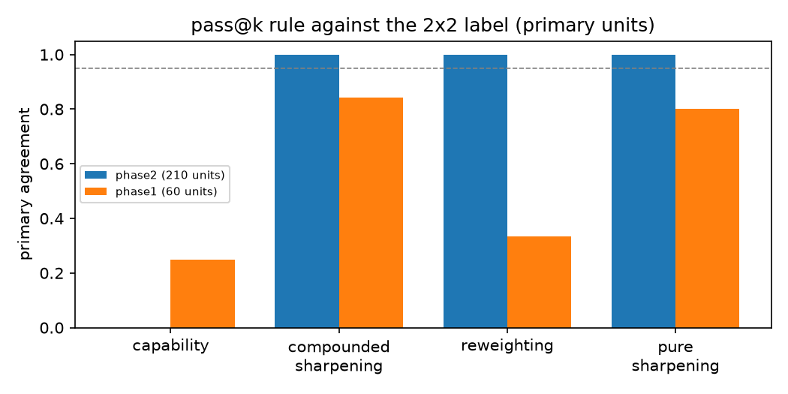
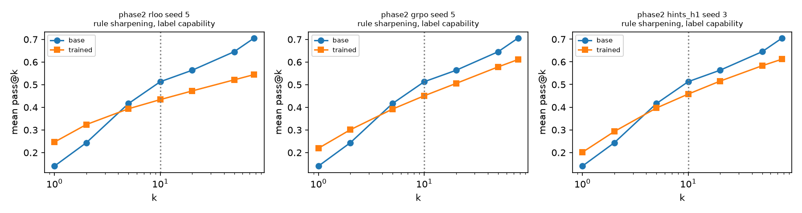

# RQ4: how often does the pass@k rule misdiagnose a run?

Results of the pre-registered RQ4 experiment. The pre-registration is `docs/rq4-preregistration.md` (git tag `rq4-frozen`), and the design is `docs/rq4-passk-design.md`. Every number here comes from the generated files in `docs/rq4/` (`verdicts.md`, `verdicts.json`, `tables/*.csv`), which are a copy of `results/rq4_report/`. Two exceptions:
- The rule-by-label counts in §3–§4 and the seed split in §5 are tallied from `tables/units.csv`.
- The RQ3 reproduction numbers in §1 come from the comparison logged as RQ4-2.

## 1. Question and data

**The rule.** The common way to read pass@k curves (blueprint D10) is:
- trained below base at large k means **sharpening**;
- never below and above somewhere means **capability**.

RQ4 measures how often that rule disagrees with the project's exact 2×2 label. The blueprint predicted sizable disagreement, concentrated in the compounded-sharpening and reweighting cells. It is contradicted if agreement is above 95%.

A unit is one (run, checkpoint, prompt group). The primary units are the held-out prompts at the final checkpoint, scored with "capability or not" agreement (D10's primary score).

| Phase | Runs | Primary units | How the run mix was chosen |
|---|---|---|---|
| **2 (headline)** | RQ3 Phase 2's 240 runs (GRU on the rule task, 72 prompts) | 210 | Not chosen: these are RQ3's natural runs |
| 1 | New grid sweep with a **shared** tabular policy (8 prompts, one logit table), 80 runs | 60 | Tuned on **labels only** so all four cells occur (RQ4-1). The rule's outputs were not looked at before the freeze |

**Phase 2 is a rerun.** It uses the RQ3 experiment rerun on this machine at the same commit. It reproduces all four RQ3 verdicts, but not the committed numbers: the base models differ by up to about 2% relative from pre-training on, most likely from a different torch or BLAS build (RQ4-2). The units here are the rerun's.

## 2. Verdicts

**Validity.**
- All pre-registered validity checks pass, and the primary unit counts are 210 and 60, as expected. Phase 1's manifests show the tagged commit with a clean tree; that was checked by hand, since `score` doesn't compute it.
- The design's reproduction check against the committed RQ3 report **failed** (RQ4-2). Using the rerun anyway was Bilal's decision (RQ4-3).

| | Claim | Verdict | Numbers |
|---|---|---|---|
| **Q1** | Phase 2: the rule misdiagnoses a sizable share | **Contradicted** | Agreement 0.986, 95% CI [0.962, 1.000] |
| **Q2** | Phase 1: the same | **Supported**, on a designed run mix (§5) | Agreement 0.550, 95% CI [0.383, 0.717] |
| **Q3** | Disagreement concentrates in compounded sharpening and reweighting | **Inconclusive** | Pooled disagreement: capability 0.789, reweighting 0.588, compounded 0.030, pure sharpening 0.015 |

- **No undetermined calls.** The rule never returned "undetermined" in either phase.
- **k_large doesn't matter here.** Both phases' agreement is the same at k_large ∈ {5, 10, 20, 50} (`tables/k_large_sensitivity.csv`).

**The headline result contradicts the prediction.** On RQ3's runs, the rule agreed with the label in 207 of 210 units. Read the rest of this report before quoting that number, though: §3 explains why the agreement is high and what it does and doesn't say about the rule.

## 3. What the rule actually did



Rule calls against labels, primary units (from `tables/units.csv`):

| Label | Phase 2: rule said sharpening | Phase 2: capability | Phase 1: sharpening | Phase 1: capability |
|---|---|---|---|---|
| capability | 3 | 0 | 12 | 4 |
| compounded sharpening | 82 | 0 | 16 | 3 |
| reweighting | 2 | 0 | 5 | 10 |
| pure sharpening | 123 | 0 | 8 | 2 |

**Phase 2: high agreement, but no discrimination.**
- **The rule said "sharpening" for all 210 units.** RQ3 found that post-training made the held-out prompts worse (`docs/report.md` §4.3 (ii)), so every trained pass@k curve fell below the base at large k.
- **The labels agree only because they are almost all "not capability".** 207 of 210 are not capability, so "sharpening" counts as agreement for them under D10's primary score.
- **The rule never said "capability", so it missed all 3 real capability units.** The 98.6% is the share of non-capability units in this mix. The pilot warned about exactly this: a rate that comes from the run mix. Here it was produced by RQ3's training, not by design.
- **On a mixed benchmark the agreement drops.** On the `all` group, which includes the training prompts that improved, agreement peaks at 0.943 (update 50), reaches its lowest at 0.776 (update 500), and ends at 0.790 (`tables/agreement.csv`). That group is secondary, not pre-registered.

**Phase 1: the rule fails both ways.** Here training helps some held-out prompts and hurts others, through the shared logits:
- **It called 12 of 16 capability units "sharpening".** Those runs gained new solutions on some prompts but lost on others, so the curve dipped below the base at large k.
- **It called 10 of 15 reweighting units "capability".** Those runs moved mass among solutions the base could already reach, and the curve rose everywhere.

Only the second failure matches the prediction: reweighting was one of the two cells it named. The first, capability called "sharpening", was not predicted. Proposition 3 shows that pass@k can't separate these cases in principle; RQ4 Phase 1 shows it happening in about half the units.



**The Phase 2 misses look like the curves in the LLM papers.** The trained model is better at k = 1 but worse at large k, which the usual reading calls "RL only sharpens". The exact label says these runs did make a previously unreachable correct solution reachable and beat every re-tempered base.

**Why Q3 is inconclusive, not supported.** Pooled over both phases, reweighting does have high disagreement (0.588). But compounded sharpening has almost none (0.030): whenever prompts get worse, the rule says "sharpening", which counts as correct for every non-capability cell. The cell that disagrees most is **capability** (0.789), which the prediction didn't name.

## 4. What this means

- **The rate depends on the run mix.** A single misdiagnosis rate is not a property of the rule alone. When training degrades the evaluated prompts (Phase 2), the rule says "sharpening" and is usually right, because little real capability is there. When gains and losses mix (Phase 1), it is right about half the time.
- **It fails in both directions.**
  - **It misses capability.** True capability units were mostly called "sharpening": 15 of 19 pooled (12 of 16 in Phase 1, all 3 in Phase 2).
  - **It invents capability.** It called "capability" 15 times when the label wasn't capability, all in Phase 1 (10 reweighting, 3 compounded, 2 pure sharpening). Only 4 of its 19 "capability" calls were right.
  - **What this means for LLM evaluation.** A curve below the base at large k doesn't rule out that RL added something new. A curve above the base everywhere doesn't show that it did. The Phase 2 evidence for missed capability is only 3 units; most of the evidence for both directions comes from Phase 1.
- **For the Qwen comparison.** The frozen rule is `capsplit.diagnostics.passk_rule` with k_large = 10, and it needs per-prompt success rates for both models. Running it on a base and post-trained Qwen pair would show which of these regimes that pair is in. RQ4's numbers don't transfer to it directly.

## 5. Limitations

- **Toy settings.** One GRU task and one 5×5 grid.
- **Phase 1's run mix was designed.** It was tuned on labels so that every cell occurs (RQ4-1). That is fair to the rule's per-cell rates, since its outputs were not used, but Phase 1's overall rate reflects a designed mix.
  - **The tuning used seeds 0–4, which are also 15 of the 60 primary units.** The full sweep is deterministic, so those units are the same ones whose labels chose the base settings. They carry a heavier capability-plus-reweighting mix (9 of 15, against 22 of 45) and lower agreement (0.333).
  - **Q2 doesn't hinge on them.** On seeds 5–19 alone, agreement is 0.622, 95% CI [0.444, 0.800], still below 0.95. That split is not pre-registered and is given only as a check.
- **Seeds.** Phase 2 has 10 seeds, Phase 1 has 20. The intervals reflect seed-to-seed spread only.
- **Phase 2 is a rerun.** Its numbers differ slightly from the committed RQ3 report (RQ4-2).
- **SRR/NDR: Phase 1 only, provisional.** `docs/notes/invisible-leash-scores.md` was checked against arXiv v4 (by Claude, 2026-11-24; a person's sign-off is still pending), and the settings are proposed as RQ4-5, not ratified. Phase 1 (policies regenerated at `rq4-frozen`; all 60 primary units reproduce the frozen labels and rule calls): SRR 0.459, NDR 0.259 over 60 units, with NDR 0.000 in both the reweighting and pure-sharpening cells (`verdicts.md`, `srr_ndr.json`, `tables/srr_ndr_units.csv`). Phase 2 is not computed: the frozen `results/main` isn't in the repo, and a rerun here matched only 151 of 210 frozen labels (all 210 rule calls match).
- **The rule is D10 as frozen.** Other pass@k rules (other k_large, other tie handling) could behave differently. The sensitivity table covers k_large only.

## 6. Reproduce

```bash
python -m capsplit.harness run configs/main.json --out results --workers 8      # Phase 2 runs, about 20 minutes here
python -m capsplit.harness run configs/rq4_grid.json --out results --workers 8  # Phase 1 runs, about 3 minutes here
python experiments/rq4_passk.py score --phase2 results/main --phase1 results/rq4_grid --out results/rq4_report
```

`score` refuses to run unless the tag `rq4-frozen` is an ancestor of HEAD.
