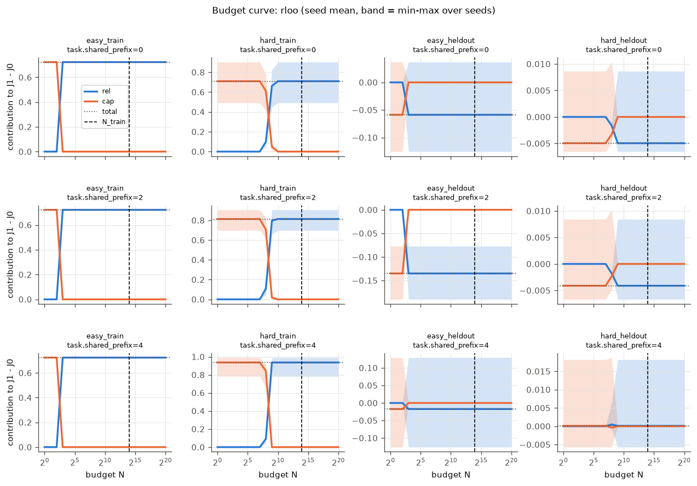

# Budget curve

Generated by `capsplit.harness.budget.build_budget_curve`; do not edit by hand.

Source: `results/seedstudy_train`, checkpoint: final, c = 1.

## What this measures

A correct solution counts as *reachable* at budget N when the base model already finds it with probability at least 1/N, so N tries would usually find it. Training changes each solution's probability; **rel(N)** adds up the change on reachable solutions (better reliability on what the base could already do) and **cap(N)** the change on unreachable ones (new capability at that budget). The two always add up to the total gain J1 - J0 (checked to 1e-12 at every N).

As N grows more solutions become reachable, so gain moves from cap to rel. **N\*** is the smallest budget on the grid at which rel holds at least half of the gain: above N\*, most of what training added was already within reach of the base given that many tries. rel(N) only rises with N when no solution lost probability; otherwise it can move either way, so N\* is read off the grid literally.

**cap at N_train** is cap evaluated at the number of episodes the arm sampled per training prompt: the part of the gain that the base could not have found with the same sampling the arm used.

Grid: 21 budgets from 1 to 1048576 (powers of two by default).

## Results

N\* is the seed mean over seeds where it is defined (k/n = defined/seeds). cap at N_train: seed mean [min, max].

### rloo

| factors | group | total gain | N* (k/n) | cap at N_train [min, max] | N_train | N_train source |
|---|---|---|---|---|---|---|
| task.shared_prefix=0 | all | +0.4671 | 173.3 (30/30) | +0.0000 [+0.0000, +0.0000] | 16000 | training_log |
| task.shared_prefix=0 | easy | +0.4625 | 8 (30/30) | +0.0000 [+0.0000, +0.0000] | 16000 | training_log |
| task.shared_prefix=0 | hard | +0.4718 | 512 (30/30) | +0.0000 [+0.0000, +0.0000] | 16000 | training_log |
| task.shared_prefix=0 | heldout | -0.0319 | 8 (3/30) | +0.0000 [+0.0000, +0.0000] | 16000 | training_log |
| task.shared_prefix=0 | train | +0.7166 | 132 (30/30) | +0.0000 [+0.0000, +0.0000] | 16000 | training_log |
| task.shared_prefix=0 | easy_heldout | -0.0588 | 8 (3/30) | +0.0000 [+0.0000, +0.0000] | 16000 | training_log |
| task.shared_prefix=0 | easy_train | +0.7231 | 8 (30/30) | +0.0000 [+0.0000, +0.0000] | 16000 | training_log |
| task.shared_prefix=0 | hard_heldout | -0.0050 | 512 (2/30) | +0.0000 [+0.0000, +0.0000] | 16000 | training_log |
| task.shared_prefix=0 | hard_train | +0.7101 | 512 (30/30) | +0.0000 [+0.0000, +0.0000] | 16000 | training_log |
| task.shared_prefix=2 | all | +0.4888 | 324.3 (30/30) | +0.0000 [+0.0000, +0.0000] | 16000 | training_log |
| task.shared_prefix=2 | easy | +0.4367 | 8 (30/30) | +0.0000 [+0.0000, +0.0000] | 16000 | training_log |
| task.shared_prefix=2 | hard | +0.5409 | 512 (30/30) | +0.0000 [+0.0000, +0.0000] | 16000 | training_log |
| task.shared_prefix=2 | heldout | -0.0696 | n/a (0/30) | +0.0000 [+0.0000, +0.0000] | 16000 | training_log |
| task.shared_prefix=2 | train | +0.7680 | 256.5 (30/30) | +0.0000 [+0.0000, +0.0000] | 16000 | training_log |
| task.shared_prefix=2 | easy_heldout | -0.1351 | n/a (0/30) | +0.0000 [+0.0000, +0.0000] | 16000 | training_log |
| task.shared_prefix=2 | easy_train | +0.7226 | 8 (30/30) | +0.0000 [+0.0000, +0.0000] | 16000 | training_log |
| task.shared_prefix=2 | hard_heldout | -0.0041 | 512 (1/30) | +0.0000 [+0.0000, +0.0000] | 16000 | training_log |
| task.shared_prefix=2 | hard_train | +0.8133 | 512 (30/30) | +0.0000 [+0.0000, +0.0000] | 16000 | training_log |
| task.shared_prefix=4 | all | +0.5505 | 435.2 (30/30) | +0.0000 [+0.0000, +0.0000] | 16000 | training_log |
| task.shared_prefix=4 | easy | +0.4767 | 8 (30/30) | +0.0000 [+0.0000, +0.0000] | 16000 | training_log |
| task.shared_prefix=4 | hard | +0.6243 | 512 (30/30) | +0.0000 [+0.0000, +0.0000] | 16000 | training_log |
| task.shared_prefix=4 | heldout | -0.0086 | 99.64 (11/30) | +0.0000 [+0.0000, +0.0000] | 16000 | training_log |
| task.shared_prefix=4 | train | +0.8300 | 443.7 (30/30) | +0.0000 [+0.0000, +0.0000] | 16000 | training_log |
| task.shared_prefix=4 | easy_heldout | -0.0173 | 8 (11/30) | +0.0000 [+0.0000, +0.0000] | 16000 | training_log |
| task.shared_prefix=4 | easy_train | +0.7236 | 8 (30/30) | +0.0000 [+0.0000, +0.0000] | 16000 | training_log |
| task.shared_prefix=4 | hard_heldout | +0.0001 | 472.6 (13/30) | +0.0000 [+0.0000, +0.0000] | 16000 | training_log |
| task.shared_prefix=4 | hard_train | +0.9364 | 512 (30/30) | +0.0000 [+0.0000, +0.0000] | 16000 | training_log |

## Figures

