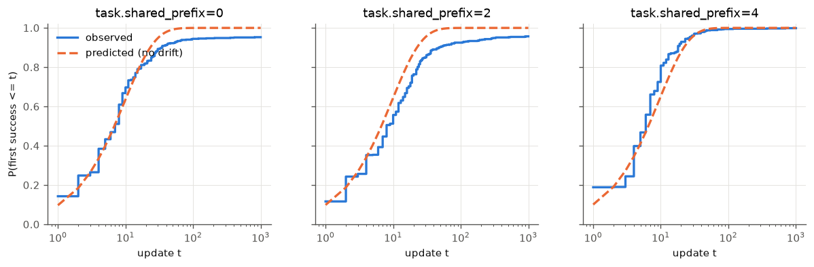
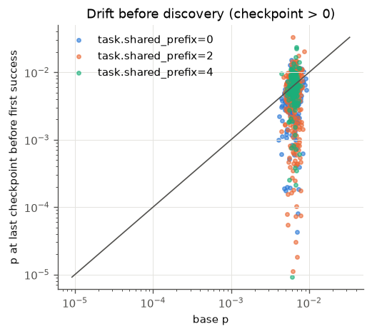
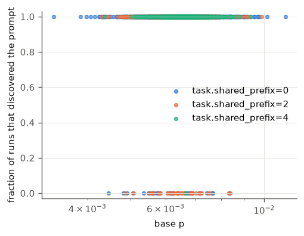

# Discovery analysis: seedstudy_base

Generated by `python -m capsplit.harness discovery analyze`. It tests the pre-registered prediction in `docs/prediction_discovery.md`: without drift, the first update with a correct sample on a hard training prompt is geometric with P(T > t) = (1 - p)^(16 t), using each prompt's exact base p (predictions from `seedstudy_base`). Budget B = 1000 updates; arm `rloo`.

Consistency check: the predicted p and the base success rate recorded in the metrics differ by at most 0.

## Verdicts

| combination | verdict | evidence |
|---|---|---|
| task.shared_prefix=0 | **none of the stated outcomes** | no prompt has >= 5 runs; pooled median ratio 1 (need 0.5..2); never-discovered fraction 0.0472; PIT z = -1.72 |
| task.shared_prefix=2 | **later than predicted (negative drift)** | PIT z = 4.54 > 3.0 and pooled ratio 1.14 > 1; 31 never-discovered observation(s) |
| task.shared_prefix=4 | **disagreement against the model** | prompts never discovered in most runs have higher base p than discovered ones |

The prediction doc tests agreement at k = 4 and expects disagreement in the predicted direction (later first successes, some prompts never discovered) at k = 0. Thresholds: within a factor of 2 for more than half the prompts with >= 5 runs; never-discovered fraction <= 0.01 counts as ~0; 'systematically later' = PIT z > 3.0 with pooled median ratio > 1; 'much earlier' = PIT z < -3.0 with pooled ratio < 0.5.

## First-success times

| combination | runs | observations | median T observed / predicted (ratio) | prompts within x2 | never discovered observed / predicted | KS D (D+ earlier, D- later) | PIT mean (z) |
|---|---|---|---|---|---|---|---|
| task.shared_prefix=0 | 30 | 720 | 7 / 7 (1) | n/a | 0.0472 / 6.29e-27 | 0.0702 (0.0702, 0.0702) | 0.481 (-1.72) |
| task.shared_prefix=2 | 30 | 720 | 8 / 7 (1.14) | n/a | 0.0431 / 1.99e-33 | 0.123 (0.0553, 0.123) | 0.549 (4.54) |
| task.shared_prefix=4 | 30 | 720 | 6 / 7 (0.857) | n/a | 0.00139 / 5.18e-34 | 0.156 (0.156, 0.028) | 0.438 (-5.75) |

KS D is the largest gap between the observed and the predicted (mixture) first-success CDF over t = 1..B; it is descriptive only (discrete, censored, correlated observations; 1.36/sqrt(n) would be the 5% value for independent continuous data). The PIT values should be uniform on [0, 1] if the model holds; values near 1 mean later than predicted.

PIT histograms (10 equal bins from 0 to 1, counts):

- task.shared_prefix=0: [105, 71, 64, 68, 72, 92, 59, 42, 40, 107]
- task.shared_prefix=2: [80, 93, 47, 44, 53, 49, 65, 65, 81, 143]
- task.shared_prefix=4: [126, 14, 72, 111, 121, 72, 88, 30, 38, 48]

## Which prompts are discovered

| combination | prompts discovered in all / none / some runs | reading | median base p never / discovered | AUC (never-discovered p higher) |
|---|---|---|---|---|
| task.shared_prefix=0 | 0 / 0 / 0 | one run per prompt | 0.00617 / 0.00625 | 0.456 |
| task.shared_prefix=2 | 0 / 0 / 0 | one run per prompt | 0.0064 / 0.00646 | 0.494 |
| task.shared_prefix=4 | 0 / 0 / 0 | one run per prompt | 0.00664 / 0.00659 | 0.529 |

An AUC below 0.5 means never-discovered prompts had lower base p, as the waiting-time picture expects.

## Drift before discovery

For each discovered prompt: its success probability at the last checkpoint before the first success, divided by its base p (only checkpoints after 0 are informative). The doc predicts ratios below 1 at k = 0 and not below 1 at k = 4.

| combination | informative | median ratio | geometric-mean ratio | fraction below 1 | never discovered: median final p / base p |
|---|---|---|---|---|---|
| task.shared_prefix=0 | 184 | 0.712 | 0.556 | 0.783 | 2.35e-06 (n = 34) |
| task.shared_prefix=2 | 288 | 0.85 | 0.562 | 0.608 | 1.3e-05 (n = 31) |
| task.shared_prefix=4 | 137 | 0.907 | 0.767 | 0.591 | 0.00102 (n = 1) |

## Determined by the base, or by luck?

Variance of the final per-prompt capability gain (delta_cap, hard_train, primary N and c) across runs. V_train: base fixed, training seed varies. V_base: training seed fixed, base varies. share = V_train / V_base; <= 0.33 reads as 'outcome determined by the base', >= 0.67 as 'outcome depends on sampling luck', otherwise 'mixed'.

| combination | per-prompt V_train | per-prompt V_base | share | verdict | run-level V_train | run-level V_base | share | verdict |
|---|---|---|---|---|---|---|---|---|
| task.shared_prefix=0 | n/a | 0.176 | n/a | n/a | n/a | 0.00796 | n/a | n/a |
| task.shared_prefix=2 | n/a | 0.098 | n/a | n/a | n/a | 0.00399 | n/a | n/a |
| task.shared_prefix=4 | n/a | 0.0353 | n/a | n/a | n/a | 0.0018 | n/a | n/a |

Only one seed stream is available here; pass the other study to complete the comparison.

## Figures

