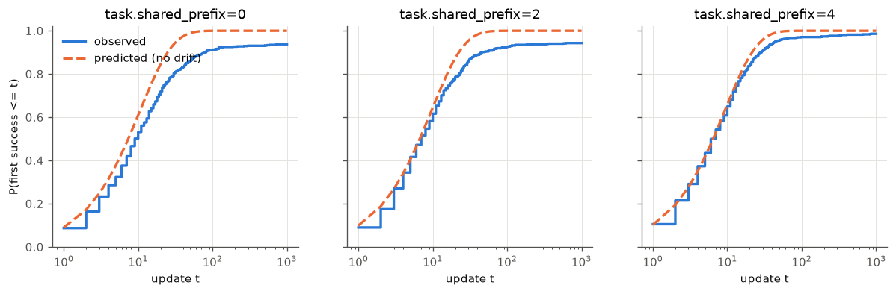
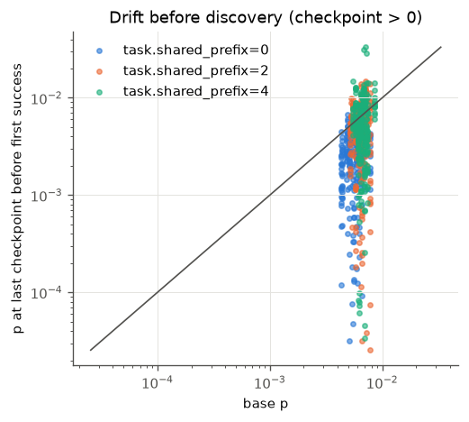
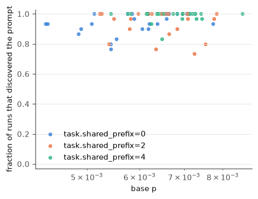

# Discovery analysis: seedstudy_train

Generated by `python -m capsplit.harness discovery analyze`. It tests the pre-registered prediction in `docs/prediction_discovery.md`: without drift, the first update with a correct sample on a hard training prompt is geometric with P(T > t) = (1 - p)^(16 t), using each prompt's exact base p (predictions from `seedstudy_train`). Budget B = 1000 updates; arm `rloo`.

Consistency check: the predicted p and the base success rate recorded in the metrics differ by at most 0.

## Verdicts

| combination | verdict | evidence |
|---|---|---|
| task.shared_prefix=0 | **disagreement in the predicted direction** | PIT z = 6.25 > 3.0 and pooled ratio 1.12 > 1; 45 never-discovered observation(s) |
| task.shared_prefix=2 | **none of the stated outcomes** | 96% of 24 replicated prompts within a factor 2 (need > 50%); never-discovered fraction 0.0569; PIT z = 2.45 |
| task.shared_prefix=4 | **none of the stated outcomes** | 96% of 24 replicated prompts within a factor 2 (need > 50%); never-discovered fraction 0.0139; PIT z = 0.157 |

The prediction doc tests agreement at k = 4 and expects disagreement in the predicted direction (later first successes, some prompts never discovered) at k = 0. Thresholds: within a factor of 2 for more than half the prompts with >= 5 runs; never-discovered fraction <= 0.01 counts as ~0; 'systematically later' = PIT z > 3.0 with pooled median ratio > 1; 'much earlier' = PIT z < -3.0 with pooled ratio < 0.5.

## First-success times

| combination | runs | observations | median T observed / predicted (ratio) | prompts within x2 | never discovered observed / predicted | KS D (D+ earlier, D- later) | PIT mean (z) |
|---|---|---|---|---|---|---|---|
| task.shared_prefix=0 | 30 | 720 | 9 / 8 (1.12) | 96% | 0.0625 / 4.6e-32 | 0.144 (0, 0.144) | 0.567 (6.25) |
| task.shared_prefix=2 | 30 | 720 | 7 / 7 (1) | 96% | 0.0569 / 2.82e-38 | 0.101 (0.0114, 0.101) | 0.526 (2.45) |
| task.shared_prefix=4 | 30 | 720 | 6 / 7 (0.857) | 96% | 0.0139 / 6.1e-40 | 0.0508 (0.0236, 0.0508) | 0.502 (0.157) |

KS D is the largest gap between the observed and the predicted (mixture) first-success CDF over t = 1..B; it is descriptive only (discrete, censored, correlated observations; 1.36/sqrt(n) would be the 5% value for independent continuous data). The PIT values should be uniform on [0, 1] if the model holds; values near 1 mean later than predicted.

PIT histograms (10 equal bins from 0 to 1, counts):

- task.shared_prefix=0: [75, 60, 62, 52, 68, 59, 52, 58, 66, 168]
- task.shared_prefix=2: [61, 76, 83, 75, 70, 55, 58, 55, 46, 141]
- task.shared_prefix=4: [71, 80, 73, 76, 72, 56, 79, 63, 48, 102]

## Which prompts are discovered

| combination | prompts discovered in all / none / some runs | reading | median base p never / discovered | AUC (never-discovered p higher) |
|---|---|---|---|---|
| task.shared_prefix=0 | 9 / 0 / 15 | luck matters for 15 of 24 prompt(s) (discovered in some runs only) | 0.00543 / 0.00605 | 0.35 |
| task.shared_prefix=2 | 13 / 0 / 11 | luck matters for 11 of 24 prompt(s) (discovered in some runs only) | 0.00664 / 0.00649 | 0.554 |
| task.shared_prefix=4 | 19 / 0 / 5 | luck matters for 5 of 24 prompt(s) (discovered in some runs only) | 0.00647 / 0.00683 | 0.483 |

An AUC below 0.5 means never-discovered prompts had lower base p, as the waiting-time picture expects.

## Drift before discovery

For each discovered prompt: its success probability at the last checkpoint before the first success, divided by its base p (only checkpoints after 0 are informative). The doc predicts ratios below 1 at k = 0 and not below 1 at k = 4.

| combination | informative | median ratio | geometric-mean ratio | fraction below 1 | never discovered: median final p / base p |
|---|---|---|---|---|---|
| task.shared_prefix=0 | 292 | 0.564 | 0.448 | 0.88 | 1.36e-06 (n = 45) |
| task.shared_prefix=2 | 235 | 0.798 | 0.586 | 0.689 | 3.61e-06 (n = 41) |
| task.shared_prefix=4 | 242 | 0.801 | 0.628 | 0.661 | 9.03e-05 (n = 10) |

## Determined by the base, or by luck?

Variance of the final per-prompt capability gain (delta_cap, hard_train, primary N and c) across runs. V_train: base fixed, training seed varies. V_base: training seed fixed, base varies. share = V_train / V_base; <= 0.33 reads as 'outcome determined by the base', >= 0.67 as 'outcome depends on sampling luck', otherwise 'mixed'.

| combination | per-prompt V_train | per-prompt V_base | share | verdict | run-level V_train | run-level V_base | share | verdict |
|---|---|---|---|---|---|---|---|---|
| task.shared_prefix=0 | 0.144 | 0.176 | 0.822 | outcome depends on sampling luck | 0.00923 | 0.00796 | 1.16 | outcome depends on sampling luck |
| task.shared_prefix=2 | 0.0978 | 0.098 | 0.998 | outcome depends on sampling luck | 0.00364 | 0.00399 | 0.911 | outcome depends on sampling luck |
| task.shared_prefix=4 | 0.046 | 0.0353 | 1.3 | outcome depends on sampling luck | 0.0024 | 0.0018 | 1.33 | outcome depends on sampling luck |

## Figures

